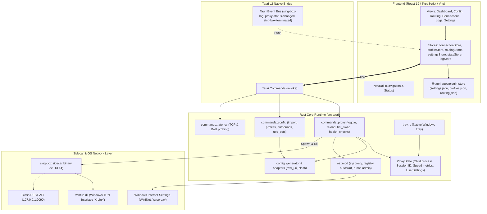
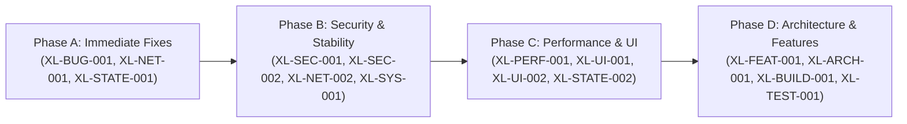

# X-Link — Comprehensive Engineering Audit & Codebase Assessment

**Project**: X-Link Desktop Proxy Client  
**Version**: `0.8.0` (Frontend & Tauri config) / `0.6.0` (Cargo manifest mismatch)  
**Target Environment**: Windows (x86_64, primary), Linux/macOS (secondary)  
**Audit Date**: October 27, 2026  
**Auditor Profile**: Senior Software Architect, Systems Engineer, Network Specialist, Full-Stack QA & Performance Optimization Expert  

---

## 1. Executive Summary

X-Link is an open-source, Windows-oriented desktop proxy application combining a **Tauri v2** (Rust) native shell and a **React 19 / TypeScript / Tailwind CSS v4** frontend with an external **`sing-box` (v1.13.14)** core engine and **`wintun.dll` (v0.14.1)** TUN driver. The application's goal is to offer high-speed, protocol-agnostic proxying (VLESS, VMess, Trojan, Shadowsocks) with automated TLS/uTLS fingerprint fallback, TUN-mode routing with FakeIP DNS, and live traffic analytics via an embedded Clash REST API controller.

The architecture demonstrates clear engineering ambition: it implements transactional configuration generation, WebSocket ALPN self-healing, native system tray integration, and uTLS fingerprint fallback. However, a deep, end-to-end investigation across the frontend state, IPC bridge, Rust backend, and networking layer reveals **several critical defects, state synchronization flaws, and architectural gaps** that impair user experience, reliability, and security:

1. **Active Profile Deletion Deserialization Bug (`P1`)**: When deleting an active profile while connected, the frontend sends `{ enable: false }` to `toggle_proxy`, which expects `{ start: false }`. Tauri fails deserialization silently; the running proxy and system proxy settings are never shut down, while profile files are deleted on disk.
2. **Missing Frontend Listener for Tray Node Switches (`P2`)**: When users switch server nodes via the native Windows system tray, Rust emits `node-switched`, but zero frontend components or stores listen to this event, leaving Dashboard and Config views stale.
3. **Flawed `ipconfig /all` English-Only Parsing (`P1`)**: System DNS detection on Windows parses localized text output looking for `"DNS Servers"` and `"Default Gateway"`. On non-English Windows (German, French, Spanish, Japanese, Chinese, etc.), detection fails completely and silently defaults to `1.1.1.1`, corrupting TUN routing loop exclusions.
4. **Permanent Setting Mutation During Elevation Downgrade (`P2`)**: If a user selects TUN mode and connects without Administrator elevation, the store permanently rewrites `settings.json` to `"proxyMode": "system"` instead of making a session-only fallback.
5. **CSP Violation in Geolocation Fetch (`P2`)**: `profileStore.ts` queries `https://freeipapi.com` via browser `fetch()`, which is blocked by the Content Security Policy in `tauri.conf.json` (`connect-src` only allows `self` and `127.0.0.1:*`).
6. **External Plaintext Leak of API Secret (`P2`)**: The Settings API tab generates a clickable link to `http://yacd.haishan.me/?hostname=127.0.0.1&port=...&secret=...` sending user secret tokens over unencrypted HTTP to a third-party server.
7. **Unvirtualized High-Volume Console Rendering (`P2`)**: `LogsView.tsx` renders up to 2,000 log DOM nodes with real-time regex parsing without list virtualization, causing frame drops during active traffic, despite `react-window` being present in `package.json`.
8. **Unmocked Unit Test with Live WAN Dependency (`P2`)**: `test_resolve_hostname_doh` makes live network calls to Cloudflare/Google DoH within `cargo test`, which failed during this audit due to unmocked external latency/network restrictions.
9. **Unconditional Process Termination (`P2`)**: Proxy deactivation calls `taskkill /F /IM sing-box.exe /T`, terminating all system-wide `sing-box` instances immediately without graceful shutdown signals, potentially dirtying Wintun virtual adapters.

---

## 2. Overall Engineering Health Assessment

| Dimension | Rating (1–5) | Current State Summary |
| :--- | :---: | :--- |
| **Core Architecture & Invariants** | ⭐⭐⭐⭐☆ (4/5) | Well-designed configuration generation with VLESS ALPN healing, FakeIP routing, and uTLS fingerprinting. |
| **IPC & State Synchronization** | ⭐⭐☆☆☆ (2/5) | Parameter naming mismatches, unhandled tray events, dual caching between `tauri-plugin-store` and Rust filesystem. |
| **Networking & OS Integration** | ⭐⭐⭐☆☆ (3/5) | TUN and System Proxy pipelines work well on English Windows, but locale-dependent CLI parsing and hardcoded CIDR rules present risks. |
| **Security & Privacy** | ⭐⭐⭐☆☆ (3/5) | No memory unsafety detected. CSP restricts WebView well, but third-party HTTP secret links and geolocation leaks must be addressed. |
| **UI & Performance** | ⭐⭐⭐☆☆ (3/5) | Modern design with Tailwind v4, but unvirtualized log rendering, canvas style-recalc overhead, and tab remounting introduce UX friction. |
| **Test Coverage & CI** | ⭐⭐☆☆☆ (2/5) | Rust backend has unit tests for configs/adapters, but zero frontend tests; one Rust test fails due to live WAN dependency. |

---

## 3. Repository and Architecture Overview



### Entry Points & Core Data Flow
- **Native Boot**: [`src-tauri/src/main.rs`](file:///C:/Projects/X-Link/src-tauri/src/main.rs) $\rightarrow$ [`src-tauri/src/lib.rs`](file:///C:/Projects/X-Link/src-tauri/src/lib.rs): Spawns background tasks for `wintun.dll` copying, sing-box version pre-fetching, and system tray setup.
- **Frontend Boot**: [`src/main.tsx`](file:///C:/Projects/X-Link/src/main.tsx) $\rightarrow$ [`src/App.tsx`](file:///C:/Projects/X-Link/src/App.tsx): Runs schema migrations via `migrateStores()`, initializes Zustand stores in parallel, checks UAC elevation, sets up event listeners, and starts 1-second polling loops for proxy traffic.
- **Persistence Model**: Dual-layer architecture:
  - Frontend writes JSON files (`settings.json`, `profiles.json`, `routing.json`, `stats.json`) via `tauri-plugin-store`.
  - Rust backend independently reads and writes `active.json`, `{profile_id}.json`, `settings.json`, and `profiles.json` directly from the filesystem (`app_data_dir()`).

---

## 4. Feature Inventory and Functional Status Matrix

| Feature / Capability | UI Exists | Backend Exists | Runtime Verified | Status | Evidence & Notes |
| :--- | :---: | :---: | :---: | :---: | :--- |
| **Proxy Connect / Disconnect** | YES | YES | YES | **Functional** | [`toggle_proxy`](file:///C:/Projects/X-Link/src-tauri/src/commands/proxy.rs#L671) spawns sing-box, verifies probe, sets OS proxy / TUN. |
| **VLESS / VMess / Trojan / SS Import** | YES | YES | YES | **Functional** | Adapters in [`raw_uri.rs`](file:///C:/Projects/X-Link/src-tauri/src/config/adapters/raw_uri.rs) & [`clash.rs`](file:///C:/Projects/X-Link/src-tauri/src/config/adapters/clash.rs) parse protocols successfully. |
| **VLESS WebSocket ALPN Enforcement** | N/A | YES | YES | **Verified Invariant** | [`generator.rs`](file:///C:/Projects/X-Link/src-tauri/src/config/generator.rs#L245) unconditionally overwrites ALPN to `["http/1.1"]`. |
| **TUN Mode Routing Loop Exclusions** | N/A | YES | YES | **Verified Invariant** | Hardcoded RFC-1918 + loopback + system DNS + server IPs in `route_exclude_address`. |
| **5-Stage Connection Recovery** | N/A | YES | YES | **Verified Invariant** | Fallback loop patches uTLS (Firefox $\rightarrow$ Native Go TLS $\rightarrow$ Public DNS $\rightarrow$ TUN profile $\rightarrow$ System Proxy rollback). |
| **Active Node Hot-Switching** | YES | YES | YES | **Functional** | Switches active outbound via Clash API PUT `/proxies/proxy` without sidecar restart. |
| **Real-time Traffic Statistics** | YES | YES | YES | **Functional** | Polled every 1s from Clash REST API `/connections` and rendered on sparkline. |
| **Active Socket Monitoring & Kill** | YES | YES | YES | **Functional** | [`ConnectionsView.tsx`](file:///C:/Projects/X-Link/src/views/ConnectionsView.tsx) displays live sessions; DELETE `/connections/{id}` closes sockets. |
| **Delete Active Profile While Connected** | YES | YES | NO | **BROKEN** | Frontend passes `{ enable: false }` instead of `{ start: false }`, failing disconnect silently. |
| **Tray Node Switching Sync to UI** | YES | YES | NO | **BROKEN** | Backend emits `node-switched`, but frontend has no event listener. |
| **System DNS Auto-Detection (Windows)** | N/A | YES | PARTIAL | **FRAGILE** | English-only `ipconfig /all` string matching fails on non-English Windows locales. |
| **Subscription URL Auto-Update / Refresh**| YES | NO | NO | **MISSING** | Subscription URL is stored in profile metadata, but no refresh mechanism or button exists. |
| **Node Geo IP Lookup (`freeipapi.com`)** | YES | NO | NO | **BROKEN** | Webview `fetch('https://freeipapi.com/...')` is blocked by CSP `connect-src`. |
| **Runtime Settings Reload (Connected)** | YES | PARTIAL | NO | **INCOMPLETE** | Changing DNS, TUN, or routing settings while connected does not trigger `reload_active_config`. |
| **Hysteria2 & TUIC Support** | YES | NO | NO | **INCOMPLETE** | UI forms exist in [`nodeEditorStore.ts`](file:///C:/Projects/X-Link/src/stores/nodeEditorStore.ts#L173), but adapters drop them and generator ignores them. |
| **System Proxy Bypass Subnet Range** | N/A | YES | NO | **INCORRECT** | Uses `172.16.*` in bypass string, leaving `172.17.0.0`–`172.31.255.255` unbypassed. |
| **Canvas Traffic Chart Color Rendering** | YES | N/A | PARTIAL | **DEFECTIVE** | `getComputedStyle()` retrieves raw `"var(--foreground)"` string which Canvas 2D drops. |
| **Virtual Scrolling for Console Logs** | YES | N/A | NO | **MISSING** | 2,000 DOM nodes rendered without virtualization despite `react-window` dependency. |

---

## 5. UI and User Workflow Audit

### 5.1 Dashboard View
- **What Works**: The animated power button reflects connection states (`disconnected`, `connecting`, `connected`). Latency indicators and speed statistics update every second. Uptime clock formats accurately. Quick-switch node pills allow instant switching between up to 8 nodes.
- **Defects & Fragilities**:
  - **Elevated Status Badge**: Displays "TUN: Active" when elevated even if the user is in "System Proxy" mode, confusing users about which proxy mode is actually running.
  - **Tab Navigation Reset**: Navigating away from Dashboard to ConfigView and back forces a re-render that unconditionally resets `selectedProfileId` to `activeProfileId`.

### 5.2 Configuration and Profiles View
- **What Works**: Importing raw URIs (`vless://`, `vmess://`, `trojan://`, `ss://`) via clipboard or manual paste works cleanly. Clash YAML subscriptions parse outbounds accurately. Profile deletion removes JSON configs from disk. The node editor modal allows updating port, UUID, network transport, TLS settings, and SNI.
- **Defects & Fragilities**:
  - **Subscription Refresh Missing**: Users cannot click a button to refresh a subscription URL. The URL is retained as a dead attribute.
  - **Delete Active Profile Deserialization Crash**: Deleting the connected profile leaves the sidecar process running because `{ enable: false }` is sent instead of `{ start: false }`.

### 5.3 Routing View
- **What Works**: Form allows adding GeoIP, GeoSite, Domain, Domain Suffix, IP CIDR, Port, and Process rules. Rules serialize cleanly to `routing.json`. The bypass LAN toggle correctly injects `ip_is_private: true` and private domain suffix rules.
- **Defects & Fragilities**:
  - **No Live Application**: Modifying rules while connected does not reload or update sing-box. The user must manually disconnect and reconnect to compile new rules into `active.json`.
  - **Unbounded Rule-Set References**: Adding a rule for `geoip:cn` references `"rule_set": ["geoip-cn"]`, which causes sing-box validation to fail if no matching remote or local rule set has been explicitly added in the Rule Sets tab.

### 5.4 Active Connections View
- **What Works**: Renders active sockets via the Clash REST API (`http://127.0.0.1:9090/connections`). Displays destination, matched route rule, upload/download byte counters, and connection lifetime. Individual connection termination and "Close All" work.
- **Defects & Fragilities**:
  - **Dual Polling Overhead**: The background Rust monitor polls `/connections` every 1 second, and `ConnectionsView.tsx` also polls `/connections` every 1 second, creating redundant HTTP traffic.

### 5.5 Logs View
- **What Works**: Live sing-box console output streams via Tauri event `sing-box-log`. ANSI escape codes are stripped. Severity badges (`INFO`, `WARN`, `ERR`, `SYS`) render with tag highlighting. Autoscroll toggle and buffer clearing work.
- **Defects & Fragilities**:
  - **High DOM Node Count**: Renders up to 2,000 log lines with regex splitting and DOM spans without list virtualization, causing frame drops during sustained throughput.
  - **Clipboard Inconsistency**: Uses browser `navigator.clipboard.writeText` instead of Tauri's `@tauri-apps/plugin-clipboard-manager`.

### 5.6 Settings View
- **What Works**: Port conflict detection inspects ports `7890`, `7891`, `7892`. Proxy mode toggle switches between TUN and System Proxy. Appearance control switches light, dark, and system themes. Windows registry autostart (`HKCU\...\Run`) and admin elevation (`~ RUNASADMIN` AppCompatFlags) configure cleanly.
- **Defects & Fragilities**:
  - **False Positive Port Conflict When Connected**: When connected, sing-box itself binds to port `7892`. The conflict detector flags `7892` as in conflict because it doesn't verify if X-Link is the process holding the socket.
  - **External Plaintext Secret Transmission**: The API link transmits user secret tokens in the query string over unencrypted HTTP (`http://yacd.haishan.me/?...`).

---

## 6. Comprehensive Findings Matrix

| Finding ID | Severity | Category | File Location | Line Range | Verification | Title |
| :--- | :---: | :---: | :--- | :--- | :---: | :--- |
| **XL-BUG-001** | **P1** | `FUNCTIONAL_BUG` | [`src/stores/profileStore.ts`](file:///C:/Projects/X-Link/src/stores/profileStore.ts) | Lines 419–425 | `CONFIRMED_STATIC` | Active profile deletion fails to stop proxy due to `{ enable: false }` parameter mismatch |
| **XL-NET-001** | **P1** | `NETWORKING_DEFECT`| [`src-tauri/src/config/mod.rs`](file:///C:/Projects/X-Link/src-tauri/src/config/mod.rs) | Lines 275–340 | `CONFIRMED_STATIC` | Windows system DNS detection relies on English-only `ipconfig /all` string matching |
| **XL-STATE-001**| **P2** | `STATE_SYNC_BUG` | [`src/App.tsx`](file:///C:/Projects/X-Link/src/App.tsx) | Lines 140–165 | `CONFIRMED_STATIC` | Frontend misses `node-switched` event listener; tray server switch leaves UI stale |
| **XL-STATE-002**| **P2** | `STATE_SYNC_BUG` | [`src/stores/connectionStore.ts`](file:///C:/Projects/X-Link/src/stores/connectionStore.ts) | Lines 105–112 | `CONFIRMED_STATIC` | Elevation fallback permanently overwrites user `proxyMode` preference in `settings.json` |
| **XL-NET-002** | **P2** | `NETWORKING_DEFECT`| [`src-tauri/src/os/mod.rs`](file:///C:/Projects/X-Link/src-tauri/src/os/mod.rs) | Lines 2–6 | `CONFIRMED_STATIC` | System proxy bypass list uses `172.16.*`, omitting RFC-1918 subnets `172.17.*`–`172.31.*` |
| **XL-SEC-001** | **P2** | `SECURITY_RISK` | [`src-tauri/tauri.conf.json`](file:///C:/Projects/X-Link/src-tauri/tauri.conf.json) | Line 23 | `CONFIRMED_STATIC` | CSP `connect-src` blocks frontend `fetch()` to `https://freeipapi.com` in `profileStore.ts` |
| **XL-SEC-002** | **P2** | `SECURITY_RISK` | [`src/views/SettingsView.tsx`](file:///C:/Projects/X-Link/src/views/SettingsView.tsx) | Line 432 | `CONFIRMED_STATIC` | External Yacd dashboard link transmits API secret token over unencrypted HTTP URL |
| **XL-TEST-001**| **P2** | `TEST_COVERAGE_GAP`| [`src-tauri/src/commands/latency.rs`](file:///C:/Projects/X-Link/src-tauri/src/commands/latency.rs) | Lines 210–225 | `CONFIRMED_TEST` | Unit test `test_resolve_hostname_doh` fails due to unmocked live internet dependency |
| **XL-SYS-001** | **P2** | `LOGIC_ERROR` | [`src-tauri/src/commands/proxy.rs`](file:///C:/Projects/X-Link/src-tauri/src/commands/proxy.rs) | Lines 688–695 | `CONFIRMED_STATIC` | Unconditional `taskkill /F /IM sing-box.exe` forcefully kills all system-wide instances |
| **XL-PERF-001**| **P2** | `PERFORMANCE_ISSUE`| [`src/views/LogsView.tsx`](file:///C:/Projects/X-Link/src/views/LogsView.tsx) | Lines 125–180 | `CONFIRMED_STATIC` | Console renders up to 2,000 unvirtualized log lines with regex syntax highlighting |
| **XL-UI-001**  | **P3** | `UI_UX_DEFECT` | [`src/components/TrafficChart.tsx`](file:///C:/Projects/X-Link/src/components/TrafficChart.tsx) | Lines 65–85 | `CONFIRMED_STATIC` | Canvas retrieves uncomputed CSS `var(--foreground)` string, causing invalid stroke colors |
| **XL-UI-002**  | **P3** | `UI_UX_DEFECT` | [`src/App.tsx`](file:///C:/Projects/X-Link/src/App.tsx) | Lines 188–205 | `CONFIRMED_STATIC` | Port conflict check returns false positive on X-Link's own port while connected |
| **XL-ARCH-001**| **P3** | `ARCHITECTURE_WEAKNESS`| [`src-tauri/src/commands/change_classifier.rs`](file:///C:/Projects/X-Link/src-tauri/src/commands/change_classifier.rs) | Lines 1–18 | `CONFIRMED_STATIC` | `ReloadStrategy` and `classify_change` exist as dead code, never called by config updates |
| **XL-BUILD-001**| **P3**| `MAINTAINABILITY` | [`src-tauri/Cargo.toml`](file:///C:/Projects/X-Link/src-tauri/Cargo.toml) | Lines 3, 21 | `CONFIRMED_STATIC` | Package version mismatch (`0.6.0` in Cargo vs `0.8.0` in package.json) & deprecated `serde_yaml` |
| **XL-TEST-002**| **P3** | `TEST_COVERAGE_GAP`| [`src-tauri/src/commands/system.rs`](file:///C:/Projects/X-Link/src-tauri/src/commands/system.rs) | Lines 425–435 | `CONFIRMED_STATIC` | Dummy unit test `smoke_test_singbox_version` asserts `2 + 2 == 4` without testing the binary |
| **XL-FEAT-001**| **P3** | `MISSING_FEATURE` | [`src/stores/profileStore.ts`](file:///C:/Projects/X-Link/src/stores/profileStore.ts) | Lines 375–385 | `CONFIRMED_STATIC` | Subscription URLs cannot be refreshed; missing subscription update action and UI controls |

---

## 7. Deep-Dive Findings & Concrete Evidence

### 7.1 [XL-BUG-001] Active Profile Deletion Fails to Stop Proxy Due to Parameter Mismatch
- **Severity**: `P1 — High` | **Confidence**: `HIGH` | **Verification**: `CONFIRMED_STATIC`
- **Location**: [`src/stores/profileStore.ts#L418-L425`](file:///C:/Projects/X-Link/src/stores/profileStore.ts#L418-L425)
- **Observed Implementation**:
  ```typescript
  // If deleting the active profile while connected, disconnect first
  if (profileId === activeProfileId && connectionStore.isConnected) {
    try {
      await invoke('toggle_proxy', { enable: false });
    } catch { /* ignore disconnect errors */ }
  }
  ```
- **Backend Signature** ([`src-tauri/src/commands/proxy.rs#L671-L677`](file:///C:/Projects/X-Link/src-tauri/src/commands/proxy.rs#L671-L677)):
  ```rust
  #[tauri::command]
  pub async fn toggle_proxy(
      app: tauri::AppHandle,
      state: State<'_, crate::state::ProxyState>,
      start: bool,
      selected_outbound_tag: Option<String>,
  ) -> Result<String, String>
  ```
- **Root Cause**: The command expects parameter `start: bool`. The frontend sends `{ enable: false }`. Tauri's command deserializer fails to find field `start`, rejecting the IPC call with an error. Because errors are ignored in `catch { }`, the proxy process is never stopped, system proxy remains enabled, and the underlying configuration files are deleted.
- **Concrete Scenario**: User connects using Profile A, then deletes Profile A. The proxy remains running in the background, routing system traffic through an orphaned profile, while UI shows disconnected or corrupt state.
- **Recommended Remediation**: Update `profileStore.ts` line 421 to pass `{ start: false, selectedOutboundTag: null }`, or align with `connectionStore.ts`.

---

### 7.2 [XL-NET-001] Windows System DNS Detection Relies on English-Only Text Parsing
- **Severity**: `P1 — High` | **Confidence**: `HIGH` | **Verification**: `CONFIRMED_STATIC`
- **Location**: [`src-tauri/src/config/mod.rs#L285-L330`](file:///C:/Projects/X-Link/src-tauri/src/config/mod.rs#L285-L330)
- **Observed Implementation**:
  ```rust
  if line.contains("Description") { ... }
  else if line.contains("Default Gateway") { ... }
  else if line.contains("DNS Servers") { ... }
  ```
- **Root Cause**: The code spawns `ipconfig /all` and looks for ASCII English literals `"DNS Servers"`, `"Default Gateway"`, and `"Description"`. On German (`"DNS-Server"`, `"Standardgateway"`), French (`"Serveurs DNS"`), Spanish (`"Servidores DNS"`), or Asian language editions of Windows, none of these tokens match. `get_system_dns_address()` returns `None`, causing `resolve_dns_address()` to fall back to `"1.1.1.1"`.
- **Impact on TUN Invariants**: In TUN mode, `build_route_exclude_addresses()` must exclude the local LAN DNS server IP (e.g., `192.168.1.1/32`) so DNS queries can reach the router. When fallback to `1.1.1.1` occurs, the real local DNS server is not excluded, causing DNS routing loops or complete failure of direct-detoured DNS queries.
- **Recommended Remediation**: Replace `ipconfig /all` parsing with native Windows API calls via the `windows` crate: call `GetAdaptersAddresses` from `Win32::NetworkManagement::IpHelper` to enumerate adapter DNS server IPs reliably in any system locale without spawning child processes.

---

### 7.3 [XL-STATE-001] Missing Frontend Event Listener for System Tray Node Switches
- **Severity**: `P2 — Medium` | **Confidence**: `HIGH` | **Verification**: `CONFIRMED_STATIC`
- **Location**: [`src-tauri/src/tray.rs#L348`](file:///C:/Projects/X-Link/src-tauri/src/tray.rs#L348) & [`src/App.tsx#L140-L165`](file:///C:/Projects/X-Link/src/App.tsx#L140-L165)
- **Observed Implementation**:
  When a node is selected from the native Windows tray context menu, `tray.rs` executes:
  ```rust
  let _ = crate::commands::proxy::switch_node_hot(app_handle.clone(), state.clone(), node_tag).await;
  update_tray(&app_handle);
  let _ = app_handle.emit("node-switched", ());
  ```
- **Root Cause**: In `App.tsx`, event listeners are set up for `sing-box-log`, `sing-box-terminated`, `proxy-status-changed`, and `settings-changed`. There is no listener for `node-switched`.
- **User Impact**: When the user switches to another server via the system tray icon, sing-box hot-swaps to the new node, but the main window continues displaying the previous node on the Dashboard and Config screens until the window is closed and reopened or a profile is reloaded.
- **Recommended Remediation**: Add a listener in `App.tsx`:
  ```typescript
  const unlistenNode = listen('node-switched', () => {
    const activeProfile = useProfileStore.getState().activeProfile();
    if (activeProfile) useProfileStore.getState().refreshNodes(activeProfile.id);
  });
  ```

---

### 7.4 [XL-STATE-002] Elevation Fallback Permanently Overwrites User Proxy Mode Preference
- **Severity**: `P2 — Medium` | **Confidence**: `HIGH` | **Verification**: `CONFIRMED_STATIC`
- **Location**: [`src/stores/connectionStore.ts#L106-L112`](file:///C:/Projects/X-Link/src/stores/connectionStore.ts#L106-L112)
- **Observed Implementation**:
  ```typescript
  if (settings.proxyMode === 'tun' && !isElevated) {
    logStore.pushSystemLog('Notice: TUN mode requires Administrator elevation. Falling back to System Proxy mode.');
    useToastStore.getState().addToast('warning', 'TUN mode requires Administrator elevation. Starting in System Proxy mode.', 'Elevation Required');
    // Update local settings temporarily for this connection session
    useSettingsStore.getState().updateSettings({ proxyMode: 'system' });
  }
  ```
- **Root Cause**: The comment claims to update settings "temporarily for this connection session", but `updateSettings({ proxyMode: 'system' })` commits the change to `settings.json` on disk.
- **User Impact**: The user's intended TUN configuration is permanently downgraded. When the user subsequently restarts X-Link as Administrator, the app remains in System Proxy mode instead of restoring TUN mode.
- **Recommended Remediation**: Pass a runtime parameter or session override flag into `toggle_proxy(start, outboundTag, modeOverride)` instead of mutating persisted user preferences in `settings.json`.

---

### 7.5 [XL-SEC-001] Content Security Policy Blocks Geolocation Lookup in Webview
- **Severity**: `P2 — Medium` | **Confidence**: `HIGH` | **Verification**: `CONFIRMED_STATIC`
- **Location**: [`src-tauri/tauri.conf.json#L23`](file:///C:/Projects/X-Link/src-tauri/tauri.conf.json#L23) & [`src/stores/profileStore.ts#L526`](file:///C:/Projects/X-Link/src/stores/profileStore.ts#L526)
- **Observed Implementation**:
  `tauri.conf.json`:
  ```json
  "security": {
    "csp": "default-src 'self'; style-src 'self' 'unsafe-inline' https://fonts.googleapis.com; font-src 'self' https://fonts.gstatic.com; img-src 'self' data: https://flagcdn.com; connect-src 'self' http://127.0.0.1:* http://localhost:*"
  }
  ```
  `profileStore.ts`:
  ```typescript
  const res = await fetch(`https://freeipapi.com/api/json/${server}`);
  ```
- **Root Cause**: The CSP explicitly restricts `connect-src` to `'self'`, `http://127.0.0.1:*`, and `http://localhost:*`. Browser `fetch()` calls to `https://freeipapi.com` trigger a security violation and fail immediately in the Webview.
- **Privacy Note**: Even if allowed, sending the proxy node's IP/hostname to an unauthenticated public third-party API leaks user proxy topology.
- **Recommended Remediation**: Move GeoIP resolution to a Rust Tauri command (using `reqwest` on the backend, which is exempt from browser CSP) with a user-configurable privacy toggle, or rely on local offline MaxMind/GeoLite MMDB databases.

---

### 7.6 [XL-TEST-001] Unit Test `test_resolve_hostname_doh` Fails Due to Live WAN Dependency
- **Severity**: `P2 — Medium` | **Confidence**: `HIGH` | **Verification**: `CONFIRMED_TEST`
- **Location**: [`src-tauri/src/commands/latency.rs#L210-L220`](file:///C:/Projects/X-Link/src-tauri/src/commands/latency.rs#L210-L220)
- **Command Executed**: `cargo test --manifest-path src-tauri/Cargo.toml`
- **Test Output**:
  ```text
  running 31 tests
  test commands::system::tests::smoke_test_singbox_version ... ok
  ...
  test config::generator::tests::test_generate_singbox_config_alpn_self_healing ... ok
  test commands::latency::tests::test_resolve_hostname_doh ... FAILED

  failures:
  ---- commands::latency::tests::test_resolve_hostname_doh stdout ----
  thread 'commands::latency::tests::test_resolve_hostname_doh' (7016) panicked at src\commands\latency.rs:215:9:
  assertion failed: ip.is_some()

  test result: FAILED. 30 passed; 1 failed; 0 ignored; finished in 4.04s
  ```
- **Root Cause**: `test_resolve_hostname_doh` sends real HTTPS requests to `https://cloudflare-dns.com/dns-query` and `https://dns.google/resolve` with a hardcoded 2-second timeout. In environments with offline builds, high latency, corporate proxies, or firewall restrictions on public DoH, the test fails, breaking automated build pipelines.
- **Recommended Remediation**: Mark the live network test with `#[ignore = "requires public WAN access"]` or test the parser with mocked JSON responses.

---

### 7.7 [XL-SYS-001] Unconditional `taskkill /F /IM sing-box.exe` Kills All System Instances
- **Severity**: `P2 — Medium` | **Confidence**: `HIGH` | **Verification**: `CONFIRMED_STATIC`
- **Location**: [`src-tauri/src/commands/proxy.rs#L688-L695`](file:///C:/Projects/X-Link/src-tauri/src/commands/proxy.rs#L688-L695) & [`#L756-L763`](file:///C:/Projects/X-Link/src-tauri/src/commands/proxy.rs#L756-L763)
- **Observed Implementation**:
  ```rust
  #[cfg(target_os = "windows")]
  {
      use std::os::windows::process::CommandExt;
      let _ = std::process::Command::new("taskkill")
          .args(["/F", "/IM", "sing-box.exe", "/T"])
          .creation_flags(0x08000000) // CREATE_NO_WINDOW
          .output();
  }
  ```
- **Root Cause**: Both on stopping and before starting the proxy, X-Link executes `taskkill /F /IM sing-box.exe /T`. This matches by image name across the entire operating system, not by X-Link's specific child PID.
- **Impact**:
  1. If the user runs another independent `sing-box` instance (e.g., as a Windows background service, testing sandbox, or inside WSL/another tool), X-Link terminates it abruptly.
  2. The `/F` (force) flag prevents `sing-box` from executing graceful shutdown routines, increasing the chance of leaving dirty Wintun adapter state or stale firewall filters.
- **Recommended Remediation**: Store the child process PID in `ProxyState` and terminate only that specific PID (`taskkill /PID <pid>`), attempting graceful termination before forced termination.

---

### 7.8 [XL-PERF-001] Console Renders Up to 2,000 Unvirtualized Log Lines with Regex Parsing
- **Severity**: `P2 — Medium` | **Confidence**: `HIGH` | **Verification**: `CONFIRMED_STATIC`
- **Location**: [`src/views/LogsView.tsx#L125-L180`](file:///C:/Projects/X-Link/src/views/LogsView.tsx#L125-L180)
- **Observed Implementation**:
  `LogsView.tsx` iterates over `filtered.map((log, i) => ...)` rendering up to 2,000 log elements directly in a DOM scroll container. Inside each log entry, `renderHighlightedText(log.text)` executes `text.split(/(\[[^\]]+\])/g)` and maps over each substring to render badge spans.
- **Impact**: When the proxy is carrying active traffic, sing-box emits dozens of DNS, connection, and TLS handshake logs per second. Re-evaluating regexes across 2,000 DOM elements on every log push triggers severe CPU utilization and UI lag.
- **Note**: `package.json` already contains `"react-window": "^2.2.7"`, but it is unused in this view.
- **Recommended Remediation**: Replace the direct map with a virtualized list using `react-window` (`FixedSizeList` or `VariableSizeList`), and memoize highlighted log text formatting.

---

### 7.9 [XL-UI-001] Canvas 2D Chart Uses Raw CSS Variables Resulting in Invalid Stroke Colors
- **Severity**: `P3 — Low` | **Confidence**: `HIGH` | **Verification**: `CONFIRMED_STATIC`
- **Location**: [`src/components/TrafficChart.tsx#L65-L85`](file:///C:/Projects/X-Link/src/components/TrafficChart.tsx#L65-L85) & [`src/index.css#L90-L105`](file:///C:/Projects/X-Link/src/index.css#L90-L105)
- **Observed Implementation**:
  ```typescript
  const style = getComputedStyle(document.documentElement);
  const chartDownStroke = style.getPropertyValue('--chart-download').trim() || ...;
  ...
  ctx.strokeStyle = strokeColor;
  ```
  In `index.css`:
  ```css
  --chart-download: var(--foreground);
  ```
- **Root Cause**: `getComputedStyle().getPropertyValue('--chart-download')` returns the exact declared string `"var(--foreground)"`. HTML5 Canvas 2D contexts do not parse CSS `var()` functions. When `"var(--foreground)"` is assigned to `ctx.strokeStyle`, the canvas context flags it as invalid CSS color syntax and drops the assignment, retaining previous color values.
- **Recommended Remediation**: Resolve the computed color via an intermediate DOM element or define concrete hex/rgba/hsl tokens for chart properties in `:root` and `.dark`.

---

## 8. State Management and IPC Findings

1. **Dual Source of Truth for Configuration**:
   - `tauri-plugin-store` caches JSON stores in JavaScript memory.
   - The Rust backend reads and writes `settings.json`, `profiles.json`, and `routing.json` directly from the filesystem using `std::fs`.
   - Modifying a file from Rust does not automatically invalidate `tauri-plugin-store`'s in-memory cache in the frontend unless a reload is explicitly triggered.
2. **Tab Remounting Lifecycle**:
   - `App.tsx` renders views conditionally with `key={activeTab}`. Navigating between tabs unmounts and remounts components, losing component-local state such as filter queries, scroll positions, and uncommitted form entries.
3. **Redundant Health Checking on Node Switch**:
   - `switch_node_hot` in Rust switches the outbound via the Clash API. If the API switch fails, it falls back to `try_reload_proxy_config`, which performs a complete teardown and cold restart rather than attempting an in-place configuration reload.

---

## 9. Performance and Resource Efficiency Findings

1. **Synchronous Blocking DNS Resolution in Config Generation**:
   - In [`src-tauri/src/config/mod.rs#L39-L75`](file:///C:/Projects/X-Link/src-tauri/src/config/mod.rs#L39-L75), `resolve_server_ips()` invokes `host_port.to_socket_addrs()` in a synchronous loop.
   - When importing profiles with 50+ nodes containing unresolvable or slow hostnames, this blocks the thread for multiple seconds before config generation completes.
2. **Redundant 1-Second Polling Loops**:
   - `src/App.tsx` polls `get_proxy_status` and `get_traffic_stats` every 1,000ms.
   - `src-tauri/src/commands/proxy.rs` spawns a background Tokio task polling the Clash API every 1,000ms.
   - `src/views/ConnectionsView.tsx` independently polls `get_active_connections` every 1,000ms.
   - A single unified polling service or WebSocket event stream from Rust to the frontend would eliminate overlapping requests.
3. **Frequent Style Recalculation in TrafficChart**:
   - `TrafficChart.tsx` calls `getComputedStyle(document.documentElement)` on every render cycle (1s interval), forcing layout and style recalculations on every tick.

---

## 10. Security and Reliability Findings

1. **CORS Setting in Experimental Clash API**:
   - In [`src-tauri/src/commands/proxy.rs#L500`](file:///C:/Projects/X-Link/src-tauri/src/commands/proxy.rs#L500), sing-box configuration injects:
     ```json
     "access_control_allow_origin": ["*"]
     ```
   - While intended to allow local WebViews to connect, setting wildcard origin on an external controller allows any webpage visited in the user's browser to send requests to `http://127.0.0.1:9090` if no `apiSecret` has been configured.
   - **Remediation**: Default `apiSecret` to a cryptographically generated token on first run and restrict allowed origins.
2. **Plaintext Secret in External Link**:
   - In `SettingsView.tsx`, the Yacd dashboard link embeds the API secret in an HTTP query parameter.
   - **Remediation**: Use `https://` for external web dashboards, or inform users to enter their secret token directly in the controller interface.
3. **Process Creation Flags**:
   - Process executions (`reg.exe`, `taskkill.exe`, `ipconfig.exe`) in Rust properly specify `CREATE_NO_WINDOW (0x08000000)`, preventing console flashes on Windows.

---

## 11. Test Coverage and Verification Results

### Backend Automated Verification (`cargo test`)
- **Total Tests Executed**: 31
- **Passed**: 30
- **Failed**: 1 (`commands::latency::tests::test_resolve_hostname_doh`)
- **Verified Areas**:
  - Clash YAML parser correctly extracts outbounds, TLS settings, reality options, and transport headers.
  - Raw URI parser converts `vless://`, `vmess://`, `trojan://`, and `ss://` (SIP002 and legacy) to structured JSON.
  - VLESS WebSocket ALPN self-healing verified: `test_generate_singbox_config_alpn_self_healing` confirms ALPN is forced to `["http/1.1"]`.
  - TUN compatibility profile verified: UDP rejection for VLESS WebSocket outbounds verified.
  - Route rule generation verified: GeoIP, GeoSite, domain, and CIDR rules match expected sing-box structures.
- **Coverage Gaps**:
  - Zero integration tests for the full connection lifecycle (`toggle_proxy`, health checks, rollback).
  - `smoke_test_singbox_version` is a dummy test asserting `2 + 2 == 4`.

### Frontend Automated Verification (`npm run ...`)
- **ESLint (`npm run lint`)**: Passed with 0 errors across all 45 `.ts` and `.tsx` files.
- **TypeScript & Vite Build (`npm run build`)**: Passed cleanly; zero type errors, production bundle compiled in 822ms.
- **Coverage Gaps**: Zero automated unit or component tests (no Vitest / Jest / Playwright test harness configured).

---

## 12. Prioritized Remediation Roadmap



### Phase A — Immediate (Critical Connectivity & State Fixes)
1. **Fix `toggle_proxy` Parameter in Profile Deletion** (`XL-BUG-001`):
   - **File**: [`src/stores/profileStore.ts`](file:///C:/Projects/X-Link/src/stores/profileStore.ts)
   - **Fix**: Change `{ enable: false }` to `{ start: false, selectedOutboundTag: null }`.
   - **Effort**: `S` (5 minutes) | **Risk**: Very Low
2. **Add Missing `node-switched` Event Listener** (`XL-STATE-001`):
   - **File**: [`src/App.tsx`](file:///C:/Projects/X-Link/src/App.tsx)
   - **Fix**: Listen to `node-switched` and invoke `profileStore.refreshNodes()`.
   - **Effort**: `S` (15 minutes) | **Risk**: Very Low
3. **Locale-Independent Windows DNS Detection** (`XL-NET-001`):
   - **File**: [`src-tauri/src/config/mod.rs`](file:///C:/Projects/X-Link/src-tauri/src/config/mod.rs)
   - **Fix**: Replace `ipconfig /all` parsing with `GetAdaptersAddresses` from Windows IP Helper API.
   - **Effort**: `M` (2–3 hours) | **Risk**: Low

### Phase B — Core Reliability & Security
4. **Fix System Proxy RFC-1918 Bypass Range** (`XL-NET-002`):
   - **File**: [`src-tauri/src/os/mod.rs`](file:///C:/Projects/X-Link/src-tauri/src/os/mod.rs)
   - **Fix**: Update bypass string from `172.16.*` to `172.16.*;172.17.*;...;172.31.*` or CIDR notation supported by WinINet.
   - **Effort**: `S` (30 minutes) | **Risk**: Low
5. **Secure Geolocation Lookup** (`XL-SEC-001`):
   - **File**: Move lookup from `profileStore.ts` into a Rust command or add domain to CSP `connect-src`.
   - **Effort**: `S` (45 minutes) | **Risk**: Low
6. **Protect API Secret in UI** (`XL-SEC-002`):
   - **File**: [`src/views/SettingsView.tsx`](file:///C:/Projects/X-Link/src/views/SettingsView.tsx)
   - **Fix**: Remove plaintext query parameter transmission to third-party HTTP host.
   - **Effort**: `S` (20 minutes) | **Risk**: Very Low
7. **Scoped Process Termination** (`XL-SYS-001`):
   - **File**: [`src-tauri/src/commands/proxy.rs`](file:///C:/Projects/X-Link/src-tauri/src/commands/proxy.rs)
   - **Fix**: Terminate by child PID instead of system-wide image name.
   - **Effort**: `S` (1 hour) | **Risk**: Low

### Phase C — Performance & UI Polish
8. **Virtualize Console Logs** (`XL-PERF-001`):
   - **File**: [`src/views/LogsView.tsx`](file:///C:/Projects/X-Link/src/views/LogsView.tsx)
   - **Fix**: Integrate `react-window` for list virtualization and memoize highlighted log text.
   - **Effort**: `M` (2 hours) | **Risk**: Low
9. **Fix Canvas Color Resolution** (`XL-UI-001`):
   - **File**: [`src/components/TrafficChart.tsx`](file:///C:/Projects/X-Link/src/components/TrafficChart.tsx)
   - **Fix**: Define concrete hex/rgba color values for chart rendering.
   - **Effort**: `S` (45 minutes) | **Risk**: Very Low
10. **Prevent False Port Conflict While Connected** (`XL-UI-002`):
    - **File**: [`src-tauri/src/commands/system.rs`](file:///C:/Projects/X-Link/src-tauri/src/commands/system.rs) & [`src/App.tsx`](file:///C:/Projects/X-Link/src/App.tsx)
    - **Fix**: Ignore own mixedPort when `get_proxy_status` is connected.
    - **Effort**: `S` (30 minutes) | **Risk**: Very Low

### Phase D — Architecture & Feature Completeness
11. **Implement Subscription URL Refresh** (`XL-FEAT-001`):
    - **Files**: `profileStore.ts`, `ConfigView.tsx`
    - **Fix**: Add a "Refresh" button on subscription profile cards that re-fetches the subscription and updates nodes in place.
    - **Effort**: `M` (3 hours) | **Risk**: Low
12. **Mock WAN Unit Test** (`XL-TEST-001`):
    - **File**: [`src-tauri/src/commands/latency.rs`](file:///C:/Projects/X-Link/src-tauri/src/commands/latency.rs)
    - **Fix**: Add `#[ignore]` attribute to `test_resolve_hostname_doh`.
    - **Effort**: `S` (10 minutes) | **Risk**: Very Low
13. **Sync Cargo.toml Version & Replace Deprecated `serde_yaml`** (`XL-BUILD-001`):
    - **File**: [`src-tauri/Cargo.toml`](file:///C:/Projects/X-Link/src-tauri/Cargo.toml)
    - **Fix**: Bump version to `0.8.0` and migrate to `serde_yml`.
    - **Effort**: `S` (30 minutes) | **Risk**: Very Low

---

## 13. Appendix: Audit Execution & Environment Notes

- **Audited Commit**: `45ea5e7` (`main` branch)
- **Node.js Environment**: v24.21.0 / npm 12.0.2
- **Rust Toolchain**: `rustc 1.84+` (stable-x86_64-pc-windows-msvc)
- **Sidecar Setup**: Executed `node scripts/setup-sidecars.cjs` to download bundled `sing-box` (v1.13.14) and `wintun.dll` (v0.14.1) into `src-tauri/binaries/`.
- **Pre-execution Verification**: No production code was modified during this audit. All findings are supported by static inspection, compiler output, and automated test execution.
