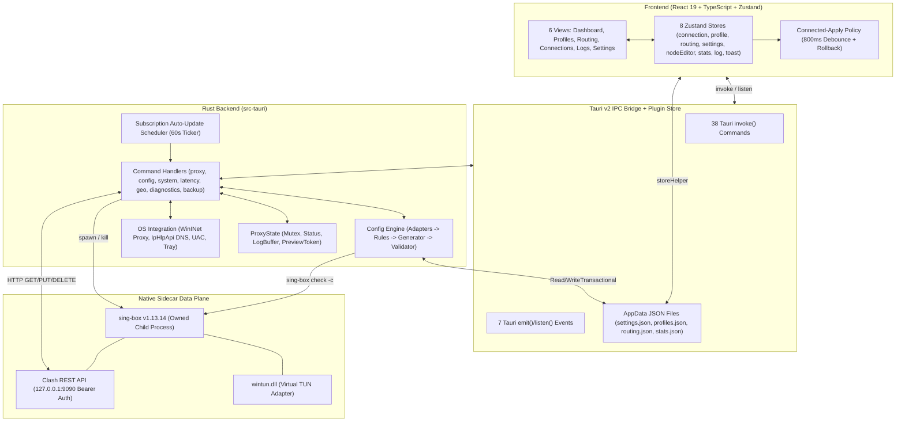
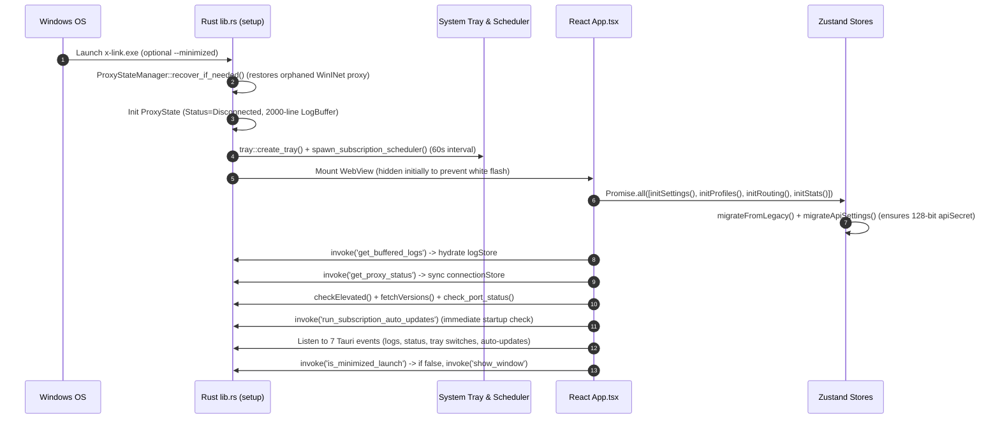
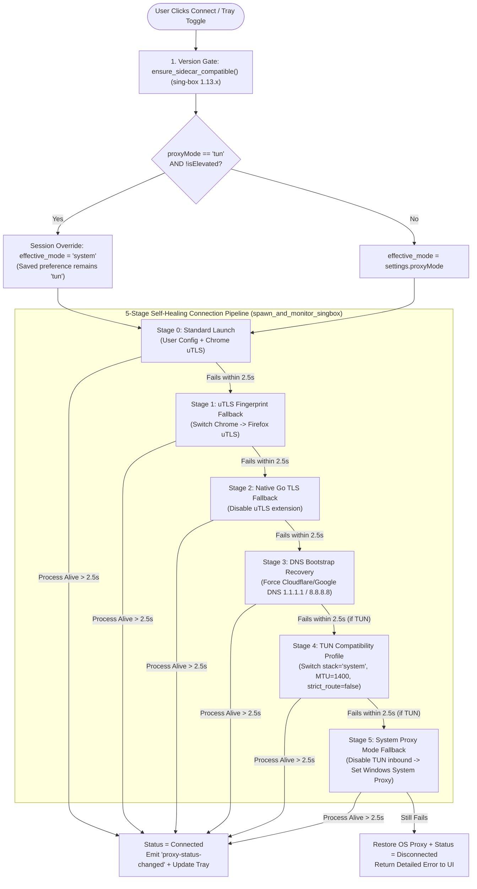

# 01 — Architecture Overview & System Lifecycle

**Navigation**: [[00-Home-MOC]] | **Next**: [[02-Frontend-UI-Architecture]] | **Related**: [[05-Rust-Backend-Architecture]], [[06-IPC-Bridge-and-Data-Contracts]], [[07-AI-Agent-Playbook]]

---

## 1. High-Level System Topology

X-Link operates as a **3-tier local desktop architecture**:
1. **Presentation & State Layer (React 19 WebView)**: Renders the 6 application views, manages optimistic UI state in 8 Zustand stores, and persists user preferences/metadata via `@tauri-apps/plugin-store`.
2. **Orchestration & OS Control Plane (Tauri v2 Rust Core)**: Compiles user settings + profiles + routing rules into a hardened `sing-box` JSON configuration, validates it via a pre-flight sidecar check, manages Windows OS state (WinINet system proxy, UAC elevation, IP Helper DNS discovery, process port inspection), and supervises the `sing-box` child process.
3. **Data Plane (`sing-box v1.13.14` Sidecar + `wintun.dll`)**: Executes actual packet capture (TUN or HTTP/SOCKS/Mixed listeners), DNS resolution (FakeIP + remote DoH/DoT/DoQ + local bypass), protocol encryption (VLESS, VMess, Hysteria2, TUIC, etc.), and exposes a local Clash-compatible REST API (`127.0.0.1:9090`) for real-time telemetry and zero-downtime hot node switching.

---

## 2. Application Boot & Initialization Sequence

When X-Link launches, both the Rust `setup` hook (`src-tauri/src/lib.rs`) and the React root effect (`src/App.tsx`) execute coordinated startup sequences:

### Key Boot Safeguards
- **Orphaned System Proxy Recovery**: Before anything else runs, `ProxyStateManager::recover_if_needed(&app_handle)` checks if `proxy_state_backup.json` exists with `managed_by_xlink: true` from a previous power loss or force-kill, and restores the user's original Windows `ProxyEnable` / `ProxyServer` / `ProxyOverride` registry values.
- **Anti-Flash Window Reveal**: `tauri.conf.json` starts the main window hidden (`visible: false` or revealed via `show_window` after stores initialize) unless launched with `--minimized` (autostart).
- **API Secret Auto-Migration**: `migrateApiSettings()` in `src/utils/store.ts` guarantees that `settings.apiSecret` is populated with a 128-bit CSPRNG hex token even on upgraded installations, because the backend refuses to start the Clash API controller with an empty secret.

---

## 3. Connection Lifecycle & 5-Stage Self-Healing Engine

When the user clicks **Connect** on the Dashboard (or toggles from the System Tray), `toggle_proxy` (`src-tauri/src/commands/proxy.rs`) orchestrates a resilient, multi-stage connection pipeline:

### How Each Stage Works (`src-tauri/src/commands/proxy.rs`)
1. **Pre-Flight Compilation (`prepare_active_config_generation`)**:
   - Reads `profiles.json` $\rightarrow$ locates `profiles/{activeProfileId}.json` (or `configs/active.json`).
   - Reads `settings.json` and `routing.json`.
   - Calls `generator::generate_Config()` to inject inbounds (`tun-in`, `mixed-in` / `http-in` + `socks-in`), outbounds (`proxy` selector, all nodes, `direct`), DNS servers (`remote-dns`, `fallback-dns`, `local-dns`, `fakeip-dns`), and route rules.
   - Runs `validator::validate_config()` (`sing-box check -c temp_check_{uuid}.json`).
2. **Stage Execution & Monitoring**:
   - For each stage, X-Link kills any previous owned `CommandChild`, writes `configs/active.json` atomically, spawns `sing-box run -c active.json`, streams `stdout`/`stderr` into `ProxyState.log_buffer` (and emits `sing-box-log`), and monitors the child for **2,500ms** (`50 x 50ms` ticks) checking for premature exit codes or fatal log patterns (`FATAL`, `panic:`, `bind: An attempt was made`).
   - If TUN mode fails at Stage 0–3, Stage 4 relaxes the TUN interface (`system` stack, `1400` MTU, `strict_route: false`), and Stage 5 falls back to System Proxy mode so the user still gets internet connectivity.

---

## 4. Transactional Config & Connected-Apply Pipeline

X-Link never mutates active configuration files in-place without validation and rollback protection:

### Frontend Debounced Applier (`src/utils/applyPolicy.ts` & `src/utils/connectedApply.ts`)
Every setting in `Settings` is classified into one of three categories:
- **`live`** (`closeToTray`, `theme`, `autostart`, `geoLookupEnabled`): Applied immediately in the app/OS; never restarts `sing-box`.
- **`defer`** (`proxyMode`): Saved to `settings.json` for the **next** connection session; never silently switches a running TUN/System session.
- **`restart`** (ports, TUN stack/MTU/routes, sniffing, DNS, Clash API, multiplex, routing rules):
  - When connected, edits are debounced by **800ms** (`APPLY_DEBOUNCE_MS`).
  - The applier captures a `baseline` snapshot before the first edit in the debounce window.
  - Calls `invoke('reload_active_config', { selectedOutboundTag })`.
  - If validation or restart fails, the applier automatically **restores the baseline snapshot** to Zustand and `settings.json`/`routing.json` and recovers the connection, reporting one of: `applied`, `invalid`, `kept-running`, `recovered`, or `recovery-failed`.

### Backend Transactional File Commit (`src-tauri/src/commands/config.rs`)
- `commit_files_transactionally()` writes every target file to a `.tmp.{uuid}` sibling first, backs up existing files to `.bak.{uuid}`, renames staged files into place, and rolls back from `.bak` if any step fails.
- `commit_and_apply_with_rollback()` wraps file commits + live proxy reloads so that if `reload_active_config` fails while connected, the on-disk profile/config files are rolled back to their exact pre-operation bytes and the previous proxy session is restored.

---

## 5. Core Architectural Invariants (Summary)

> [!CAUTION] Never Violate These 7 Invariants
> Full implementation details are in [[07-AI-Agent-Playbook]], but every module in X-Link depends on these rules:
> 1. **ALPN Enforcement**: VLESS/VMess over `ws` or `httpupgrade` with TLS **must** force `alpn: ["http/1.1"]` (`generator.rs`).
> 2. **TUN Route Exclusion & DNS Loop Prevention**: `tun-in` **must** exclude RFC-1918, loopback, link-local, `1.1.1.1/32`, `8.8.8.8/32`, the active Windows system DNS IP (`GetAdaptersAddresses`), and resolved proxy server IPs.
> 3. **FakeIP DNS Isolation**: `fakeip` (`198.18.0.0/15`) **must** bypass `geosite:private` to `local-dns`.
> 4. **Ownership-Scoped Process Control**: Only terminate the `CommandChild` stored in `ProxyState.child`; never run system-wide `taskkill /IM sing-box.exe`.
> 5. **Dual-Store Sync**: Whenever a Rust command modifies `profiles.json`, `settings.json`, or `routing.json` directly on disk, the frontend **must** call `storeHelper.reload*()` before reading from `@tauri-apps/plugin-store`.
> 6. **Sidecar Compatibility Gate**: `sing-box` must match `1.13.x` (tested with `1.13.14`), verified via `ensure_sidecar_compatible()`.
> 7. **Authenticated Local Controller**: Clash API (`127.0.0.1:9090`) must never start without a non-empty `apiSecret` Bearer token.
