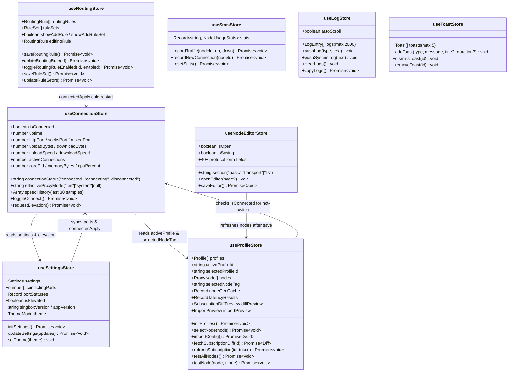

# 02 — Frontend UI Architecture & State Management

**Navigation**: [[00-Home-MOC]] | **Prev**: [[01-Architecture-Overview]] | **Next**: [[03-UI-Components-and-Views]] | **Related**: [[04-UI-Wireframes]], [[06-IPC-Bridge-and-Data-Contracts]]

---

## 1. Frontend Stack & Design System

The X-Link frontend (`src/`) is a single-page desktop application engineered for native responsiveness, zero-jank scrolling, and strict keyboard/screen-reader accessibility.

### Core Libraries
- **React 19 (`^19.2.0`) + TypeScript (`~5.9.3`)**: Bundled with **Vite 8 (`^8.0.0`)**. Path alias `@/*` resolves to `src/*`.
- **Tailwind CSS v4 (`@tailwindcss/vite ^4.2.1`)**: Configured in `src/index.css` and `src/App.css` with custom utility classes (`utility-view`, `utility-toolbar`, `material-scroll-area`, `settings-layout`, `routing-layout`, `profiles-grid`).
- **Material Web (`@material/web ^2.4.1`) & Material Symbols**:
  - Uses Google's `<md-icon>` custom element wrapped in `src/components/ui/icon.tsx` (`<Icon name="..." size={16} />`) rendering the **Material Symbols Rounded** variable icon font.
- **Radix / Base UI Primitives (`@base-ui/react`, `class-variance-authority`, `clsx`, `tailwind-merge`)**: Powers accessible primitives in `src/components/ui/` (`Button`, `Card`, `Badge`, `Sheet`, `Switch`, `Select`, `Table`, `ScrollArea`, `Separator`, `Input`).
- **Virtualized Rendering (`react-window ^2.2.7`)**: Powers `LogsView.tsx` to render up to 2,000 syntax-highlighted log lines at `28px` fixed row height with zero DOM bloat.

### Theme Architecture (`dark` | `light` | `system`)
- Controlled by `useSettingsStore().setTheme(theme)`.
- Persists to both `settings.json` (via `storeHelper.saveSettings`) and `localStorage.getItem('theme')` for instant synchronous hydration before Tauri IPC resolves.
- Sets `document.documentElement.setAttribute('data-theme', resolved)` and toggles the `.dark` class on `<html>`.
- **Color Palette Tokens** (`src/index.css` & `src/App.css`):
  - Semantic CSS variables: `--background`, `--foreground`, `--card`, `--muted`, `--muted-foreground`, `--border`, `--primary`, `--primary-foreground`, `--destructive`, `--md-sys-color-primary`, `--md-sys-color-tertiary`.
  - Status colors:
    - **Connected / Fast (<100ms)**: Emerald/Green (`text-green-600 dark:text-green-400`, `#16a34a` / `#4ade80`).
    - **Connecting / Medium Latency (100–250ms) / Warning**: Amber (`text-amber-500`, `#f59e0b`).
    - **Error / High Latency (>250ms) / Destructive**: Red (`text-destructive`, `#dc2626` / `#f87171`).

---

## 2. Root Orchestrator (`src/App.tsx`)

`src/App.tsx` is the single top-level component mounted inside `<ErrorBoundary>` in `src/main.tsx`.

### Responsibilities of `App.tsx`
1. **Active Tab Routing**:
   - Holds `const [activeTab, setActiveTab] = useState<Tab>('dashboard')` where `Tab = 'dashboard' | 'config' | 'routing' | 'connections' | 'logs' | 'settings'`.
   - Renders `<NavRail activeTab={activeTab} setActiveTab={setActiveTab} />` on the left (`220px` fixed width) and switches the active view inside `<main className="main-content">`.
   - Always mounts `<NodeEditor />` (slide-over drawer controlled by `useNodeEditorStore`) and `<ToastContainer />` (floating notifications controlled by `useToastStore`).
2. **Startup Hydration (`useEffect` on mount)**:
   - Calls `initSettings()`, `initProfiles()`, `initRouting()`, `initStats()` in parallel.
   - Syncs initial ports (`httpPort`, `socksPort`, `mixedPort`) from `settingsStore` into `connectionStore`.
   - Calls `invoke('get_buffered_logs')` to replay any startup logs buffered in Rust before WebView mount.
   - Calls `invoke('get_proxy_status')` to sync `connectionStatus` and `effectiveProxyMode`.
   - Checks UAC elevation (`checkElevated()`), binary versions (`fetchVersions()`), and runs an immediate subscription auto-update check (`invoke('run_subscription_auto_updates')`).
   - Checks `invoke('is_minimized_launch')` and calls `invoke('show_window')` if not minimized.
3. **Global Tauri Event Subscriptions**:
   - `sing-box-log`: Classifies incoming raw log lines (`error`, `warn`, `info`) via `classifySingBoxLog()` and pushes to `useLogStore`.
   - `sing-box-terminated`: Resets `connectionStore` to `disconnected`, logs exit code, and shows an error toast if exit code $\neq 0$.
   - `proxy-status-changed`: Updates `connectionStatus`, `isConnected`, and queries `get_proxy_status` for `effectiveProxyMode` when toggled from the system tray.
   - `settings-changed`: Reloads settings (`storeHelper.reloadSettings()` + `initSettings()`) when modified externally.
   - `node-switched`: Calls `useProfileStore.getState().syncNodeFromTray(profileId, tag)` when the user switches servers from the system tray menu.
   - `subscription-auto-updated` & `subscription-update-error`: Reloads profiles/nodes and triggers toast notifications when the Rust background scheduler updates a subscription.
4. **Live Telemetry Polling Loop (`1000ms` interval while `isConnected`)**:
   - Every 1 second while connected:
     - Increments `uptime` counter in `connectionStore`.
     - Invokes `get_traffic_stats` $\rightarrow$ receives `{ uploadSpeed, downloadSpeed, uploadTotal, downloadTotal, activeConnections, corePid, memoryBytes, cpuPercent }`.
     - Updates `connectionStore` (`updateTrafficStats`, `setCoreMetrics`) and `statsStore` (`recordTraffic` for the active node).
5. **Port Conflict & Status Polling**:
   - Whenever `httpPort`, `socksPort`, `mixedPort`, `useSeparatePorts`, or `isConnected` changes, invokes `check_port_status` and updates `settingsStore.portStatuses` (`free` | `own` | `external` | `unknown`) and `conflictingPorts`.

---

## 3. Zustand State Management Stores (`src/stores/`)

X-Link partitions frontend state into **8 focused Zustand stores**. Cross-store access uses `useOtherStore.getState()` inside async actions to avoid React hook coupling.

---

### 3.1 `useConnectionStore` (`src/stores/connectionStore.ts`)
Manages the live proxy session, listener ports, real-time throughput history, and sidecar process telemetry.

| State Field | Type | Default | Description |
| :--- | :--- | :--- | :--- |
| `isConnected` | `boolean` | `false` | True when `connectionStatus === 'connected'`. |
| `connectionStatus` | `'connected' \| 'connecting' \| 'disconnected'` | `'disconnected'` | Current tunnel lifecycle state. |
| `effectiveProxyMode` | `'tun' \| 'system' \| null` | `null` | Actual running mode (may be `'system'` even if `settings.proxyMode === 'tun'` due to non-admin session fallback or Stage 5 self-healing). |
| `uptime` | `number` | `0` | Seconds elapsed since connection established. |
| `httpPort`, `socksPort`, `mixedPort` | `number` | `7890`, `7891`, `7892` | Mirrored inbound listener ports. |
| `uploadBytes`, `downloadBytes` | `number` | `0` | Session total bytes transferred. |
| `uploadSpeed`, `downloadSpeed` | `number` | `0` | Current throughput in bytes/sec. |
| `activeConnections` | `number` | `0` | Count of active sockets reported by Clash API. |
| `speedHistory` | `{ up: number; down: number }[]` | `[]` | Sliding window of last **30** 1-second speed samples rendered by `TrafficChart`. |
| `corePid`, `memoryBytes`, `cpuPercent` | `number \| null`, `number`, `number` | `null`, `0`, `0` | `sing-box` process telemetry displayed in the Dashboard telemetry strip. |

**Key Actions**:
- `toggleConnect()`:
  - **When connected/connecting**: Invokes `toggle_proxy({ start: false, selectedOutboundTag: null })` and resets state to `disconnected`.
  - **When disconnected**: Validates that an active profile and node exist (auto-selects first node if none selected). Checks if `settings.proxyMode === 'tun' && !isElevated`; if so, sets `modeOverride = 'system'` for this session without overwriting the user's saved `tun` preference. Runs `check_port_conflict`, sets status to `connecting`, and invokes `toggle_proxy({ start: true, selectedOutboundTag, modeOverride })`.
- `requestElevation()`: Invokes `request_elevation` (UAC prompt on Windows) to relaunch X-Link as Administrator.

---

### 3.2 `useProfileStore` (`src/stores/profileStore.ts`)
Manages multi-profile metadata, outbound nodes, subscription imports/previews/refreshes, latency benchmarks, and GeoIP flag resolution.

| State Field | Type | Description |
| :--- | :--- | :--- |
| `profiles` | `Profile[]` | List of all profiles (`subscription`, `manual`, `file`). |
| `activeProfileId` | `string \| null` | UUID of the profile currently backing `configs/active.json`. |
| `selectedProfileId` | `string \| null` | UUID of the profile currently viewed in `ConfigView` / `DashboardView`. |
| `nodes` | `ProxyNode[]` | Outbound proxy servers belonging to `selectedProfileId`. |
| `selectedNodeTag` | `string \| null` | Tag of the currently selected server node. |
| `nodeGeoCache` | `Record<string, GeoCacheEntry \| 'loading'>` | Keyed by node `server` IP; stores `{ countryCode, countryName, cityName, regionName }`. |
| `latencyResults` | `Record<string, { latencyMs, error, mode }>` | Keyed by `node.tag`; stores ping in ms and mode (`'tcp'` or `'proxy-url'`). |
| `diffPreview` | `SubscriptionDiffPreview \| null` | Holds added/removed/retained node counts and `previewToken` before applying a subscription update. |
| `importPreview` | `ImportPreview \| null` | Live dry-run parse result (`nodeCount`, `nodeTypes`, `sampleNodes`) while pasting config content in `ConfigView`. |

**Key Actions**:
- `selectNode(node)`: Saves `selectedNodeTag` to the profile. If `selectedProfileId !== activeProfileId`, invokes `switch_profile` to activate that profile first. If already on the active profile and `isConnected` is true, invokes `switch_node_hot({ tag })` (uses Clash API `PUT /proxies/proxy` if `apiEnabled`, or cold-restarts if disabled).
- `testAllNodes()` / `testNode(node, mode)`: Automatically uses `'proxy-url'` (`test_all_nodes_url_latency` / `test_proxy_url_latency` via Clash API) when connected with `apiEnabled` on the active profile, or falls back to `'tcp'` (`test_all_nodes` / `test_node_latency`).
- `fetchSubscriptionDiff(profileId)` & `refreshSubscription(profileId, previewToken?)`: Two-phase subscription update. `preview_subscription_refresh` fetches and caches the raw payload in Rust with a 5-minute TTL `previewToken`; `apply_previewed_subscription_refresh` commits that exact payload without re-downloading.
- `fetchNodeGeo(server, tag)`: If `settings.geoLookupEnabled` is true and `server` is a literal IP, invokes `lookup_node_geo({ server })`. Falls back to offline heuristic tag parsing (`getCountryCode(tag)`) supporting flag emojis and 18 country codes/keywords.

---

### 3.3 `useSettingsStore` (`src/stores/settingsStore.ts`)
Holds the 34 application settings (`Settings` interface in `src/utils/store.ts`), port conflict statuses, UAC elevation flag, and version strings.
- `updateSettings(updates)`: Optimistically updates Zustand state, persists to `settings.json` (stamping `_schemaVersion: 2`), triggers the debounced `connectedApply` cold-restart if any modified key is classified as `'restart'` while connected, and invokes `set_runas_admin` or `set_autostart` when `proxyMode` or `autostart` changes.

---

### 3.4 `useRoutingStore` (`src/stores/routingStore.ts`)
Manages custom routing rules (`RoutingRule[]`) and remote/local rule sets (`RuleSet[]`) persisted in `routing.json`.
- Every mutation (`saveRoutingRule`, `deleteRoutingRule`, `toggleRoutingRuleEnabled`, `saveRuleSet`, `deleteRuleSet`) snapshots the current `{ rules, ruleSets }` before persisting and schedules a validated cold restart via `connectedApply` if connected.
- `updateRuleSet(rs)` invokes `update_rule_set({ ruleSetId, url })` to download the `.srs`/`.json` file into `app_data_dir()/rule-sets/` and stamps `lastUpdated`.

---

### 3.5 `useNodeEditorStore` (`src/stores/nodeEditorStore.ts`)
Manages the slide-over `NodeEditor` drawer state (`isOpen`, `isSaving`, `saveError`, `section: 'basic' | 'transport' | 'tls'`) and 45 form fields covering all 10 outbound protocols (`vless`, `vmess`, `trojan`, `shadowsocks`, `hysteria2`, `tuic`, `socks`, `http`, `wireguard`, `ssh`).
- `openEditor(node?)`: Populates all form fields from an existing `ProxyNode` (extracting nested `transport`, `tls`, `reality`, `utls`, `obfs`, `peers`) or initializes defaults for a new server (`Server N`, random UUID, port `443`).
- `saveEditor()`: Validates protocol-specific required fields (e.g., UUID for VLESS/VMess, private/peer keys for WireGuard, Reality public key), constructs a normalized `Partial<ProxyNode>`, and invokes `update_node({ newOutbound })`.

---

### 3.6 `useStatsStore`, `useLogStore`, and `useToastStore`
- **`useStatsStore` (`src/stores/statsStore.ts`)**: Accumulates per-node `totalUploadBytes`, `totalDownloadBytes`, `connectionCount`, `firstUsedAt`, and `lastUsedAt` in `stats.json` using a **5,000ms debounced save** (`debouncedSave`) so 1-second traffic ticks do not thrash the disk.
- **`useLogStore` (`src/stores/logStore.ts`)**: Maintains an in-memory ring buffer of the last **2,000** `LogEntry` items (`{ type: 'info' | 'warn' | 'error' | 'system', text, timestamp }`) and `autoScroll` state.
- **`useToastStore` (`src/stores/toastStore.ts`)**: Manages up to **5** concurrent floating toasts (`success`, `error`, `info`, `warning`) with a default `4500ms` auto-dismiss timer and smooth exit transition state (`exiting: boolean`).
