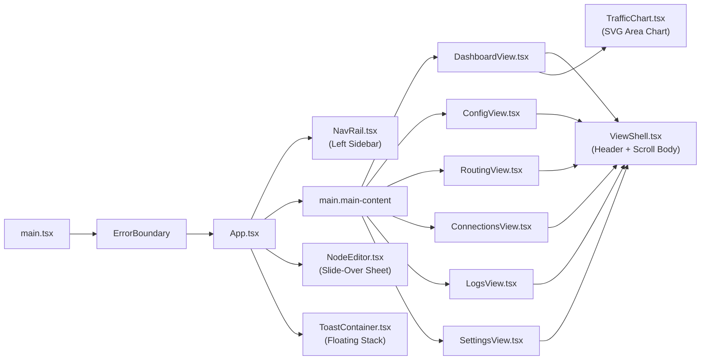

# 03 — UI Components & Views Reference

**Navigation**: [[00-Home-MOC]] | **Prev**: [[02-Frontend-UI-Architecture]] | **Next**: [[04-UI-Wireframes]] | **Related**: [[06-IPC-Bridge-and-Data-Contracts]]

---

## 1. Component Hierarchy Overview

---

## 2. Shell, Layout & Global Components (`src/components/`)

### 2.1 `NavRail` (`src/components/NavRail.tsx`)
- **Role**: Fixed left navigation rail (`220px` wide) providing top-level view switching and a live connection summary footer.
- **Props**: `{ activeTab: Tab; setActiveTab: (tab: Tab) => void }`.
- **Structure**:
  1. **Brand Header**: X-Link logo (`X-Link-logo.png`), title `"X-Link"`, subtitle `"Private Tunnel"`.
  2. **Navigation List (`6 items`)**:
     - `dashboard` (`icon: "speed"`, label: `"Dashboard"`)
     - `config` (`icon: "dns"`, label: `"Profiles"`)
     - `routing` (`icon: "alt_route"`, label: `"Routing"`)
     - `connections` (`icon: "hub"`, label: `"Connections"`)
     - `logs` (`icon: "terminal"`, label: `"Logs"`)
     - `settings` (`icon: "settings"`, label: `"Settings"`)
  3. **Footer Status Pill (`.nav-status`)**:
     - Status dot (`.status-dot.connected` green, `.connecting` amber, or muted when disconnected).
     - Status label (`"Connected"` / `"Connecting..."` / `"Disconnected"`).
     - Mode badge (`"TUN"` or `"SYS"`, showing `effectiveProxyMode ?? settings.proxyMode`).
     - Active node tag + country flag (`flagcdn.com/w20/{code}.png`) when a server is selected.
     - Version label (`sing-box v1.13.14` + `X-Link v0.6.0`).

### 2.2 `ViewShell` (`src/components/ViewShell.tsx`)
- **Role**: Standardized layout frame wrapping all 6 views.
- **Props**: `{ title: string; subtitle: string; actions?: ReactNode; children: ReactNode; contentClassName?: string; noScroll?: boolean }`.
- **Structure**:
  - Top `<header className="view-header">` with `.view-header-copy` (`<h1>{title}</h1>`, `
{subtitle}
`) on the left and `.view-header-actions` (`{actions}`) on the right.
  - Body `
` (either fixed height when `noScroll={true}` as used in `DashboardView`, or wrapped in `<ScrollArea>` for scrollable views).

### 2.3 `TrafficChart` (`src/components/TrafficChart.tsx`)
- **Role**: High-DPI responsive SVG area chart plotting the 30-sample `speedHistory` (`up` and `down` bytes/sec) from `useConnectionStore`.
- **Features**:
  - Uses `ResizeObserver` to dynamically track container width/height.
  - Computes smooth **cubic Bézier curves** (`buildPath` + `buildArea`) with linear vertical scaling (`maxVal * 1.15`).
  - Renders horizontal dashed gridlines with auto-formatted speed labels (`KB/s`, `MB/s`), gradient fills (`#downGrad` primary color, `#upGrad` tertiary color), and pulsing live endpoint dots when `isConnected` is true.

### 2.4 `ToastContainer` (`src/components/ToastContainer.tsx`)
- **Role**: Renders up to 5 stacked floating notifications in the bottom-right corner (`role="region" aria-label="Notifications"`).
- **Behavior**: Maps `toast.type` (`success` $\rightarrow$ `check_circle`, `error` $\rightarrow$ `error`, `warning` $\rightarrow$ `warning`, `info` $\rightarrow$ `info`) with semantic border/icon colors and an animated progress bar (`toast-progress`).

### 2.5 `ErrorBoundary` (`src/components/ErrorBoundary.tsx`)
- **Role**: React class error boundary catching unexpected render exceptions and displaying a recovery card with the error stack and a `"Reload Application"` button.

---

## 3. Domain & Form Components

### 3.1 `NodeEditor` (`src/components/domain/NodeEditor.tsx`)
- **Role**: Slide-over modal sheet (`<Sheet side="right">` width `440px–500px`) for creating or editing a proxy node inside the active profile.
- **State**: Driven by `useNodeEditorStore`.
- **3 Segmented Tabs**:
  1. **`Basic`**:
     - `Protocol` selector (`VLESS`, `VMess`, `Trojan`, `Shadowsocks`, `Hysteria2`, `TUIC v5`, `SOCKS5`, `HTTP`, `WireGuard`, `SSH`) with live protocol description banner.
     - `Node Name (Tag)`, `Server Address`, `Server Port`.
     - Protocol-specific credential fields:
       - **VLESS/VMess**: `UUID` + `Flow Control` (`None`, `xtls-rprx-vision`, `xtls-rprx-vision-udp443`).
       - **Trojan**: `Password`.
       - **Shadowsocks**: `Encryption Method` (`2022-blake3-*`, `aes-*-gcm`, `chacha20-ietf-poly1305`) + `Password`.
       - **Hysteria2**: `Auth Password`, `Upload Bandwidth` (`100 mbps`), `Download Bandwidth` (`200 mbps`), `Obfs Type` (`None` / `salamander`) + `Obfs Password`.
       - **TUIC v5**: `UUID`, `Password`, `Congestion Control` (`bbr`, `cubic`, `new_reno`), `UDP Relay Mode` (`native`, `quic`).
       - **SOCKS5**: `Protocol Version` (`5` / `4`), `Username`, `Password`, `UDP over TCP` switch.
       - **HTTP**: `Username`, `Password`, `Enable HTTPS (TLS)` switch.
       - **WireGuard**: `Interface Private Key`, `Peer Public Key`, `Local Tunnel Address (CIDR)`, `Pre-Shared Key`, `MTU` (`1420`), `Reserved Bytes (JSON array)`.
       - **SSH**: `SSH Username`, `SSH Password`, `Private Key / Path`, `Host Key Algorithms`.
  2. **`Transport`** (hidden for UDP-native/tunnel protocols `hysteria2`, `tuic`, `socks`, `http`, `wireguard`, `ssh`):
     - `Network Type` (`tcp`, `ws`, `grpc`, `http`, `httpupgrade`, `quic`).
     - Dynamic fields: `WebSocket/HTTP Path`, `Host Header`, or `gRPC Service Name`.
  3. **`TLS`** (hidden for `socks`, `http`, `shadowsocks`, `wireguard`, `ssh`; forced enabled for `hysteria2` & `tuic`):
     - `Enable TLS` switch (locked ON for QUIC protocols).
     - `SNI (Server Name Indicator)`, `ALPN` (`http/1.1` or `h3`), `uTLS Fingerprint` (`chrome`, `firefox`, `safari`, `edge`, `ios`, `android`, `random`, `none`).
     - `Allow Insecure (Skip Cert Verify)` switch with destructive security warning.
     - `Enable Reality (XTLS)` switch $\rightarrow$ reveals `Reality Public Key` and `Reality Short ID`.

### 3.2 Form Primitives (`src/components/form/`)
- **`FormInput.tsx`**: Labelled text/number/search/password input with optional `mono` font, `suffix` slot, password visibility toggle, and search clear button.
- **`FormSelect.tsx`**: Labelled select dropdown built on `@/components/ui/select`.
- **`FormSwitch.tsx` (`FormSwitchRow`)**: Horizontal card row with `title`, `desc` subtitle, and a right-aligned `<Switch>` toggle.
- **`SegmentedControl.tsx`**: Pill-style segmented radio/tab bar supporting icons, labels, and keyboard navigation.

---

## 4. Detailed Breakdown of the 6 Application Views (`src/views/`)

### 4.1 `DashboardView` (`src/views/DashboardView.tsx`)
The primary operational command center (`noScroll` flex layout):
1. **Header Actions**:
   - **Active Profile Selector Dropdown** (when $>1$ profile exists) allowing instant profile switching.
   - **Active Mode Pill**: Shows `"TUN"` or `"System Proxy"`, plus `"Fallback: System Proxy"` if TUN fell back.
   - **Connection Status Pill**: Shows `"Protected · HH:MM:SS"` (green), `"Connecting..."` (amber), or `"Unprotected"` (muted).
2. **Conditional Alert Banners**:
   - **Elevation Warning Banner**: Shown when `settings.proxyMode === 'tun' && !isElevated`. Displays *"TUN mode needs Administrator rights; connecting now will use System Proxy"* with a **"Run as Admin"** button (`requestElevation`).
   - **Port Conflict Banner**: Shown when `conflictingPorts.length > 0`. Lists conflicting ports (`7890`, `7892`, etc.) with a **"Change Ports"** button that navigates to `Settings`.
3. **Hero Control Strip (`.dashboard-control-strip`)**:
   - **Left (`Connect Action`)**: Large Connect/Disconnect button (`is-connected` / `is-connecting` / `is-disconnected`), connection state heading (`"Connected"` / `"Ready to Connect"` / `"Import a Profile"`), active server tag, and quick action buttons (**"Test Active Tunnel"** URL delay check `test_active_proxy_url` when connected, or **"Import Profile"** when empty).
   - **Right (`Live Telemetry Strip`)**:
     - `Download`: Live speed (`MB/s`) + cumulative download (`GB`).
     - `Upload`: Live speed (`MB/s`) + cumulative upload (`GB`).
     - `Active`: Active socket count + listener port (`Mixed :7892` or `HTTP :7890 · SOCKS :7891`).
     - `Engine` (when connected & `corePid` available): Memory usage (`MB`), CPU (`%`), and `PID`.
4. **Main Split Grid (`.dashboard-main-grid`)**:
   - **Left Panel — Server List Card (`Servers`)**:
     - Header with server count badge, search filter input, and **"Ping All"** button (`testAllNodes`).
     - Scrollable table of `ServerRow` items:
       - **Server Column**: Active indicator dot, Country Flag (`flagcdn.com`) or globe icon, Node Tag, and cumulative data transferred (`useStatsStore`).
       - **Protocol Column**: Uppercase badge (`VLESS`, `HYSTERIA2`, etc.).
       - **Latency Column**: Color-coded ping (`<100ms` green, `<250ms` amber, $\ge 250\text{ms}$ red, or `Err`) + mode label (`URL` vs `TCP`) + per-row `TCP` and `URL` ping buttons.
       - **Row Actions**: Edit button (opens `NodeEditor`) and Delete button (`deleteNode`).
   - **Right Panel — Throughput & Session Summary (`.dashboard-side-column`)**:
     - **Throughput Card**: Live download/upload rate readout + `<TrafficChart />`.
     - **Session Details Card**: 6 key-value rows (`Profile`, `Selected server`, `Mode`, `Active sockets`, `Core version`, `Admin access`) + **"Reset Usage Stats"** button when cumulative node stats exist.

---

### 4.2 `ConfigView` / Profiles (`src/views/ConfigView.tsx`)
Manages subscription profiles, manual profiles, and configuration imports:
1. **Header Actions**:
   - Search input (`Search profiles...`) when $>1$ profile exists.
   - **"+ Empty Profile"** button (opens inline name input bar to call `createEmptyProfile`).
   - **"+ Add Server"** button (opens `NodeEditor` to add a manual server to the active profile).
2. **Subscription Diff Preview Modal**:
   - Triggered when clicking the **Preview Changes (`difference`)** button on any subscription card.
   - Displays a 3-column summary (`Before`, `After`, `Retained`), a warning if the currently selected node was removed (showing the fallback node), scrollable lists of **Added Nodes (`+`)** and **Removed Nodes (`-`)**, and an **"Apply Update"** button that commits the cached `previewToken`.
3. **Main Split Layout**:
   - **Left Column (`Saved Profiles`)**:
     - Grid of profile cards (`.profiles-grid`). Each card displays:
       - Profile Name, Type badge (`SUBSCRIPTION`, `FILE`, `MANUAL`), `ACTIVE` badge, Node count, Last updated relative time (`2h ago`), and currently selected node tag.
       - **Subscription Controls** (for `type === 'subscription'`): Auto-update interval selector (`Off`, `1h`, `6h`, `12h`, `24h`), **Preview Diff** button, and **Quick Refresh** button.
       - **Card Actions**: `"Use Profile"` (`switchProfile`), `"Browse"` (`selectProfile`), and `"Delete"` (`deleteProfile` with confirmation dialog).
   - **Right Column (`Import Profile` Sticky Card)**:
     - `Profile Name` input (auto-detects name from share link `#fragment` or `vmess://` `ps` field).
     - `Subscription URL or Raw Configuration` textarea with **"Paste"** (`pasteClipboard`) and **"Clear"** buttons.
     - **Live Import Preview Banner**: Automatically debounces (`350ms`) calls to `preview_import_config` as the user types/pastes raw configs or share links, displaying detected node count, protocol breakdown (`VLESS: 5 · TROJAN: 2`), and sample node tags before importing!
     - **"Import from Text"** button (`importConfig`) and **"Choose File (.json, .yaml, .txt)"** button (`pickFileAndImport`).

---

### 4.3 `RoutingView` (`src/views/RoutingView.tsx`)
Configures domain/IP/process split-tunneling rules and remote rule-sets:
1. **Header Actions**:
   - **"Connected — edits restart tunnel"** badge when `isConnected`.
   - **"+ Add Rule"** button and **"+ Add Rule Set"** button.
2. **Main 2-Column Layout (`.routing-layout`)**:
   - **Left Column (`.routing-primary`)**:
     - **Inline Rule Editor Card** (when adding or editing a rule):
       - `Match Type` (`domain`, `domain_suffix`, `domain_keyword`, `domain_regex`, `ip_cidr`, `geoip`, `geosite`, `port`, `port_range`, `protocol`, `process_name`, `rule_set`, `network`, `package_name`).
       - `Target Action` (`proxy`, `direct`, `block`, `dns`).
       - `Match Value` input:
         - When `type === 'process_name'`, displays a **"Pick running process"** dropdown populated via `invoke('get_running_processes')` alongside a custom `.exe` input!
         - When `type === 'geoip'` or `'geosite'`, displays quick-pick chips (`private`, `cn`, `us`, `google`, `youtube`, `netflix`, `openai`, `category-ads-all`, etc.).
       - `Notes` input and `Invert Match` checkbox.
     - **Routing Rules Table Card**:
       - Lists all rules in priority order (`#1`, `#2`, ...) with `Enable/Disable` `<Switch>`, `Type` badge, `Value` (plus `NOT` badge if inverted), `Route` action badge (`PROXY` primary, `DIRECT` green, `BLOCK` red, `DNS` outline), `Edit`, and `Delete` buttons.
   - **Right Column (`.routing-aside`)**:
     - **Global Routing Policy Card**:
       - `Default Route (Final Outbound)` selector (`Proxy`, `Direct`, `Block`).
       - `Bypass LAN & Private Networks` switch (`settings.bypassLan`).
     - **Rule Sets Card**:
       - Lists remote/local `.srs`/`.json` rule sets (`geosite-cn`, etc.) with **"Update"** (`updateRuleSet`) and **"Delete"** buttons, plus an inline form to add new remote/local rule sets.

---

### 4.4 `ConnectionsView` (`src/views/ConnectionsView.tsx`)
Real-time socket inspector polling `get_active_connections` every `1000ms` while connected:
1. **Header Actions**: **"Close All"** destructive button (`close_all_connections` with confirmation dialog).
2. **Toolbar**:
   - Search input (`Host, IP or rule...`) using `useDeferredValue` for lag-free filtering.
   - `SegmentedControl` filter: `All Tunnels` | `Proxy Tunnels` | `Direct Tunnels`.
   - Active socket counter (`X / Y active sockets`).
3. **Connections Table**:
   - Sortable columns (`Destination`, `Network / Matched Rule`, `Live speed`, `Total data`, `Uptime`, `Kill`).
   - Computes per-connection `upSpeed` and `downSpeed` deltas across 1-second snapshots using `prevBytesRef`.
   - Each row (`ConnectionRow`, memoized) shows `host:port`, network badge (`TCP`/`UDP`), inbound type (`tun-in`/`mixed-in`), outbound chain badge (`proxy › Node-1` or `direct`), matched rule expression, live speeds, total bytes, duration, and a per-socket **Kill (`close`)** button (`close_connection`).

---

### 4.5 `LogsView` (`src/views/LogsView.tsx`)
High-performance virtualized console output viewer:
1. **Header Actions**:
   - **"Copy All"** button (`copyLogs`), **"Clear"** button (`clearLogs`), and **"Autoscroll"** `<Switch>` (automatically pauses when the user scrolls $>40\text{px}$ above the bottom and resumes when scrolled back to bottom).
2. **Filter Toolbar**:
   - Search input (`Find a message...`) + `SegmentedControl` level filter (`All` | `Info` | `Warn` | `Errors` | `System`) + entry count (`Showing X of Y entries`).
3. **Virtualized Log Panel**:
   - Uses `react-window` `<List rowHeight={28} overscanCount={6} />`.
   - `renderHighlightedText()` parses bracketed tags (`[DNS]`, `[TUN]`, `[System]`, `[Self-Heal]`, `[WARN]`, `[ERR]`) and renders them as styled pills alongside the `HH:MM:SS` timestamp and level badge (`INFO`, `WARN`, `ERR`, `SYS`).

---

### 4.6 `SettingsView` (`src/views/SettingsView.tsx`)
Organized into a 2-column `.settings-layout` with a left secondary navigation bar (`6 sections`) and right content region:
1. **`General` (`general`)**:
   - **Proxy Mode Card** (`Next connect` badge): Toggle between `TUN` and `System Proxy`.
   - **App Preferences Card** (`Live` badge): `Close to Tray`, `Launch on System Login`, `LAN Hotspot Sharing` (`0.0.0.0` bind), `Node Geolocation Lookup` (opt-in `freeipapi.com` consent toggle).
   - **Connection Optimization Card** (`Requires restart` badge): `Enable Multiplexing (Mux)` (`smux`).
   - **Appearance Card** (`Live` badge): `SegmentedControl` (`Light`, `Dark`, `System`).
   - **Inbound Ports Card** (`Requires restart` badge): `Use Separate HTTP & SOCKS5 Ports` toggle, `HTTP Proxy Port` (`7890`), `SOCKS5 Port` (`7891`), `Mixed inbound port` (`7892`) with real-time port ownership badges (`● X-Link`, `● Free`, `● Conflict`, `● Invalid`).
   - **Version Card**: X-Link logo and `v{appVersion}` badge.
2. **`TUN Mode` (`tun`)**:
   - Non-admin warning banner if `!isElevated`.
   - `TUN stack implementation` (`mixed`, `gvisor`, `system`), `TUN MTU` (`1500` / `1400`), `Auto Route`, `Auto Redirect (nftables)`, `Strict Route`, `Endpoint Independent NAT`.
3. **`Sniffing` (`sniff`)**:
   - `Enable Traffic Sniffing` master switch + `HTTP Sniffing`, `TLS/HTTPS Sniffing`, `QUIC/HTTP3 Sniffing`, `Override Destination`.
4. **`DNS` (`dns`)**:
   - **DNS Servers Card**: `Primary DNS` (with quick chips for Cloudflare DoH, Google DoH, Cloudflare DoT, AdGuard DoQ), `Fallback DNS`, and `Direct DNS` (`Auto (System DNS)`, `Cloudflare`, `Google`).
   - **DNS Options & Strategy Card**: `DNS query strategy` (`prefer_ipv4`, `ipv4_only`, `prefer_ipv6`, `ipv6_only`), `Enable DNS Caching`, `DNS Leak Protection`.
   - **Resolution Mode Card**: `DNS mode` (`fakeip` vs `normal`), `FakeIP range` (`198.18.0.0/15`), `FakeIP exclude filter` (`geosite:private`).
   - **Routing Card**: `Bypass LAN / Private IPs`.
5. **`API` (`api`)**:
   - `Enable External API` switch (auto-generates a 128-bit `apiSecret` if empty), `API Port` (`9090`), `API secret token` input with regenerate button, `Allow CORS` switch, and a live **Yacd UI** launch link + **"Copy Token"** button when connected.
6. **`Diagnostics` (`diagnostics`)**:
   - **System Health & Bundle Card**: 4 status tiles (`Elevation`, `Proxy Core`, `Current Mode`, `Port Conflicts`) + **"Generate Diagnostics"**, **"Copy JSON"**, **"Download Report"**, and collapsible sanitized JSON preview (`export_system_diagnostics`).
   - **Configuration Backup & Restore Card**: **"Export backup"** (`export_config_backup`) and **"Inspect backup file"** (`validate_backup_archive`) with selective checkboxes (`Profiles and node configs`, `App settings`, `Routing rules`) and **"Restore selected sections"** (`import_config_backup`, enabled only when disconnected).
   - **Routing Rule & DNS Simulation Card**: Input any domain or IP (`e.g. 192.168.1.1, google.com`) and click **"Simulate"** (`simulate_routing`) to inspect the exact `matchedOutbound`, `matchedRuleType`, `matchReason`, `isLanBypass`, and `dnsStrategy`.
