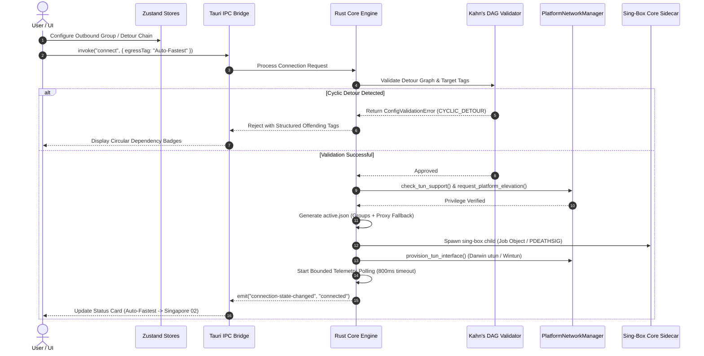

# X-Link v0.8.0 Cross-Platform Desktop & Sing-Box Routing Architecture

* **Author:** Isuruzenith & Claude Code (EGM Draft)
* **Status:** Draft
* **Date:** 2026-11-03
* **Target Version:** v0.8.0 (Head: `feat/material-web-redesign`)
* **Artifact Path:** `docs/designs/design_draft.md`

--------------------------------------------------------------------------------

## Overview

X-Link v0.8.0 establishes the production-grade foundation for X-Link across Windows, macOS, and Linux. The release unifies the Material 3 (M3) desktop application shell, delivers reliable operating-system-level TUN mode without running the WebKit GUI as root, exposes sing-box routing primitives (Outbound Groups, 2-hop Detour Chaining, and Rule-to-Group targeting) through progressive disclosure, hardens sidecar process supervision against orphan zombies, bounds live telemetry streams, and updates the Obsidian documentation vault (`docs/00`–`07`) to full parity while introducing `docs/08-User-Guide-and-FAQ.md` with incident recovery runbooks.

## The Problem

X-Link currently faces several architectural, platform, and usability limitations:
1. **Platform Couplings & macOS TUN Defect**: The existing TUN implementation hardcodes the Windows interface name `"X-Link"` and Windows registry hooks. On macOS, Darwin kernel requirements (`utun[0-9]+`) fail, and running the GUI elevated via `osascript` causes WebKit sandbox security crashes on macOS 14+ Sonoma and macOS 15+ Sequoia.
2. **Monolithic Egress Bottleneck**: All proxy nodes are collapsed into a single hardcoded `selector` outbound tagged `"proxy"`. Users cannot configure automated latency-based failover (`urltest`), fallback pools, or load balancing. Furthermore, routing rules cannot direct specific traffic (e.g. streaming, work domains) to specialized proxy groups; non-direct/non-block traffic is unconditionally coerced to `"proxy"`.
3. **Telemetry Saturation & UI Freezes**: Unthrottled 1-second polling of the Clash API (`GET /connections`) creates excessive JSON serialization and garbage collection churn under heavy concurrent connection loads (1,000–5,000 connections), leading to UI frame drops in the Material 3 desktop views.
4. **Documentation & Contract Drift**: Existing documentation in `docs/00`–`07` cites `v0.6.0`, omits 8 newly introduced Tauri IPC commands, and lacks operational failure runbooks for emergency internet recovery and ghost TUN adapter cleanup.

## Goals

* **G-1 (Cross-Platform M3 Shell)**: Deliver a responsive Material 3 desktop UI across Windows, macOS, and Linux with platform-adapted window chrome (macOS traffic light padding, Windows native controls, Linux CSD/SSD).
* **G-2 (Cross-Platform TUN Parity)**: Support TUN mode natively across Windows (`wintun.dll`), Linux (single-click Polkit `pkexec setcap` GUI prompt without running desktop app as root), and macOS (dynamic `utun` auto-allocation with a one-time scoped helper installation to eliminate repeated password prompts on connect). If TUN initiation fails on any platform, present a strict diagnostic error dialog rather than silently degrading connection security.
* **G-3 (Sing-Box Routing Groups)**: Expose `urltest` (latency auto-failover), `fallback`, `loadbalance`, and custom `selector` outbound groups in the UI, allowing routing rules to target persistent Outbound Groups with compile-time fallback to `"proxy"`.
* **G-4 (Protected Detour Chaining)**: Support 2-hop detour chaining (Entry Relay -> Exit Node) guarded by compile-time Kahn's Directed Acyclic Graph (DAG) cycle detection and UDP protocol capability checks.
* **G-5 (Telemetry Hardening)**: Replace unthrottled polling with a persistent HTTP client singleton (800ms read timeout), top-100 connections cap, unmount polling pauses, and fixed-capacity native Rust ring buffers (500 entries) for DNS and connection events.
* **G-6 (Enterprise Subsystems)**: Support multi-format subscription parsing (Clash, V2Ray, SIP008 JSON), scheduled auto-updates with randomized jitter, and self-describing v2 backup archives with optional AES-256-GCM encryption.
* **G-7 (Documentation Vault Parity)**: Upgrade `docs/00`–`07` to v0.8.0 specification (covering all 46 IPC commands) and author `docs/08-User-Guide-and-FAQ.md` with plain-English onboarding and SRE failure recovery runbooks.

## Non-Goals

* **NG-1 (Kernel Packet Dissection)**: No raw packet capture, `libpcap` integration, or deep packet inspection. Diagnostics rely strictly on sing-box routing logs, DNS events, and Clash API connection tables.
* **NG-2 (Persistent System Daemons)**: No persistent Session 0 Windows Services or continuous macOS background `launchd` system daemons. Process lifecycle remains strictly scoped to the active user desktop session.
* **NG-3 (Pure-Rust Rewrite)**: The speculative `eframe`/`egui` rewrite remains strictly out-of-scope for v0.8.0. All implementation targets the production Tauri v2 + React 19 architecture.
* **NG-4 (Unbounded Detour Meshes)**: No arbitrary N-hop proxy mesh graphs. Detours are strictly capped at 2 hops (Relay -> Exit).
* **NG-5 (Disaster Recovery Redaction)**: Full cryptographic fidelity (UUIDs, passwords, private keys) is preserved in backup archives. Secret sanitization applies solely to diagnostic support bundles (`export_system_diagnostics`).

## Open Questions

* **OQ-1**: *Dynamic Port Reallocation on Startup*: If sing-box crashes ungracefully and holds port 2080 or 9090, should X-Link attempt PID termination via its session metadata file first, or dynamically increment port numbers (`2081`, `9091`) if the port is busy? *(Current baseline: Terminate matching recorded session PID; if still busy, surface actionable port collision toast).*
* **OQ-2**: *Health-Check Interval Guardrail*: Should the UI permit users to override the minimum 5-minute health check interval on automated `urltest` groups if they explicitly accept cellular data consumption warnings? *(Current baseline: Hard floor of 5 minutes in UI controls to protect metered connections).*

## Critical User Journeys (CUJs)

### CUJ 1: One-Click Connection with Automated Lowest Latency Egress
* **Given**: An end-user has imported a remote subscription containing 50 server nodes and configured an Outbound Group named "Auto-Fastest" of type `urltest` with a 10-minute check interval.
* **When**: The user selects "Auto-Fastest" from the primary Dashboard Egress dropdown and clicks the "Connect" switch.
* **Then**: Sing-box launches in user session; `urltest` establishes background latency probes against `https://cp.cloudflare.com/generate_204`; the Dashboard status card indicates "Connected (Auto-Fastest -> Singapore 02 - 42ms)"; and overall system traffic routes through the winning node with live bandwidth graphs updating.

### CUJ 2: Cross-Platform TUN Mode Activation on macOS & Linux
* **Given**: A macOS user runs X-Link as a standard non-root desktop application on macOS 15 Sequoia (or a Linux user on Fedora/Ubuntu).
* **When**: The user opens Settings, selects Proxy Mode "TUN", and toggles the connection switch for the first time.
* **Then**: 
  - On macOS: The application prompts a one-time helper installation dialog; once authorized, the helper handles Darwin network configuration; future connections require zero password prompts; dynamic `utun` interfaces are allocated cleanly; and the Tauri WebKit GUI remains completely unprivileged.
  - On Linux: A Polkit authentication prompt appears once to grant `cap_net_admin,cap_net_bind_service=+ep` directly to the `sing-box` binary.
  - Failure Condition: If elevation is declined or kernel driver initialization fails, a strict modal dialog details the exact OS error (e.g. `EPERM` or capability missing) with actionable remediation steps, rather than silently downgrading to an unencrypted or browser-only proxy mode.

### CUJ 3: Rule-Based Group Routing with Subscription Auto-Update
* **Given**: The user defines a routing rule directing domain suffix `.netflix.com` to a persistent Outbound Group named "Streaming-Pool". The active subscription undergoes a scheduled background auto-update that renames several underlying nodes.
* **When**: The background scheduler applies the subscription update via `apply_previewed_subscription_refresh`.
* **Then**: The rule targeting "Streaming-Pool" remains completely intact; sing-box config generation resolves the group reference without error; and streaming traffic continues routing through the pool without connection drops or validation panics.

--------------------------------------------------------------------------------

## Technical Plan (Architecture)

### 1. High-Level System Architecture & Component Topology

X-Link maintains a decoupled 3-tier desktop architecture:

```text
+--------------------------------------------------------------------------+
|                     PRESENTATION TIER (WebView Runtime)                  |
|  React 19 + TypeScript + Tailwind CSS v4 + Material Web Components (M3)  |
|  State Stores (8 Zustand Stores): connection, profile, routing, settings |
|  NavRail | DashboardView | ConfigView | RoutingView | ConnectionsView    |
+--------------------------------------------------------------------------+
                                     |
                       Tauri v2 IPC (46+ Commands)
                       Bi-directional Event Streaming
                                     |
+--------------------------------------------------------------------------+
|                      APPLICATION TIER (Rust Backend)                     |
|  Lifecycle Reducer | Config Generator | Transactional Validator (Check)  |
|  Kahn's DAG Cycle Detector | Telemetry Ring Buffers (DNS/Packets: 500)   |
|  Clash API Persistent HTTP Client (800ms timeout, circuit breaker)       |
|  Process Supervisor (Windows Job Object / Linux PDEATHSIG / Darwin)      |
|  PlatformNetworkManager Trait (Windows / Darwin / Linux drivers)         |
+--------------------------------------------------------------------------+
                                     |
              Subprocess Pipes (stdout/stderr) + Clash REST API
              (PUT /proxies, PUT /configs, GET /connections, DELETE)
                                     |
+--------------------------------------------------------------------------+
|                     NETWORK TIER (Sing-Box Core v1.13.14)                |
|  Inbounds: Mixed (7892), HTTP (7890), SOCKS5 (7891), TUN (utun/wintun)   |
|  Outbounds: Master "proxy" Selector, Outbound Groups (urltest, fallback, |
|             loadbalance), 2-Hop Detours, Direct, Block                   |
|  DNS: FakeIP (198.18.0.0/15) / Direct DNS with Leaks Protection          |
+--------------------------------------------------------------------------+
```

### 2. Platform-Agnostic OS Integration Trait

To prevent platform-specific logic from leaking into `proxy.rs` and `generator.rs`, all OS-level networking is unified under an explicit Rust trait in `src-tauri/src/os/mod.rs`:

```rust
#[async_trait]
pub trait PlatformNetworkManager: Send + Sync {
    /// Configures the operating system's system proxy (HTTP/SOCKS).
    async fn configure_system_proxy(&self, port: u16, bypass_local: bool) -> Result<(), String>;
    
    /// Restores the OS system proxy settings to pre-connection state.
    async fn restore_system_proxy(&self) -> Result<(), String>;
    
    /// Validates if TUN privileges and kernel drivers are available.
    async fn check_tun_support(&self) -> Result<TunSupportStatus, String>;
    
    /// Provisions platform-specific TUN interface (allocates dynamic utun on Darwin, copies wintun.dll on Windows).
    async fn provision_tun_interface(&self, settings: &TunSettings) -> Result<String, String>;
    
    /// Performs one-time elevation or helper tool installation.
    async fn request_platform_elevation(&self, app_handle: &AppHandle) -> Result<(), String>;
}
```

* **Windows Implementation (`os/windows.rs`)**: Bundles `wintun.dll`, checks elevation via `is_elevated`, uses `WinINet` for system proxy, and attaches the sidecar process to a Windows Job Object configured with `JOB_OBJECT_LIMIT_KILL_ON_JOB_CLOSE`.
* **Linux Implementation (`os/linux.rs`)**: Employs `pkexec setcap cap_net_admin,cap_net_bind_service=+ep` directly on the sidecar binary via a graphical Polkit dialog, eliminating the need to run the GUI as root. Attaches `PR_SET_PDEATHSIG` (`SIGTERM`) to the child process.
* **Darwin Implementation (`os/darwin.rs`)**: Uses dynamic `utun` allocation by omitting the hardcoded `"X-Link"` interface name, installs a scoped helper tool once to handle interface creation and route rules, and preserves unprivileged WebKit execution to prevent sandbox crashes.

### 3. Outbound Group Architecture & Topology Compiler

Outbound Groups represent logical routing pools in sing-box (`urltest`, `fallback`, `loadbalance`, `selector`).

#### Data Model (`src/utils/store.ts` & `src-tauri/src/config/rules.rs`):
```typescript
export type OutboundGroupType = 'urltest' | 'fallback' | 'loadbalance' | 'selector';

export interface OutboundGroup {
  id: string;
  tag: string;                  // User-visible unique tag (e.g. "Auto-Fastest")
  type: OutboundGroupType;
  nodes: string[];              // Node tags included in this group ("*" denotes all nodes)
  url?: string;                 // Health-check target (default: https://cp.cloudflare.com/generate_204)
  interval?: string;            // Health-check interval (floor: "300s", default: "600s")
  tolerance?: number;           // Latency delta threshold in ms (urltest only, e.g. 50ms)
  strategy?: 'round-robin' | 'consistent-hash'; // loadbalance only
}
```

#### Compilation & Referential Fallback (`src-tauri/src/config/generator.rs`):
1. **Master Root Selector**: A root selector tagged `"proxy"` is always emitted containing all available node tags, ensuring backward compatibility with existing single-node workflows and tray menus.
2. **Group Compilation**: Each user-defined `OutboundGroup` is compiled into a native sing-box outbound object with its designated `type`, `outbounds`, `url`, and `interval`.
3. **Referential Rule Fallback**: When compiling routing rules in `rules.rs`:
   - If a rule targets an Outbound Group tag, the compiler verifies that the tag exists in the compiled groups list.
   - If the targeted group is missing or contains zero valid nodes, the compiler does not fail compilation; it logs a warning and rewrites the rule destination to `"proxy"`.

### 4. Multi-Hop Detour Chaining with Compile-Time DAG Validation

Detour chaining allows an outbound connection to traverse an intermediary node before reaching the destination (e.g., `Local -> Middle Relay -> Exit Proxy -> Internet`).

#### Constraints & Guardrails:
* **2-Hop Cap**: Detour depth is capped at 2 hops (Relay -> Exit). The `detour` field on a node may only reference a primary node, never an outbound group or a node that already detours to another node.
* **Kahn's Algorithm DAG Cycle Check**: Before writing `active.json`, the configuration validator builds an adjacency list of all detour references. If in-degree topological sorting reveals a cycle (e.g., $A \to B \to A$), compilation halts immediately and returns a structured validation payload:
```rust
#[derive(Serialize, Deserialize, Debug)]
pub struct ConfigValidationError {
    pub code: String,          // "CYCLIC_DETOUR"
    pub offending_tags: Vec<String>,
    pub cycle_path: Vec<String>,
    pub message: String,
}
```

### 5. Telemetry Bounding & Clash API Telemetry Engine

To prevent UI thread stutter and memory bloat from high-frequency polling:
1. **Persistent Client Singleton**: All Clash API communications (`GET /connections`, `PUT /proxies`) share a single, lazily initialized `reqwest::Client` with connection pooling and an 800ms read timeout.
2. **View-Gated Polling**: In `ConnectionsView.tsx`, the polling loop is active only while the component is mounted. Unmounting or window minimization halts polling immediately.
3. **Top-100 Connection Windowing**: The Rust backend sorts active connections by instantaneous transfer rate and transfers only the top 100 connections across the Tauri IPC boundary.
4. **Native Ring Buffering**: Diagnostic streams (DNS resolutions and routing traces) are stored in fixed-capacity ring buffers (`VecDeque`, maximum 500 records) inside Rust `ProxyState`.
5. **Circuit Breaker**: If 3 consecutive polling calls time out or fail, the polling loop pauses for 10 seconds and surfaces a non-blocking "Telemetry Suspended" indicator in the UI.

### 6. Process Supervision & Zombie Prevention

To eliminate orphaned sidecar processes holding ports after ungraceful crashes:
1. **OS-Level Parent Death Binding**:
   - Windows: Every spawned sing-box process is assigned to a Windows Job Object with `JOB_OBJECT_LIMIT_KILL_ON_JOB_CLOSE`. When X-Link terminates or crashes, the Windows kernel terminates sing-box immediately.
   - Linux: The child process is launched with `PR_SET_PDEATHSIG` set to `SIGTERM`.
2. **Atomic Session Metadata File**: Upon process launch, X-Link atomically writes `sidecar.session.json` to the app data directory containing `{ pid: u32, session_id: String, api_port: u16, started_at: u64 }`.
3. **Startup Orphan Sweep**: During app initialization (`src-tauri/src/lib.rs`), X-Link checks for an existing `sidecar.session.json`. If the recorded PID is currently running and listening on the designated API port, X-Link issues a targeted termination against that PID before initiating new listeners.

### 7. Schema Evolution & Encrypted Backup Subsystem

#### Storage Schema Evolution (v3):
* Configuration files (`settings.json`, `profiles.json`, `routing.json`) increment schema version to `_schemaVersion: 3`.
* `routing.json` stores the `"outboundGroups"` array.
* Frontend `migrateStores()` runs on boot and executes an atomic store reload before mounting views.
* All Rust deserialization models include `#[serde(default)]` on new fields to prevent deserialization errors during headless launches.

#### Self-Describing Backup Envelope (`backup.rs`):
```json
{
  "format": "x-link-backup",
  "version": 2,
  "encryption": "aes-256-gcm",
  "kdf": {
    "algorithm": "argon2id",
    "salt": "base64...",
    "iterations": 3,
    "memoryCost": 65536
  },
  "nonce": "base64...",
  "tag": "base64...",
  "payload": "base64-ciphertext..."
}
```
* **Backward Compatibility**: `validate_backup_archive` detects whether the input is legacy unencrypted JSON (`schema_version: 1`) or envelope v2 (`version: 2`), prompting for a passphrase only when `encryption == "aes-256-gcm"`.

### 8. End-to-End Data Flow Sequence Diagram



--------------------------------------------------------------------------------

## Alternatives Considered

### Alternative A: Persistent Privileged System Daemon (`launchd` / Windows Service)

* **Pros**: 
  - Allows sing-box to operate in the background even if the GUI is terminated or restarted.
  - Avoids user elevation prompts entirely after initial daemon setup.
* **Cons**:
  - Breaks Invariant 4 (`Ownership-Scoped Process Control`) which relies on pipes to capture stdout/stderr directly into `ProxyState.log_buffer`.
  - Requires Apple Developer Team ID signing and notarization for `SMAppService` / `SMJobBless` privileged helpers on macOS.
  - Creates cross-user file permission collisions when the root daemon attempts to read configurations in user application support directories.
  - Leaves unmanaged network listeners running if the application uninstallation is incomplete.
* **Reason for Rejection**: Rejected in favor of scoped child process elevation (Windows `wintun.dll` + Job Objects, Linux `pkexec setcap`, and Darwin dynamic `utun` with a one-time helper script). This keeps process supervision directly within the user session and preserves pipe-based stream logging.

### Alternative B: Direct Rule-to-Node Tag Binding

* **Pros**:
  - Allows power users to assign individual proxy nodes directly to specific routing rules (e.g., routing `domain:github.com` strictly to `US-Node-01`).
* **Cons**:
  - High referential fragility: subscription providers frequently rename, reorder, or purge node tags on remote updates.
  - When a referenced node disappears, sing-box configuration validation rejects `active.json` with `outbound not found`, breaking the entire connection and triggering self-healing rollbacks.
* **Reason for Rejection**: Rejected in favor of Outbound Group indirection. Routing rules target persistent Outbound Groups (or built-in actions). If an Outbound Group becomes unavailable, the compiler safely falls back to the master `"proxy"` selector without crashing the sidecar.

### Alternative C: Unconstrained Arbitrary Detour Mesh Routing

* **Pros**:
  - Permits complex multi-hop proxy chains across arbitrary numbers of relays (e.g. Node A -> Node B -> Node C -> Node D).
* **Cons**:
  - Severe risk of circular dependencies ($A \to B \to A$) causing infinite dial loops or Go runtime panics at startup.
  - Exponentially higher latency and connection failure probabilities, with opaque diagnostic attribution when an intermediate hop fails.
  - Unchecked protocol mismatches (e.g., detouring UDP-dependent TUIC over TCP-only HTTP proxies).
* **Reason for Rejection**: Rejected in favor of 2-hop detour chains (Relay -> Exit) enforced by compile-time Kahn's Directed Acyclic Graph (DAG) cycle validation and protocol compatibility checks.

### Alternative D: Indefinite Plaintext Backup Format

* **Pros**:
  - Extremely simple to serialize and deserialize.
  - Allows users to inspect and manually edit backup files in any text editor.
* **Cons**:
  - Exposes private proxy credentials, passwords, WireGuard private keys, and subscription URLs in plaintext on disk.
  - Poses significant security and privacy risks if backup files are shared for troubleshooting or stored on unencrypted cloud drives.
* **Reason for Rejection**: Rejected in favor of a backward-compatible self-describing v2 envelope supporting optional AES-256-GCM encryption with Argon2id key derivation, while maintaining seamless import support for legacy v1 unencrypted archives.

### Alternative E: Low-Level Packet Capture & Deep Packet Inspection

* **Pros**:
  - Provides raw packet-level tracing similar to Wireshark or Proxyman.
* **Cons**:
  - Requires bundling native C libraries (`libpcap`, `WinPcap`) or kernel drivers.
  - Introduces substantial CPU overhead, memory consumption, and potential operating system kernel panics.
* **Reason for Rejection**: Rejected as an over-engineered non-goal. Application-layer connection inspection via the Clash REST API (`/connections`), sing-box DNS logs, and the static `simulate_routing` tool fully satisfy diagnostic requirements without kernel drivers.

--------------------------------------------------------------------------------

## Non-Functional Requirements

### 1. Security & Privacy
* **Secret Sanitization in Diagnostics**: `export_system_diagnostics` strictly sanitizes passwords, private keys, UUIDs, and bearer tokens with `[REDACTED]`. Sensitive query strings in packet logs are stripped before packaging.
* **Disaster Recovery Fidelity**: Full cryptographic fidelity is preserved in encrypted configuration backups (`export_config_backup`).
* **Unprivileged GUI Execution**: The Tauri/WebKit desktop user interface runs strictly as a standard unprivileged user on Windows, macOS, and Linux. No WebKit process executes as root.
* **SSRF Mitigation**: Remote subscription fetching retains strict private IP range, link-local, and loopback filtering to prevent Server-Side Request Forgery attacks against internal network infrastructure.

### 2. Performance & Resource Budgets
* **Telemetry Throttling**: Clash API polling is capped at top 100 active connections with an 800ms timeout. Ring buffers for DNS records and traces are capped at 500 items in native memory.
* **UI Responsiveness**: High-frequency telemetry updates use atomic Zustand selectors and virtualized lists (`react-window`), maintaining 60 FPS scrolling in the Material 3 UI shell.
* **Memory Footprint**: Background memory consumption of the Tauri desktop shell must remain under 120 MB RAM during continuous operation.

### 3. Reliability & SRE Safety
* **Parent Death Termination**: Windows Job Objects and Linux `PR_SET_PDEATHSIG` guarantee that unexpected UI crashes terminate sing-box immediately, preventing orphaned zombie processes.
* **Pre-Flight Startup Cleanups**: Startup routines verify that ports 2080, 7892, and 9090 are unoccupied, terminating any stale recorded PID from previous ungraceful sessions before launching new sidecars.

--------------------------------------------------------------------------------

## Detailed Implementation Plan

The implementation plan encompasses backend platform abstractions, config compilers, telemetry pipelines, frontend Material 3 views, and comprehensive documentation vault alignment.

### Target Files to Create/Modify

#### 1. `src-tauri/src/os/mod.rs` (Modify)
* **Type / Scope**: Rust Backend OS Abstraction
* **Proposed Changes**: Define the `PlatformNetworkManager` trait with async methods for `configure_system_proxy`, `restore_system_proxy`, `check_tun_support`, `provision_tun_interface`, and `request_platform_elevation`. Dispatch to OS-specific implementations conditionally based on `target_os`.

#### 2. `src-tauri/src/os/windows.rs` (Create)
* **Type / Scope**: Windows Platform Module
* **Proposed Changes**: Implement `PlatformNetworkManager` for Windows using `WinINet` APIs, `wintun.dll` driver copying, and process association with Windows Job Objects (`JOB_OBJECT_LIMIT_KILL_ON_JOB_CLOSE`).

#### 3. `src-tauri/src/os/darwin.rs` (Create)
* **Type / Scope**: macOS Platform Module
* **Proposed Changes**: Implement `PlatformNetworkManager` for Darwin. Omit hardcoded `"X-Link"` interface name in favor of kernel dynamic `utun` auto-allocation. Provide helper installation script and verify elevation status.

#### 4. `src-tauri/src/os/linux.rs` (Create)
* **Type / Scope**: Linux Platform Module
* **Proposed Changes**: Implement `PlatformNetworkManager` for Linux. Check `cap_net_admin` capability on the sidecar binary and trigger graphical `pkexec` dialog via Polkit when elevation is requested. Set `PR_SET_PDEATHSIG` (`SIGTERM`) on child processes.

#### 5. `src-tauri/src/config/generator.rs` (Modify)
* **Type / Scope**: Sing-Box Configuration Compiler
* **Proposed Changes**: Extend generator to compile `OutboundGroup` structs into sing-box `urltest`, `fallback`, `loadbalance`, and custom `selector` outbounds. Ensure the master `"proxy"` selector is preserved. Compile 2-hop detour links.

#### 6. `src-tauri/src/config/validator.rs` (Modify)
* **Type / Scope**: Configuration & Topology Validator
* **Proposed Changes**: Implement Kahn's algorithm for pre-flight Directed Acyclic Graph (DAG) cycle detection across detour chains and outbound group hierarchies. Return structured `ConfigValidationError` payloads with offending tags on cycle detection.

#### 7. `src-tauri/src/config/rules.rs` (Modify)
* **Type / Scope**: Routing Rule Compiler
* **Proposed Changes**: Update `map_outbound_action` to support dynamic Outbound Group tags instead of coercing all non-block/non-direct actions to `"proxy"`. Implement safe fallback: if a target Outbound Group is missing, log a warning and fallback to `"proxy"`.

#### 8. `src-tauri/src/commands/proxy.rs` (Modify)
* **Type / Scope**: Proxy Lifecycle Controller
* **Proposed Changes**: 
  - Refactor Clash API calls to use a persistent `reqwest::Client` singleton with an 800ms read timeout.
  - Implement top-100 connection windowing for `get_active_connections`.
  - Write and remove `sidecar.session.json` atomically upon sidecar spawn and shutdown.
  - Integrate strict modal error emission when TUN initiation fails.

#### 9. `src-tauri/src/lib.rs` (Modify)
* **Type / Scope**: Application Entrypoint & Startup Hook
* **Proposed Changes**: In the Tauri `setup` hook, probe previous session ports via `sidecar.session.json`. Terminate any orphaned zombie sing-box process from prior crashes before starting new listeners. Register new IPC commands.

#### 10. `src-tauri/src/commands/backup.rs` (Modify)
* **Type / Scope**: Backup & Restore Subsystem
* **Proposed Changes**: Update backup archive format to version 2 supporting optional AES-256-GCM encryption with Argon2id key derivation. Update `validate_backup_archive` to handle both v1 unencrypted archives and v2 encrypted envelopes.

#### 11. `src/utils/store.ts` (Modify)
* **Type / Scope**: TypeScript Data Contracts
* **Proposed Changes**: Add `OutboundGroup` and `OutboundGroupType` interfaces. Extend `RoutingRule` to support Outbound Group target tags. Add `detour` field to `ProxyNode`. Extend `ConfigBackupArchive` for envelope v2.

#### 12. `src/utils/migrate.ts` (Modify)
* **Type / Scope**: Schema Migration Engine
* **Proposed Changes**: Bump `CONFIG_SCHEMA_VERSION` to `3`. Backfill `"outboundGroups": []` in `routing.json` for v1/v2 user profiles.

#### 13. `src/stores/routingStore.ts` (Modify)
* **Type / Scope**: Zustand Routing State Store
* **Proposed Changes**: Add actions for creating, updating, and deleting Outbound Groups (`addOutboundGroup`, `updateOutboundGroup`, `deleteOutboundGroup`). Integrate client-side DAG cycle validation before saving.

#### 14. `src/views/DashboardView.tsx` (Modify)
* **Type / Scope**: Primary Dashboard UI
* **Proposed Changes**: Update the primary Egress Selector dropdown to support both individual nodes and Outbound Groups with type badges ("Auto-Best", "Failover", "Load-Balanced"). Display resolved active member in status card when an outbound group is active.

#### 15. `src/views/RoutingView.tsx` (Modify)
* **Type / Scope**: Routing & Rule Management UI
* **Proposed Changes**: Add an "Outbound Groups" management card allowing users to configure `urltest`, `fallback`, and `loadbalance` pools. Update rule editor target dropdown to list available Outbound Groups.

#### 16. `src/views/ConnectionsView.tsx` (Modify)
* **Type / Scope**: Active Connections & Telemetry UI
* **Proposed Changes**: Gate polling loop strictly to component mount state. Virtualize connections table using `react-window` or `@tanstack/react-virtual`. Display non-blocking indicator when circuit breaker trips.

#### 17. `src/components/domain/NodeEditor.tsx` (Modify)
* **Type / Scope**: Proxy Node Configuration Drawer
* **Proposed Changes**: Add a "Detour / Next Hop" dropdown allowing 1-hop relay selection with cycle prevention filtering. Place advanced transport parameters (smux/yamux, TFO) in a collapsed accordion with protocol guards.

#### 18. `docs/00-Home-MOC.md` through `docs/07-AI-Agent-Playbook.md` (Modify)
* **Type / Scope**: Obsidian Knowledge Vault
* **Proposed Changes**: Update all vault documents to v0.8.0 parity, document all 46+ Tauri IPC commands, align architecture diagrams with the 3-tier model, and update Invariant 4 with Windows Job Objects and Linux PDEATHSIG.

#### 19. `docs/08-User-Guide-and-FAQ.md` (Create)
* **Type / Scope**: End-User Guide & Operational Runbooks
* **Proposed Changes**: Create an introductory user guide explaining core concepts in plain English (TUN vs System Proxy, Outbound Groups, Detours). Include step-by-step setup guides for Windows, macOS, and Linux. Add operational triage runbooks for host internet recovery, zombie process removal, and ghost TUN adapter deallocation.

---

### Verification Plan

#### 1. Compilation & Static Analysis
* **TypeScript & Frontend**:
  ```bash
  npm run build
  npm run lint
  ```
  *Verify zero type errors across updated store contracts and Material 3 components.*
* **Rust Backend**:
  ```bash
  cd src-tauri && cargo check --all-targets
  cargo clippy -- -D warnings
  ```
  *Verify clean compilation across Windows, macOS, and Linux targets.*

#### 2. Unit & Integration Testing
* **DAG Cycle Validation Tests (`src-tauri/src/config/validator.rs`)**:
  - Test valid 1-hop and 2-hop detour chains compile cleanly.
  - Test 2-hop self-referential cycles ($A \to B \to A$) and 3-hop cycles ($A \to B \to C \to A$) are rejected with `ConfigValidationError` containing offending tags.
  - Test missing outbound group targets trigger fallback to `"proxy"` without panicking.
* **Telemetry & Polling Benchmarks**:
  - Mock Clash API returning 2,000 active connections; verify memory allocation in Rust and ensure WebView FPS remains above 55 FPS during virtualized table rendering.
  - Verify circuit breaker pauses polling after 3 synthetic connection timeouts.
* **Backup Subsystem Compatibility (`src-tauri/src/commands/backup.rs`)**:
  - Test export and import of unencrypted legacy v1 archives.
  - Test export and import of AES-256-GCM encrypted v2 archives with correct passphrase.
  - Test invalid passphrase returns structured `InvalidPassphrase` error without data corruption.
* **Process Supervision & Orphan Sweep**:
  - Simulate ungraceful process kill; verify startup hook detects PID in `sidecar.session.json` and frees occupied ports before spawning new listeners.


