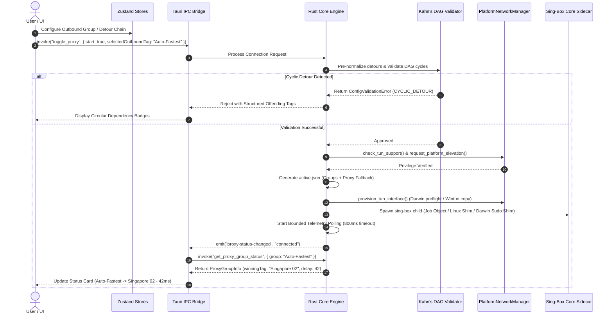

# X-Link v0.8.0 Cross-Platform Desktop & Sing-Box Routing Architecture

* **Author:** Isuruzenith & Claude Code (EGM Architecture Specification)
* **Status:** Approved
* **Date:** 2026-11-03
* **Target Version:** v0.8.0 (Head: `feat/material-web-redesign`)
* **Design Document Path:** `docs/designs/xlink-v0.8.0-stable-architecture.md`

--------------------------------------------------------------------------------

## Overview

X-Link v0.8.0 establishes the production-grade foundation for X-Link across Windows, macOS, and Linux. The release unifies the Material 3 (M3) desktop application shell, delivers reliable operating-system-level TUN mode without running the WebKit GUI as root, exposes sing-box routing primitives (Outbound Groups, 2-hop Detour Chaining, and Rule-to-Group targeting) through progressive disclosure, hardens sidecar process supervision against orphan zombies, bounds live telemetry streams, and updates the Obsidian documentation vault (`docs/00`–`07`) to full parity while introducing `docs/08-User-Guide-and-FAQ.md` with incident recovery runbooks.

--------------------------------------------------------------------------------

## Problem Statement

X-Link currently faces several architectural, platform, and usability limitations:
1. **Platform Couplings & macOS TUN Defect**: The existing TUN implementation hardcodes the Windows interface name `"X-Link"` and Windows registry hooks. On macOS, Darwin kernel requirements (`utun[0-9]+`) fail, and running the GUI elevated via `osascript` causes WebKit sandbox security crashes on macOS 14+ Sonoma and macOS 15+ Sequoia. Furthermore, unprivileged child processes cannot open Darwin kernel control sockets (`PF_SYSTEM` / `SYSPROTO_CONTROL` connecting to `com.apple.net.utun_control`) for dynamic `utun` creation without root privileges (`EUID 0`).
2. **Monolithic Egress Bottleneck**: All proxy nodes are collapsed into a single hardcoded `selector` outbound tagged `"proxy"`. Users cannot configure automated latency-based failover (`urltest`), fallback pools, or load balancing. Furthermore, routing rules cannot direct specific traffic (e.g. streaming, work domains) to specialized proxy groups; non-direct/non-block traffic is unconditionally coerced to `"proxy"`.
3. **Telemetry Saturation & UI Freezes**: Unthrottled 1-second polling of the Clash API (`GET /connections`) creates excessive JSON serialization and garbage collection churn under heavy concurrent connection loads (1,000–5,000 connections), leading to UI frame drops in the Material 3 desktop views.
4. **Documentation & Contract Drift**: Existing documentation in `docs/00`–`07` cites `v0.6.0`, omits 8 newly introduced Tauri IPC commands, and lacks operational failure runbooks for emergency internet recovery and ghost TUN adapter cleanup.

--------------------------------------------------------------------------------

## Goals

* **G-1 (Cross-Platform M3 Shell)**: Deliver a responsive Material 3 desktop UI across Windows, macOS, and Linux with platform-adapted window chrome (macOS traffic light padding of 72px, Windows native controls, Linux CSD/SSD).
* **G-2 (Cross-Platform TUN Parity)**: Support TUN mode natively across Windows (`wintun.dll`), Linux (single-click Polkit `pkexec setcap` GUI prompt without running desktop app as root), and macOS (dynamic `utun` auto-allocation with a scoped `/etc/sudoers.d/xlink-singbox` rule installed once with user consent via `osascript`, enabling passwordless `sudo -n` execution of a root-owned supervisor shim in `/Library/Application Support/X-Link/helpers/` while keeping the Tauri WebKit GUI completely unprivileged). If TUN initiation fails on any platform, present a strict diagnostic error dialog rather than silently degrading connection security.
* **G-3 (Sing-Box Routing Groups)**: Expose `urltest` (latency auto-failover with configurable tolerance), `fallback` (compiled to sing-box `urltest` with hysteresis tolerance), and custom `selector` outbound groups in the UI, allowing routing rules to target persistent Outbound Groups with compile-time referential fallback to `"proxy"`.
* **G-4 (Protected Detour Chaining)**: Support 2-hop detour chaining (Entry Relay -> Exit Node) guarded by compile-time Kahn's Directed Acyclic Graph (DAG) cycle detection and UDP protocol capability checks.
* **G-5 (Telemetry Hardening)**: Replace unthrottled polling with a persistent HTTP client singleton (800ms read timeout), top-100 connections cap, unmount polling pauses, and fixed-capacity native Rust ring buffers (500 entries) for DNS and connection events.
* **G-6 (Enterprise Subsystems)**: Support multi-format subscription parsing (Clash, V2Ray, SIP008 JSON), scheduled auto-updates with randomized jitter, and self-describing v2 backup archives with optional AES-256-GCM encryption and Argon2id key derivation bounded to safe memory limits.
* **G-7 (Documentation Vault Parity)**: Upgrade `docs/00`–`07` to v0.8.0 specification (covering all 46+ IPC commands) and author `docs/08-User-Guide-and-FAQ.md` with plain-English onboarding and SRE failure recovery runbooks.

--------------------------------------------------------------------------------

## Non-Goals

* **NG-1 (Kernel Packet Dissection)**: No raw packet capture, `libpcap` integration, or deep packet inspection. Diagnostics rely strictly on sing-box routing logs, DNS events, and Clash API connection tables.
* **NG-2 (Persistent System Daemons)**: No persistent Session 0 Windows Services or continuous macOS background `launchd` system daemons. Process lifecycle remains strictly scoped to the active user desktop session.
* **NG-3 (Pure-Rust Rewrite)**: The speculative `eframe`/`egui` rewrite remains strictly out-of-scope for v0.8.0. All implementation targets the production Tauri v2 + React 19 architecture.
* **NG-4 (Unbounded Detour Meshes)**: No arbitrary N-hop proxy mesh graphs. Detours are strictly capped at 2 hops (Relay -> Exit).
* **NG-5 (Disaster Recovery Redaction)**: Full cryptographic fidelity (UUIDs, passwords, private keys) is preserved in backup archives. Secret sanitization applies solely to diagnostic support bundles (`export_system_diagnostics`).

--------------------------------------------------------------------------------

## Critical User Journeys (CUJs)

### CUJ 1: One-Click Connection with Automated Lowest Latency Egress
* **Given**: An end-user has imported a remote subscription containing 50 server nodes and configured an Outbound Group named "Auto-Fastest" of type `urltest` with a 10-minute check interval, 50ms hysteresis tolerance, and membership capped at 10 nodes.
* **When**: The user selects "Auto-Fastest" from the primary Dashboard Egress dropdown and clicks the "Connect" switch.
* **Then**: Sing-box launches in user session; `urltest` establishes background latency probes against `https://cp.cloudflare.com/generate_204`; the Rust backend queries `GET /proxies/Auto-Fastest` via the IPC command `get_proxy_group_status("Auto-Fastest")`; the Dashboard status card indicates "Connected (Auto-Fastest -> Singapore 02 - 42ms)"; and overall system traffic routes through the winning node with live bandwidth graphs updating.

### CUJ 2: Cross-Platform TUN Mode Activation on macOS & Linux
* **Given**: A macOS user runs X-Link as a standard non-root desktop application on macOS 15 Sequoia (or a Linux user on Fedora/Ubuntu).
* **When**: The user opens Settings, selects Proxy Mode "TUN", and toggles the connection switch for the first time.
* **Then**: 
  - On macOS: The application prompts a one-time administrator authorization dialog via `osascript` to install `/etc/sudoers.d/xlink-singbox` via an atomic `visudo -c -f` staging pipeline targeting root-owned binaries in `/Library/Application Support/X-Link/helpers/`; future TUN connections spawn the sing-box supervisor via `sudo -n` without password prompts; dynamic `utun` interfaces are allocated cleanly by the kernel; and the Tauri WebKit GUI remains completely unprivileged.
  - On Linux: A Polkit authentication prompt appears once to grant `cap_net_admin,cap_net_bind_service=+ep` directly to the `sing-box` binary via `pkexec setcap`.
  - Failure Condition: If elevation is declined or kernel driver initialization fails, a strict modal dialog details the exact OS error (e.g. `EPERM` or capability missing) with actionable remediation steps, rather than silently downgrading to an unencrypted or browser-only proxy mode.

### CUJ 3: Rule-Based Group Routing with Subscription Auto-Update
* **Given**: The user defines a routing rule directing domain suffix `.netflix.com` to a persistent Outbound Group named "Streaming-Pool". The active subscription undergoes a scheduled background auto-update that renames several underlying nodes.
* **When**: The background scheduler applies the subscription update via `apply_previewed_subscription_refresh`.
* **Then**: Incoming subscription node tags colliding with reserved tags are sanitized (appended with `_node`); the rule targeting "Streaming-Pool" remains completely intact; sing-box config generation prunes invalid node tags from the group; if any group (including `selector`) has all members pruned, it falls back to containing all valid dialable nodes (capped at 10) or `"direct"`, avoiding circular selector dependencies; any node with a deleted `detour` target has its detour stripped gracefully; sing-box config generation resolves all references without error; and streaming traffic continues routing through the pool without connection drops or validation panics.

--------------------------------------------------------------------------------

## Proposed Architecture

### 1. High-Level System Architecture & Component Topology

X-Link maintains a decoupled 3-tier desktop architecture:

```text
+--------------------------------------------------------------------------+
|                     PRESENTATION TIER (WebView Runtime)                  |
|  React 19 + TypeScript + Tailwind CSS v4 + Material Web Components (M3)  |
|  State Stores (8 Zustand Stores): connection, profile, routing, settings |
|  NavRail | DashboardView | ConfigView | RoutingView | ConnectionsView    |
+--------------------------------------------------------------------------+
                                     |
                       Tauri v2 IPC (46+ Commands)
                       Bi-directional Event Streaming
                                     |
+--------------------------------------------------------------------------+
|                      APPLICATION TIER (Rust Backend)                     |
|  Lifecycle Reducer | Config Generator | Transactional Validator (Check)  |
|  Kahn's DAG Cycle Detector | Telemetry Ring Buffers (DNS/Packets: 500)   |
|  Clash API Persistent HTTP Client (800ms timeout, circuit breaker)       |
|  Process Supervisor (Windows Job Object / Linux Shim / Darwin Sudo Shim) |
|  PlatformNetworkManager Trait (Windows / Darwin / Linux drivers)         |
+--------------------------------------------------------------------------+
                                     |
              Subprocess Pipes (stdout/stderr) + Clash REST API
              (PUT /proxies, PUT /configs, GET /connections, DELETE)
                                     |
+--------------------------------------------------------------------------+
|                     NETWORK TIER (Sing-Box Core v1.13.14)                |
|  Inbounds: Mixed (7892), HTTP (7890), SOCKS5 (7891), TUN (utun/wintun)   |
|  Outbounds: Master "proxy" Selector, Outbound Groups (urltest, fallback, |
|             selector), 2-Hop Detours, Direct, Block                      |
|  DNS: FakeIP (198.18.0.0/15) / Direct DNS with Leaks Protection          |
+--------------------------------------------------------------------------+
```

### 2. Platform-Agnostic OS Integration Trait

To prevent platform-specific logic from leaking into `proxy.rs` and `generator.rs`, all OS-level networking is unified under an explicit Rust trait in `src-tauri/src/os/mod.rs`:

```rust
#[derive(Debug, Clone, Serialize, Deserialize, PartialEq, Eq)]
#[serde(rename_all = "camelCase")]
pub enum TunSupportStatus {
    Supported,
    RequiresElevation,
    DriverMissing(String),
    UnsupportedPlatform,
}

#[async_trait]
pub trait PlatformNetworkManager: Send + Sync {
    /// Configures the operating system's system proxy (HTTP/SOCKS).
    async fn configure_system_proxy(&self, port: u16, bypass_local: bool) -> Result<(), String>;
    
    /// Restores the OS system proxy settings to pre-connection state asynchronously.
    async fn restore_system_proxy(&self) -> Result<(), String>;

    /// Synchronous variant for use in Tauri exit/shutdown hooks.
    fn restore_system_proxy_sync(&self) -> Result<(), String>;
    
    /// Validates if TUN privileges and kernel drivers are available.
    async fn check_tun_support(&self) -> Result<TunSupportStatus, String>;
    
    /// Provisions platform-specific TUN prerequisites (validates elevation readiness on Darwin, copies wintun.dll on Windows).
    async fn provision_tun_interface(&self, settings: &TunSettings) -> Result<String, String>;
    
    /// Performs one-time elevation or helper tool installation.
    async fn request_platform_elevation(&self, app_handle: &AppHandle) -> Result<(), String>;

    /// Dynamically discovers host DNS server IP addresses to enforce Invariant 2 (route_exclude_address).
    async fn get_system_dns_servers(&self) -> Result<Vec<std::net::IpAddr>, String>;
}

/// Factory constructor returning the active platform's network manager.
pub fn get_network_manager() -> Box<dyn PlatformNetworkManager> {
    #[cfg(target_os = "windows")]
    return Box::new(windows::WindowsNetworkManager::new());
    #[cfg(target_os = "macos")]
    return Box::new(darwin::DarwinNetworkManager::new());
    #[cfg(target_os = "linux")]
    return Box::new(linux::LinuxNetworkManager::new());
}
```

* **Windows Implementation (`os/windows.rs`)**: Bundles `wintun.dll`, checks elevation via `is_elevated`, uses `WinINet` for system proxy, extracts host adapter DNS servers via `GetAdaptersAddresses`, and attaches the sidecar process to a Windows Job Object configured with `JOB_OBJECT_LIMIT_KILL_ON_JOB_CLOSE`.
* **Linux Implementation (`os/linux.rs`)**:
  - Employs `pkexec setcap cap_net_admin,cap_net_bind_service=+ep` directly on the sidecar binary via a graphical Polkit dialog, eliminating the need to run the GUI as root.
  - **Process Supervision Shim (`xlink-linux-supervisor`)**: Because the Linux kernel unconditionally clears `PR_SET_PDEATHSIG` during `execve` on binaries with file capabilities, Linux sidecar launching employs an unprivileged companion supervisor binary (`xlink-linux-supervisor`) that has no file capabilities. The supervisor sets `PR_SET_PDEATHSIG` (`SIGTERM`), forwards command-line arguments (`run -c <config> -D <data_dir>`) and standard stream descriptors (`stdout`, `stderr`) to the capable `sing-box` binary, and forwards signals.
  - Queries system DNS via `systemd-resolved` DBus or `/etc/resolv.conf`.
* **Darwin Implementation (`os/darwin.rs`)**:
  - Uses dynamic `utun` allocation by omitting the hardcoded `"interface_name"` property from TUN inbound configuration when `cfg!(target_os = "macos")`.
  - **Protected Helper Directory & LPE Containment**: To prevent Local Privilege Escalation (CWE-732), binaries in user-writable application bundles (`/Applications/X-Link.app/...`) must never be granted root privileges in sudoers. During one-time elevation, `request_platform_elevation` copies `xlink-darwin-supervisor` and `sing-box` into a protected, root-owned system directory `/Library/Application Support/X-Link/helpers/` (mode `0755`, owned by `root:wheel`).
  - **Sudoers Staging Pipeline**: Installs a strictly scoped `/private/etc/sudoers.d/xlink-singbox` rule authorizing `%admin ALL=(root) NOPASSWD: /Library/Application\ Support/X-Link/helpers/xlink-darwin-supervisor`. To prevent symlink race attacks (CWE-377/59) and handle clean macOS installs where `/private/etc/sudoers.d` does not exist, the elevation script:
    1. Ensures the target directory exists: `mkdir -p -m 0755 /private/etc/sudoers.d`
    2. Writes a hidden staging file inside the target directory: `/private/etc/sudoers.d/.xlink-singbox.tmp` with mode `0440` (with an active cleanup trap: `trap 'rm -f /private/etc/sudoers.d/.xlink-singbox.tmp' EXIT INT TERM`)
    3. Validates syntax: `visudo -c -f /private/etc/sudoers.d/.xlink-singbox.tmp`
    4. Atomically moves the validated configuration into place: `mv /private/etc/sudoers.d/.xlink-singbox.tmp /private/etc/sudoers.d/xlink-singbox`
  - **Root Supervisor Shim (`xlink-darwin-supervisor`)**: Spawning is initiated via `tokio::process::Command::new("sudo")` with arguments `["-n", "/Library/Application Support/X-Link/helpers/xlink-darwin-supervisor", "run", "-c", config_path, "-D", app_data_dir, "--parent-pid", &std::process::id().to_string()]`, and standard streams configured via `stdin(Stdio::piped())`, `stdout(Stdio::piped())`, and `stderr(Stdio::piped())`. Using `-n` (non-interactive) guarantees that if sudoers authorization is missing, sudo fails immediately rather than blocking on an invisible password prompt. The supervisor binary forwards all trailing CLI arguments to `/Library/Application Support/X-Link/helpers/sing-box`, proxies stdout and stderr pipes back to the Tauri process for telemetry ingestion, and monitors the parent `stdin` pipe (with kernel pipe EOF as primary death detection) and parent PID via `kqueue` `EVFILT_PROC` / `NOTE_EXIT`. When the parent X-Link process exits or drops the pipe on disconnect, the supervisor executes `kill -TERM "$SING_BOX_PID"` with root authority, guaranteeing clean shutdown without orphaned processes.
  - **Startup Orphan Sweep**: If an unprivileged `kill(root_pid, SIGTERM)` returns `EPERM` during startup recovery, X-Link triggers the supervisor cleanup command or surfaces a collision alert directing the user to the triage runbook.
  - Discovers DNS servers via `scutil --dns`.

### 3. Outbound Group Architecture & Topology Compiler

Outbound Groups represent logical routing pools in sing-box (`urltest`, `fallback`, `selector`).

#### TypeScript Data Model (`src/utils/store.ts`)
```typescript
export type OutboundGroupType = 'urltest' | 'fallback' | 'selector';

export interface OutboundGroup {
  id: string;
  tag: string;                  // User-visible unique tag (e.g. "Auto-Fastest")
  type: OutboundGroupType;
  nodes: string[];              // Node tags included in this group (capped at 10 for automated pools)
  url?: string;                 // Health-check target (default: https://cp.cloudflare.com/generate_204)
  interval?: string;            // Health-check interval (floor: "300s", default: "600s")
  tolerance?: number;           // Latency delta threshold in ms (urltest only, e.g. 50ms)
}

export type OutboundAction = 'proxy' | 'direct' | 'block' | 'dns' | (string & {});

export type TunSupportStatus =
  | 'supported'
  | 'requiresElevation'
  | { driverMissing: string }
  | 'unsupportedPlatform';

export interface BackupKdfParams {
  algorithm: string;
  salt: string;
  iterations: number;
  memoryCost: number;
  parallelism?: number;         // Enforced to 1 across all platforms
}

export interface ConfigValidationError {
  code: string;
  offendingTags: string[];
  cyclePath: string[];
  message: string;
}

export interface BackupArchiveEnvelope {
  format: string;
  version: number;
  encryption: 'aes-256-gcm' | 'none';
  kdf?: BackupKdfParams;
  nonce?: string;
  tag?: string;
  payload: string;
}

export interface BackupValidationResult {
  valid: boolean;
  isValid?: boolean;
  schemaVersion: number;
  appVersion?: string;
  exportedAt?: number;
  profileCount?: number;
  profileNames?: string[];
  hasSettings?: boolean;
  ruleCount?: number;
  ruleSetCount?: number;
  encryption?: 'aes-256-gcm' | 'none';
  requiresPassphrase?: boolean;
  error?: string;
}

export interface DnsLogEntry {
  timestamp: number;
  domain: string;
  qtype: string;
  answers: string[];
  elapsedMs: number;
}

export interface TraceEntry {
  timestamp: number;
  inbound: string;
  outbound: string;
  rule?: string;
  destination: string;
}

export interface DiagnosticTracesPayload {
  dnsQueries: DnsLogEntry[];
  traces: TraceEntry[];
}

export interface ConnectionMetadata {
  network: string;
  type: string;
  sourceIP: string;
  sourcePort: string;
  destinationIP: string;
  destinationPort: string;
  host: string;
}

export interface ActiveConnection {
  id: string;
  metadata: ConnectionMetadata;
  upload: number;
  download: number;
  start: string;
  chains: string[];
  rule: string;
  upSpeed?: number;
  downSpeed?: number;
}

export interface ConnectionsPayload {
  downloadTotal: number;
  uploadTotal: number;
  totalConnections: number;
  connections: ActiveConnection[];
}

export interface ProxyGroupInfo {
  group: string;
  winningTag: string;
  delay?: number;
}
```

#### Rust Data Model (`src-tauri/src/config/rules.rs` & `generator.rs`)
```rust
#[derive(Debug, Clone, Serialize, Deserialize, PartialEq, Eq)]
#[serde(rename_all = "lowercase")]
pub enum OutboundGroupType {
    Urltest,
    Fallback,
    Selector,
}

#[derive(Debug, Clone, Serialize, Deserialize)]
#[serde(rename_all = "camelCase")]
pub struct OutboundGroup {
    pub id: String,
    pub tag: String,
    pub r#type: OutboundGroupType,
    pub nodes: Vec<String>,
    #[serde(default, skip_serializing_if = "Option::is_none")]
    pub url: Option<String>,
    #[serde(default, skip_serializing_if = "Option::is_none")]
    pub interval: Option<String>,
    #[serde(default, skip_serializing_if = "Option::is_none")]
    pub tolerance: Option<u32>,
}
```

#### Compilation & Referential Fallback (`src-tauri/src/config/generator.rs`)
1. **Sing-Box Primitive Mapping**:
   - `urltest`: Emitted as `{"type": "urltest", "tag": tag, "outbounds": valid_nodes, "url": url, "interval": interval, "tolerance": tolerance}`. If `interval` is empty or None, inject default `"600s"` explicitly to prevent sing-box internal 180s fallback.
   - `fallback`: Because sing-box v1.13 lacks priority-ordered fallback outbounds, `fallback` is compiled as `{"type": "urltest", ...}` with a default hysteresis tolerance (50ms) to provide reliable latency-tested failover while preventing rapid route flapping.
   - `selector`: Emitted as standard sing-box `{"type": "selector", "tag": tag, "outbounds": valid_nodes}`.
2. **Master Root Selector**: A root selector tagged `"proxy"` is always emitted containing all user-defined Outbound Group tags prepended to all individual dialable node tags (`[group_tags..., node_tags...]`). Because sing-box selectors natively permit nested outbound groups, including group tags ensures that when an Outbound Group (such as `"Auto-Fastest"`) is selected as primary egress, setting `"default": "Auto-Fastest"` on `"proxy"` passes sing-box schema validation without rejection (`outbound[0].default not found`), enables Clash API hot-switching via `PUT /proxies/proxy`, and preserves backward compatibility with single-node workflows and tray menus.
3. **Reserved Namespace & Tag Sanitization**:
   - User-defined Outbound Group tags cannot match reserved system tags: `["proxy", "direct", "block", "dns"]`.
   - Outbound Group tags must be globally unique and cannot collide with existing proxy node tags in the active profile.
   - Incoming remote subscription node tags that collide with reserved tags are automatically appended with `_node` during subscription refresh.
4. **Group Membership Pruning & Referential Fallback**:
   - When compiling each `OutboundGroup`, its `nodes` list is filtered against the active profile's valid outbound tags. Any pruned or renamed tags are discarded.
   - **Dialable Node Fallback**: Sing-box schemas reject empty outbound arrays (`outbounds: []`), and `urltest` strictly forbids nested outbound groups within its `outbounds` array. If any Outbound Group (`urltest`, `fallback`, or `selector`) has all member nodes pruned, the compiler populates the group with valid dialable node tags from the active profile (capped at the first 10 nodes for automated pools: `.into_iter().take(10)`). If no dialable nodes exist, the group is dynamically emitted as a `selector` pointing to `["direct"]`, avoiding circular selector dependencies.
   - If a routing rule targets a missing or deleted Outbound Group, the compiler logs a warning and rewrites the rule destination to the root `"proxy"` selector.
5. **Group Size & Interval Constraints**:
   - Automated pools (`urltest`, `fallback`) are capped at a maximum of 10 nodes to preserve battery life and prevent excessive bandwidth consumption.
   - Health-check intervals enforce a strict minimum floor of 300 seconds (`300s`) with zero UI bypass.

### 4. Multi-Hop Detour Chaining with Compile-Time DAG Validation

Detour chaining allows an outbound connection to traverse an intermediary node before reaching the destination (e.g., `Local -> Middle Relay -> Exit Proxy -> Internet`).

#### Constraints & Guardrails
* **2-Hop Cap**: Detour depth is capped at 2 hops (Relay -> Exit). The `detour` field on a node may only reference a primary node, never an outbound group or a node that already detours to another node.
* **Protocol Compatibility**: Nodes utilizing UDP-dependent protocols (such as TUIC and Hysteria2) cannot detour through TCP-only HTTP proxies.
* **Pre-Validation Detour Normalization**: Before executing Kahn's DAG cycle detection, the compiler normalizes detour references: if a node's `detour` references a non-existent or pruned tag, the compiler strips the `detour` property (falling back to direct connection for that node), logs a warning, and surfaces a diagnostic notification.
* **Kahn's Algorithm DAG Cycle Check**:
```rust
#[derive(Serialize, Deserialize, Debug)]
#[serde(rename_all = "camelCase")]
pub struct ConfigValidationError {
    pub code: String,          // "CYCLIC_DETOUR"
    pub offending_tags: Vec<String>,
    pub cycle_path: Vec<String>,
    pub message: String,
}

pub fn validate_detour_graph(
    nodes: &[crate::config::adapters::SingBoxOutbound],
    groups: &[crate::config::rules::OutboundGroup],
) -> Result<(), ConfigValidationError>;
```
*Note: `validate_detour_graph` executes on the normalized nodes slice after pre-validation normalization has stripped dangling detour references, ensuring Kahn's algorithm operates on sound topological edges.*

### 5. Telemetry Bounding & Clash API Telemetry Engine

To prevent UI thread stutter and memory bloat from high-frequency polling:
1. **Persistent Client Singleton**: All Clash API communications (`GET /connections`, `PUT /proxies`, `GET /proxies/{group}`) share a single, lazily initialized `reqwest::Client` stored in `ProxyState`, configured with connection pooling and an 800ms read timeout.
2. **View-Gated Polling**: In `ConnectionsView.tsx`, the polling loop is active only while the component is mounted and the document is visible (`document.visibilityState === "visible"`). Unmounting or window minimization halts polling immediately.
3. **Top-100 Connection Windowing & Bidirectional Rate Tracking**: The Rust backend calculates instantaneous transfer rates using previous connection byte counters (`prev_connection_bytes` in `ProxyState`), sorts active connections by throughput, and transfers only the top 100 connections across the Tauri IPC boundary while maintaining aggregate envelope totals.
4. **Memory Leak Prevention (Map Pruning)**: During each polling cycle, `prev_connection_bytes` is pruned by retaining only connection IDs currently present in the latest Clash response (`prev_connection_bytes.retain(|id, _| current_ids.contains(id))`), preventing memory bloat from closed sockets.
5. **Native Ring Buffering & Stdout Log Ingestion**: Diagnostic streams (DNS resolutions and routing traces) are parsed from sing-box stdout log lines in `proxy.rs` (e.g. `[dns] exchanged ...` and `[router] match ...`) and stored in fixed-capacity ring buffers (`VecDeque`, maximum 500 records each) inside Rust `ProxyState`. To ensure routing rule match events are emitted to stdout, sing-box is configured with log level `"debug"` (`"log": { "level": "debug", "timestamp": true }`). Diagnostic records are exposed to the frontend via the `get_diagnostic_traces` IPC command and included in the `DiagnosticsReport` payload via `export_system_diagnostics`.
6. **Circuit Breaker**: If 3 consecutive polling calls time out or fail, the polling loop pauses for 10 seconds and surfaces a non-blocking "Telemetry Suspended" indicator in the UI.
7. **Virtualized Table Rendering**: `ConnectionsView.tsx` uses `react-window` for virtualized list rendering, ensuring consistent 60 FPS scrolling even with rapid telemetry refreshes.

#### Telemetry & State Structs (`src-tauri/src/state.rs`)
```rust
#[derive(Debug, Clone, Serialize, Deserialize)]
#[serde(rename_all = "camelCase")]
pub struct DnsLogEntry {
    pub timestamp: u64,
    pub domain: String,
    pub qtype: String,
    pub answers: Vec<String>,
    pub elapsed_ms: u32,
}

#[derive(Debug, Clone, Serialize, Deserialize)]
#[serde(rename_all = "camelCase")]
pub struct TraceEntry {
    pub timestamp: u64,
    pub inbound: String,
    pub outbound: String,
    pub rule: Option<String>,
    pub destination: String,
}

#[derive(Debug, Clone)]
pub struct ConnectionByteSnapshot {
    pub upload: u64,
    pub download: u64,
    pub recorded_at: std::time::Instant,
}

#[derive(Debug, Clone, Serialize, Deserialize, Default)]
#[serde(rename_all = "camelCase")]
pub struct ConnectionMetadata {
    pub network: String,
    pub r#type: String,
    #[serde(rename = "sourceIP", alias = "sourceIp", default)]
    pub source_ip: String,
    #[serde(default)]
    pub source_port: String,
    #[serde(rename = "destinationIP", alias = "destinationIp", default)]
    pub destination_ip: String,
    #[serde(default)]
    pub destination_port: String,
    #[serde(default)]
    pub host: String,
}

#[derive(Debug, Clone, Serialize, Deserialize)]
#[serde(rename_all = "camelCase")]
pub struct ActiveConnection {
    pub id: String,
    pub metadata: ConnectionMetadata,
    pub upload: u64,
    pub download: u64,
    pub start: String,
    pub chains: Vec<String>,
    pub rule: String,
    #[serde(skip_serializing_if = "Option::is_none")]
    pub up_speed: Option<u64>,
    #[serde(skip_serializing_if = "Option::is_none")]
    pub down_speed: Option<u64>,
}

#[derive(Debug, Clone, Serialize, Deserialize)]
#[serde(rename_all = "camelCase")]
pub struct ConnectionsPayload {
    pub download_total: u64,
    pub upload_total: u64,
    pub total_connections: usize,
    pub connections: Vec<ActiveConnection>,
}

#[derive(Debug, Clone, Serialize, Deserialize)]
#[serde(rename_all = "camelCase")]
pub struct ProxyGroupInfo {
    pub group: String,
    pub winning_tag: String,
    pub delay: Option<u32>,
}

#[derive(Debug, Clone, Serialize, Deserialize)]
#[serde(rename_all = "camelCase")]
pub struct DiagnosticTracesPayload {
    pub dns_queries: Vec<DnsLogEntry>,
    pub traces: Vec<TraceEntry>,
}
```

### 6. Process Supervision & Zombie Prevention

To eliminate orphaned sidecar processes holding ports after ungraceful crashes:
1. **OS-Level Parent Death Binding**:
   - Windows: Every spawned sing-box process is assigned to a Windows Job Object with `JOB_OBJECT_LIMIT_KILL_ON_JOB_CLOSE`. When X-Link terminates or crashes, the Windows kernel terminates sing-box immediately.
   - Linux: Spawning is handled via the dedicated unprivileged companion supervisor binary `xlink-linux-supervisor` that sets `PR_SET_PDEATHSIG` to `SIGTERM` before executing the capable `sing-box` binary, proxying stdout/stderr descriptors.
   - Darwin: Managed via `tokio::process::Command::new("sudo")` with `args(["-n", ...])` targeting `/Library/Application Support/X-Link/helpers/xlink-darwin-supervisor` with `stdin` lifecycle heartbeat pipe, and `stdout`/`stderr` pipes streaming sing-box log lines for telemetry.
2. **Sidecar Process Representation in State**:
```rust
pub enum SidecarChild {
    Shell(tauri_plugin_shell::process::CommandChild),
    Tokio(tokio::process::Child),
}

impl SidecarChild {
    pub fn pid(&self) -> Option<u32> {
        match self {
            Self::Shell(child) => Some(child.pid()),
            Self::Tokio(child) => child.id(),
        }
    }

    pub fn kill(mut self) -> Result<(), String> {
        match self {
            Self::Shell(child) => child.kill().map_err(|e| e.to_string()),
            Self::Tokio(mut child) => {
                // Dropping stdin delivers EOF to the root/companion supervisor, which cleanly sends SIGTERM to sing-box
                if let Some(stdin) = child.stdin.take() {
                    drop(stdin);
                } else {
                    let _ = child.start_kill();
                }
                Ok(())
            }
        }
    }
}

#[derive(Debug, Clone, Serialize, Deserialize)]
#[serde(rename_all = "camelCase")]
pub struct SidecarSession {
    pub pid: u32,
    pub session_id: String,
    pub proxy_mode: String, // "system" | "tun"
    pub api_port: u16,
    pub started_at: u64,
}
```
3. **Atomic Session Metadata File**: Upon process launch, X-Link atomically writes `sidecar.session.json` to the app data directory containing `SidecarSession`.
4. **Startup Orphan Sweep & System Proxy Recovery**:
   - During app initialization (`src-tauri/src/lib.rs`), X-Link checks for an existing `sidecar.session.json`.
   - If `proxyMode == "system"`, X-Link automatically invokes `restore_system_proxy_sync()` before initializing listeners, restoring host internet connectivity without manual user intervention.
   - Pre-flight checks verify configured ports (`settings.mixed_port`, `settings.http_port`, `settings.socks_port`, `settings.api_port`). If occupied, X-Link terminates verified matching PIDs. If termination fails (e.g. `EPERM` on Darwin root processes) and ports remain held, it surfaces an actionable port collision dialog pointing to the emergency triage runbook.
   - Upon completion of the startup orphan sweep and recovery sequence, `sidecar.session.json` is explicitly removed from disk only after all occupied ports are confirmed free and orphan termination succeeds. If port conflicts persist, retain the session file to facilitate troubleshooting via `docs/08-User-Guide-and-FAQ.md`.

### 7. Schema Evolution & Encrypted Backup Subsystem

#### Storage Schema Evolution (v3)
* Configuration files (`settings.json`, `profiles.json`, `routing.json`) increment schema version to `_schemaVersion: 3`.
* `src/utils/store.ts` sets `_schemaVersion` dynamically via `CONFIG_SCHEMA_VERSION` imported from `migrate.ts` (preventing version regression on save).
* `routing.json` stores the `"outboundGroups"` array.
* Frontend `migrateStores()` runs on boot and executes an atomic store reload before mounting views.
* All Rust deserialization models include `#[serde(default)]` on new fields to prevent deserialization errors during headless launches.

#### Self-Describing Backup Envelope (`backup.rs`)
```json
{
  "format": "x-link-backup",
  "version": 2,
  "encryption": "aes-256-gcm",
  "kdf": {
    "algorithm": "argon2id",
    "salt": "base64...",
    "iterations": 3,
    "memoryCost": 65536
  },
  "nonce": "base64...",
  "tag": "base64...",
  "payload": "base64-ciphertext..."
}
```

```rust
#[derive(Serialize, Deserialize, Clone, Debug)]
#[serde(rename_all = "camelCase")]
pub struct BackupKdfParams {
    pub algorithm: String,
    pub salt: String,
    pub iterations: u32,
    pub memory_cost: u32,
    #[serde(default, skip_serializing_if = "Option::is_none")]
    pub parallelism: Option<u32>,
}

#[derive(Serialize, Deserialize, Clone, Debug)]
#[serde(rename_all = "camelCase")]
pub struct BackupArchiveEnvelope {
    pub format: String,
    pub version: u32,
    pub encryption: String, // "aes-256-gcm" | "none"
    #[serde(default, skip_serializing_if = "Option::is_none")]
    pub kdf: Option<BackupKdfParams>,
    #[serde(default, skip_serializing_if = "Option::is_none")]
    pub nonce: Option<String>,
    #[serde(default, skip_serializing_if = "Option::is_none")]
    pub tag: Option<String>,
    pub payload: String,
}

#[derive(Serialize, Deserialize, Clone, Debug)]
#[serde(rename_all = "camelCase")]
pub struct BackupValidationResult {
    #[serde(rename = "valid", alias = "isValid")]
    pub valid: bool,
    pub schema_version: u32,
    pub app_version: Option<String>,
    pub exported_at: Option<u64>,
    pub profile_count: Option<usize>,
    pub profile_names: Option<Vec<String>>,
    pub has_settings: Option<bool>,
    pub rule_count: Option<usize>,
    pub rule_set_count: Option<usize>,
    pub encryption: Option<String>,
    pub requires_passphrase: Option<bool>,
    pub error: Option<String>,
}
```
* **Cryptographic Parameter Bounds**: When `encryption == "aes-256-gcm"`, `validate_backup_archive` enforces strict upper and lower bounds on untrusted archive parameters to prevent Denial-of-Service and Out-of-Memory attacks:
  - `1024 KiB <= memoryCost <= 65536 KiB (64 MiB)`
  - `1 <= iterations <= 10`
  - Salt length $\ge 16$ bytes (>= 16 bytes)
  - Decoded Nonce length $== 12$ bytes, Tag length $== 16$ bytes
  - Argon2id parallelism strictly enforced to `1` across all platforms
  - Assert `kdf.algorithm == "argon2id"` and `encryption == "aes-256-gcm"`
* **Backward Compatibility**: `validate_backup_archive` detects whether the input is legacy unencrypted JSON (nested `metadata.schemaVersion == 1`) or envelope v2 (root `version == 2`), prompting for a passphrase only when `encryption == "aes-256-gcm"`. For unencrypted v2 archives (`encryption == "none"`), cryptographic parameters (`kdf`, `nonce`, `tag`) are omitted/None and payload contains base64-encoded unencrypted JSON.
* **State Preservation & Concurrency Lock Ordering on Import**: If the proxy is running, `import_config_backup` performs a clean proxy disconnect *prior* to acquiring configuration and connection locks (`_connection_lock`), preventing lock-ordering deadlocks with `toggle_proxy` while ensuring the sidecar is not actively reading configurations being overwritten on disk.
* **Dual-Store Synchronization (Invariant 3)**: Upon successful restoration, the backend emits a `config-backup-restored` Tauri event. All frontend Zustand stores listen and trigger `storeHelper.reload*()` to synchronize disk state with in-memory stores.

### 8. End-to-End Data Flow Sequence Diagram



--------------------------------------------------------------------------------

## Risks & Mitigations

| Risk / Failure Mode | Severity | Impact | Mitigation Strategy |
| :--- | :---: | :--- | :--- |
| **macOS Elevation Rejection** | High | User declines administrative `osascript` authorization prompt for `/etc/sudoers.d/xlink-singbox`. | Surface a structured modal explaining why TUN requires elevated driver access. Offer one-click fallback to System Proxy mode (which requires no root elevation). Never silently downgrade security. |
| **Sudoers Syntax Corruption & LPE on Darwin** | Critical | Syntax error in `/etc/sudoers.d/` locks users out of `sudo` system-wide, or authorizing user-writable app bundle binaries enables Local Privilege Escalation (LPE). | Never authorize app bundle paths in sudoers; copy binaries to root-owned `/Library/Application Support/X-Link/helpers/` (mode `0755`). Never stage in `/private/tmp` (CWE-377). Create `/private/etc/sudoers.d` (`0755`), stage as hidden dotfile `/private/etc/sudoers.d/.xlink-singbox.tmp` (`0440`), validate via `visudo -c -f`, and execute atomic `mv`. |
| **Detour Relay Offline or UDP Mismatch** | High | The middle relay node goes offline, or an exit node using UDP (TUIC/Hysteria2) detours through a TCP-only relay. | Perform compile-time transport compatibility checks in `validator.rs`. At runtime, if a detour fails to establish within 5s, sing-box logs an error; X-Link surfaces an actionable diagnostic toast. If a detour target is pruned by subscription updates, strip `detour` gracefully before validation. |
| **PID Recycling Collision on Orphan Sweep** | Medium | A stale PID recorded in `sidecar.session.json` is re-assigned by the OS to an unrelated process after an unexpected crash. | Before issuing process termination, inspect the target process's binary image path and verify it matches the bundled `sing-box` binary. Never kill arbitrary processes solely by PID. |
| **Host Internet Loss on Ungraceful Crash** | High | X-Link crashes while System Proxy is active, leaving Windows WinINet or macOS network setup pointing to `127.0.0.1:7890`. | App startup hook in `src-tauri/src/lib.rs` detects prior crash in `sidecar.session.json` (`proxyMode == "system"`) and automatically invokes `restore_system_proxy_sync()`. In addition, `docs/08-User-Guide-and-FAQ.md` includes an emergency one-click cleanup batch/shell script. |
| **Clash API Telemetry Starvation** | Medium | User opens heavy torrent/streaming session (5,000+ sockets), causing Clash API JSON payloads to saturate CPU and memory. | Persistent `reqwest::Client` with 800ms read timeout; top-100 connection sorting in Rust; virtualized rendering (`react-window`); prune closed connection IDs in `prev_connection_bytes` each cycle; circuit breaker pauses polling for 10s if 3 consecutive polls fail. |
| **Argon2id Memory Exhaustion (OOM Attack)** | High | A malicious or corrupted backup archive specifies an extreme `memoryCost` (e.g. 16 GiB), exhausting system RAM upon passphrase entry. | Enforce strict upper and lower bounds during archive validation: `1024 KiB <= memoryCost <= 65536 KiB (64 MiB)`, `1 <= iterations <= 10`, salt $\ge 16$ bytes. Reject out-of-bounds archives immediately. |
| **Dual-Store Desynchronization on Restore** | Medium | Importing a backup writes JSON to disk, but in-memory Zustand caches remain stale; subsequent UI edits overwrite restored data. | Backend emits `config-backup-restored` event upon successful file write. Frontend listens and triggers `storeHelper.reload*()` across all stores before unblocking UI. Clean disconnect before overwriting disk. |

--------------------------------------------------------------------------------

## Alternatives Considered

### Alternative A: Persistent Privileged System Daemon (`launchd` / Windows Service)

* **Pros**: 
  - Allows sing-box to operate in the background even if the GUI is terminated or restarted.
  - Avoids user elevation prompts entirely after initial daemon setup.
* **Cons**:
  - Breaks Invariant 4 (`Ownership-Scoped Process Control`) which relies on pipes to capture stdout/stderr directly into `ProxyState.log_buffer`.
  - Requires Apple Developer Team ID signing and notarization for `SMAppService` / `SMJobBless` privileged helpers on macOS.
  - Creates cross-user file permission collisions when the root daemon attempts to read configurations in user application support directories.
  - Leaves unmanaged network listeners running if the application uninstallation is incomplete.
* **Reason for Rejection**: Rejected in favor of scoped child process elevation (Windows `wintun.dll` + Job Objects, Linux `pkexec setcap` + `xlink-linux-supervisor`, and Darwin dynamic `utun` with protected `/etc/sudoers.d/xlink-singbox` and root supervisor shim in `/Library/Application Support/X-Link/helpers/`). This keeps process supervision directly within the user session and preserves pipe-based stream logging without running the WebKit GUI as root.

### Alternative B: Direct Rule-to-Node Tag Binding

* **Pros**:
  - Allows power users to assign individual proxy nodes directly to specific routing rules (e.g., routing `domain:github.com` strictly to `US-Node-01`).
* **Cons**:
  - High referential fragility: subscription providers frequently rename, reorder, or purge node tags on remote updates.
  - When a referenced node disappears, sing-box configuration validation rejects `active.json` with `outbound not found`, breaking the entire connection and triggering self-healing rollbacks.
* **Reason for Rejection**: Rejected in favor of Outbound Group indirection. Routing rules target persistent Outbound Groups (or built-in actions). If an Outbound Group becomes unavailable, the compiler safely falls back to the master `"proxy"` selector without crashing the sidecar.

### Alternative C: Unconstrained Arbitrary Detour Mesh Routing

* **Pros**:
  - Permits complex multi-hop proxy chains across arbitrary numbers of relays (e.g. Node A -> Node B -> Node C -> Node D).
* **Cons**:
  - Severe risk of circular dependencies ($A \to B \to A$) causing infinite dial loops or Go runtime panics at startup.
  - Exponentially higher latency and connection failure probabilities, with opaque diagnostic attribution when an intermediate hop fails.
  - Unchecked protocol mismatches (e.g., detouring UDP-dependent TUIC over TCP-only HTTP proxies).
* **Reason for Rejection**: Rejected in favor of 2-hop detour chains (Relay -> Exit) enforced by compile-time Kahn's Directed Acyclic Graph (DAG) cycle validation and protocol compatibility checks.

### Alternative D: Indefinite Plaintext Backup Format

* **Pros**:
  - Extremely simple to serialize and deserialize.
  - Allows users to inspect and manually edit backup files in any text editor.
* **Cons**:
  - Exposes private proxy credentials, passwords, WireGuard private keys, and subscription URLs in plaintext on disk.
  - Poses significant security and privacy risks if backup files are shared for troubleshooting or stored on unencrypted cloud drives.
* **Reason for Rejection**: Rejected in favor of a backward-compatible self-describing v2 envelope supporting optional AES-256-GCM encryption with Argon2id key derivation, while maintaining seamless import support for legacy v1 unencrypted archives.

### Alternative E: Low-Level Packet Capture & Deep Packet Inspection

* **Pros**:
  - Provides raw packet-level tracing similar to Wireshark or Proxyman.
* **Cons**:
  - Requires bundling native C libraries (`libpcap`, `WinPcap`) or kernel drivers.
  - Introduces substantial CPU overhead, memory consumption, and potential operating system kernel panics.
* **Reason for Rejection**: Rejected as an over-engineered non-goal. Application-layer connection inspection via the Clash REST API (`/connections`), sing-box DNS logs, and the static `simulate_routing` tool fully satisfy diagnostic requirements without kernel drivers.

--------------------------------------------------------------------------------

## Non-Functional Requirements

### 1. Security & Privacy
* **Secret Sanitization in Diagnostics**: `export_system_diagnostics` strictly sanitizes passwords, private keys, UUIDs, and bearer tokens with `[REDACTED]`. Sensitive query strings in packet logs are stripped before packaging.
* **Disaster Recovery Fidelity**: Full cryptographic fidelity is preserved in encrypted configuration backups (`export_config_backup`).
* **Unprivileged GUI Execution**: The Tauri/WebKit desktop user interface runs strictly as a standard unprivileged user on Windows, macOS, and Linux. No WebKit process executes as root.
* **SSRF Mitigation**: Remote subscription fetching retains strict private IP range, link-local, and loopback filtering to prevent Server-Side Request Forgery attacks against internal network infrastructure.

### 2. Performance & Resource Budgets
* **Telemetry Throttling**: Clash API polling is capped at top 100 active connections with an 800ms timeout. Ring buffers for DNS records and traces are capped at 500 items in native memory.
* **UI Responsiveness**: High-frequency telemetry updates use atomic Zustand selectors and virtualized lists (`react-window`), maintaining 60 FPS scrolling in the Material 3 UI shell.
* **Memory Footprint**: Background memory consumption of the Tauri desktop shell must remain under 120 MB RAM during continuous operation.

### 3. Reliability & SRE Safety
* **Parent Death Termination**: Windows Job Objects, Linux supervisor binary (`xlink-linux-supervisor`) with `PR_SET_PDEATHSIG`, and Darwin root supervisor binary (`xlink-darwin-supervisor`) with stdin heartbeat and process tracking guarantee that unexpected UI crashes terminate sing-box immediately, preventing orphaned zombie processes.
* **Pre-Flight Startup Cleanups**: Startup routines dynamically verify configured ports (`settings.mixed_port`, `settings.http_port`, `settings.socks_port`, `settings.api_port`), terminating any verified stale recorded PID from previous ungraceful sessions before launching new sidecars. Stale session files (`sidecar.session.json`) are cleared upon sweep completion.
* **Dynamic DNS Routing Invariant**: `PlatformNetworkManager::get_system_dns_servers` provides host DNS addresses dynamically to populate `route_exclude_address`, preventing recursive DNS routing loops in TUN mode.
* **Architectural Invariants Parity**: All architectural guarantees rigorously preserve Invariants 1 through 7 defined in `docs/07-AI-Agent-Playbook.md`.

--------------------------------------------------------------------------------

## Detailed Implementation Plan

The implementation plan is structured into 4 sequential, compilable phases to ensure continuous buildability, testability, and clear rollback boundaries.

### Phase 1: Backend Trait & OS Subsystems

#### 1. `src-tauri/Cargo.toml` & `src-tauri/tauri.conf.json` (Modify)
* **Scope**: Dependency Management & Binary Packaging
* **Changes**:
  - In `Cargo.toml`, add cryptographic, concurrency, and serialization crates:
    - `aes-gcm = "0.10"`
    - `argon2 = "0.5"`
    - `async-trait = "0.1"`
  - Under `target.'cfg(target_os = "windows")'.dependencies.windows`, append `"Win32_System_JobObjects"` to the feature list.
  - Declare primary desktop binary target explicitly alongside companion supervisor targets (retaining `src/main.rs` auto-discovery):
    ```toml
    [[bin]]
    name = "xlink"
    path = "src/main.rs"

    [[bin]]
    name = "xlink-darwin-supervisor"
    path = "src/bin/xlink-darwin-supervisor.rs"

    [[bin]]
    name = "xlink-linux-supervisor"
    path = "src/bin/xlink-linux-supervisor.rs"
    ```
  - In `src-tauri/tauri.conf.json`, declare supervisor binaries under `bundle.resources` (e.g. `"resources": ["target/release/xlink-*-supervisor*"]`) so they are packaged into application bundles and installers across platforms.

#### 2. `src-tauri/src/bin/xlink-darwin-supervisor.rs` (Create)
* **Scope**: macOS Root Process Supervisor Binary
* **Changes**:
  - Implement standalone binary guarded by `#[cfg(target_os = "macos")]` (with empty `fn main() {}` stub under `#[cfg(not(target_os = "macos"))]` to guarantee clean `cargo check --all-targets` compilation on Windows and Linux).
  - Resolve `sing-box` binary target: inspect `std::env::current_exe()?.parent()` first, falling back to `/Library/Application Support/X-Link/helpers/sing-box`.
  - Forward command-line arguments (`run -c <config> -D <data_dir>`) directly to `/Library/Application Support/X-Link/helpers/sing-box`.
  - Pipe standard descriptors (`stdout`, `stderr`), proxying log streams directly to inherited process descriptors for parent telemetry parsing.
  - Monitor parent `stdin` pipe for EOF (as the primary termination trigger across the `sudo` boundary) and parent PID via `kqueue` `EVFILT_PROC` / `NOTE_EXIT`. If `kevent` returns `ESRCH` during parent PID registration, treat this as immediate parent termination, aborting execution immediately without launching `sing-box`.
  - Upon parent exit or `stdin` closure, forward `libc::kill(child_pid, libc::SIGTERM)` to sing-box with root authority, wait up to 3 seconds for child exit, and escalate to `libc::SIGKILL` if the child remains active.

#### 3. `src-tauri/src/bin/xlink-linux-supervisor.rs` (Create)
* **Scope**: Linux Unprivileged Companion Supervisor Binary
* **Changes**:
  - Implement standalone binary guarded by `#[cfg(target_os = "linux")]` (with empty `fn main() {}` stub under `#[cfg(not(target_os = "linux"))]` for Windows/macOS target compilation).
  - Resolve `sing-box` sibling binary via `std::env::current_exe()?.parent().unwrap().join("sing-box")`.
  - Invoke `libc::prctl(libc::PR_SET_PDEATHSIG, libc::SIGTERM)` before spawning the capable `sing-box` binary.
  - Install signal handler for `SIGTERM` and `SIGINT` (using `tokio::signal::unix` or `signal-hook`) to trap `PDEATHSIG` and parent termination.
  - Forward command-line arguments and standard output/error descriptors.
  - Monitor `stdin` for EOF, catching parent termination and forwarding `SIGTERM` to `sing-box`. Wait up to 3 seconds for child exit before escalating to `SIGKILL`.
  - Await child exit and reap processes via non-blocking `waitpid(-1, &mut status, libc::WNOHANG)` loop upon `SIGCHLD`.

#### 4. `src-tauri/src/os/mod.rs` (Modify)
* **Scope**: Rust Backend OS Abstraction
* **Changes**:
  - Define `TunSupportStatus` enum and `PlatformNetworkManager` trait with async methods and `restore_system_proxy_sync`.
  - Implement `pub fn get_network_manager() -> Box<dyn PlatformNetworkManager>` factory function.
  - Retain legacy standalone functions (`enable_system_proxy`, `disable_system_proxy`, `is_elevated`, `is_system_proxy_owned`) as thin backward-compatible delegates to `get_network_manager()` to preserve intermediate buildability across phases.
  - Conditionally export platform modules (`windows`, `darwin`, `linux`).

#### 5. `src-tauri/src/os/windows.rs` (Create)
* **Scope**: Windows Platform Implementation
* **Changes**: Implement `PlatformNetworkManager` using `WinINet` APIs, `wintun.dll` driver copying, DNS discovery via `GetAdaptersAddresses`, and Windows Job Object assignment with `JOB_OBJECT_LIMIT_KILL_ON_JOB_CLOSE`.

#### 6. `src-tauri/src/os/darwin.rs` (Create)
* **Scope**: macOS Platform Implementation
* **Changes**: Implement `PlatformNetworkManager` for Darwin:
  - Protected helper directory: `request_platform_elevation` copies `xlink-darwin-supervisor` and `sing-box` into `/Library/Application Support/X-Link/helpers/` (mode `0755`, owned by `root:wheel`), preventing LPE (CWE-732). Source binaries are resolved from `std::env::current_exe()?.parent()` falling back to `app_handle.path().resolve("resources/...", BaseDirectory::Resource)`.
  - Staging pipeline: ensure `/private/etc/sudoers.d` exists (`mkdir -p -m 0755`), write hidden staging file `/private/etc/sudoers.d/.xlink-singbox.tmp` with `0440` permissions authorizing `%admin ALL=(root) NOPASSWD: /Library/Application\ Support/X-Link/helpers/xlink-darwin-supervisor`, validate via `visudo -c -f /private/etc/sudoers.d/.xlink-singbox.tmp`, and atomically move to `/private/etc/sudoers.d/xlink-singbox` (with an active cleanup trap: `trap 'rm -f /private/etc/sudoers.d/.xlink-singbox.tmp' EXIT INT TERM`).
  - Discover host DNS servers via `scutil --dns`.
  - Implement companion spawning function:
    ```rust
    pub fn spawn_darwin_supervisor(config_path: &std::path::Path, app_data_dir: &std::path::Path) -> Result<tokio::process::Child, std::io::Error>;
    ```
    Spawning via `tokio::process::Command::new("sudo")` with arguments `["-n", "/Library/Application Support/X-Link/helpers/xlink-darwin-supervisor", "run", "-c", config_path.to_str().unwrap(), "-D", app_data_dir.to_str().unwrap(), "--parent-pid", &std::process::id().to_string()]` with `stdin(Stdio::piped())`, `stdout(Stdio::piped())`, and `stderr(Stdio::piped())`.

#### 7. `src-tauri/src/os/linux.rs` (Create)
* **Scope**: Linux Platform Implementation
* **Changes**: Implement `PlatformNetworkManager` for Linux:
  - Resolve source binaries from `std::env::current_exe()?.parent()` falling back to `app_handle.path().resolve("resources/...", BaseDirectory::Resource)`.
  - Copy `sing-box` and `xlink-linux-supervisor` to persistent user-writable helper directory supporting extended attributes (`~/.local/share/x-link/helpers/`) to ensure elevation succeeds on read-only AppImage/SquashFS deployments.
  - Validate and grant `cap_net_admin,cap_net_bind_service=+ep` on sidecar helper via `pkexec setcap`.
  - Implement companion spawning function:
    ```rust
    pub fn spawn_linux_supervisor(config_path: &std::path::Path, app_data_dir: &std::path::Path) -> Result<tokio::process::Child, std::io::Error>;
    ```
    Spawning `xlink-linux-supervisor` with `PR_SET_PDEATHSIG` and configuring `stdin(Stdio::piped())`, `stdout(Stdio::piped())`, and `stderr(Stdio::piped())`.
  - Discover host DNS servers via `systemd-resolved` DBus or `/etc/resolv.conf`.

#### 8. `src-tauri/src/commands/system.rs` (Modify)
* **Scope**: System Commands IPC & Synchronous Compatibility
* **Changes**:
  - Add `check_tun_support_status` Tauri command returning `Result<TunSupportStatus, String>` by delegating to `get_network_manager().check_tun_support().await`.
  - Retain `check_tun_support` as a backward-compatible boolean command (`-> bool`) returning `true` only when `matches!(status, TunSupportStatus::Supported)` so that frontend `isElevated` remains truthful and unbroken across Phases 1–3 before `settingsStore.ts` migrates in Phase 4.
  - Update `request_elevation` Tauri command to delegate to `get_network_manager().request_platform_elevation(&app).await`.
  - Provide synchronous helper `pub fn is_tun_supported() -> bool` delegating to `crate::os::is_elevated()` across all platforms (and checking Linux file capabilities), never returning `true` unconditionally on Unix.
  - Update call site in `src-tauri/src/commands/proxy.rs:795` to map the check to boolean:
    ```rust
    let tun_supported = matches!(
        crate::os::get_network_manager().check_tun_support().await,
        Ok(crate::os::TunSupportStatus::Supported)
    );
    ```

#### 9. `src-tauri/src/commands/diagnostics.rs` (Modify)
* **Scope**: Diagnostics Compatibility
* **Changes**: Update call site at line 507 to map the check to boolean:
  ```rust
  let tun_supported = matches!(
      crate::os::get_network_manager().check_tun_support().await,
      Ok(crate::os::TunSupportStatus::Supported)
  );
  ```

---

### Phase 2: Core Routing Engine & Validator

#### 10. `src-tauri/src/config/validator.rs` (Modify)
* **Scope**: Configuration & Topology Validator
* **Changes**:
  - Implement `validate_detour_graph(nodes: &[SingBoxOutbound], groups: &[OutboundGroup]) -> Result<(), ConfigValidationError>` executing on normalized nodes.
  - Normalize and strip dangling detour references prior to Kahn's topological sort.
  - Enforce maximum 2-hop detour depth and protocol compatibility checks.
  - Enforce reserved namespace: forbid Outbound Group tags matching `["proxy", "direct", "block", "dns"]` and ensure tags do not collide with node tags.
  - Return structured `ConfigValidationError` containing `code: "CYCLIC_DETOUR"`, `offending_tags`, and `cycle_path`. Derive or implement `std::fmt::Display` on `ConfigValidationError` so callers returning `Result<_, String>` in `proxy.rs` can map errors using `.map_err(|e| e.to_string())`.
  - Enforce 10-node cap on automated groups and minimum 300s health-check interval.

#### 11. `src-tauri/src/config/rules.rs` (Modify)
* **Scope**: Routing Rule Compiler
* **Changes**:
  - Define Rust `OutboundGroup` and `OutboundGroupType` structs.
  - Add `pub fn load_outbound_groups_from_file(app: &tauri::AppHandle) -> Vec<OutboundGroup>` parsing `"outboundGroups"` from `routing.json`.
  - Update `build_singbox_rule` signature:
    ```rust
    pub fn build_singbox_rule(
        rule: &RoutingRule,
        geosite_db_exists: bool,
        geoip_db_exists: bool,
        outbound_groups: &[OutboundGroup],
    ) -> Option<serde_json::Value>;
    ```
  - Update `map_outbound_action` to support dynamic Outbound Group tags instead of coercing all non-block/non-direct actions to `"proxy"`.
  - Implement safe fallback: if a target Outbound Group is missing or invalid, log a warning and fall back to master `"proxy"`.
  - Update all 10 unit test call sites in `src-tauri/src/config/rules.rs` (lines 213, 221, 229, 236, 243, 249, 259, 276, 285, 292) to pass `&[]` for `outbound_groups`, maintaining unit test suite compilation.

#### 12. `src-tauri/src/config/generator.rs` (Modify)
* **Scope**: Sing-Box Configuration Compiler
* **Changes**:
  - Update `generate_singbox_config` signature:
    ```rust
    pub fn generate_singbox_config(
        mixed_port: u16,
        outbounds: Vec<SingBoxOutbound>,
        proxy_mode: &str,
        dns_address: &str,
        listen_address: &str,
        tun_settings: &TunSettings,
        default_outbound_tag: Option<&str>,
        user_rules: &[crate::config::rules::RoutingRule],
        rule_sets: &[crate::config::rules::RuleSet],
        app_data_dir: &std::path::Path,
        outbound_groups: &[crate::config::rules::OutboundGroup],
        host_dns_servers: &[std::net::IpAddr],
    ) -> Result<String, String>;
    ```
  - In `generate_singbox_config`, configure sing-box log block with `"level": "debug"` and `"timestamp": true` so routing rule match decisions (`[router] match ...`) are emitted to stdout for ingestion into `trace_buffer`.
  - Omit `"interface_name"` from TUN inbound JSON when `cfg!(target_os = "macos")` is active to allow dynamic `utun` allocation.
  - Compile `OutboundGroup` structs into native sing-box outbounds:
    - `urltest`: Emitted with `type: "urltest"`, target URL, interval (defaulting to `"600s"` if omitted), and tolerance.
    - `fallback`: Emitted as `type: "urltest"` with hysteresis tolerance (50ms).
    - `selector`: Emitted as `type: "selector"`.
  - Filter group member tags against valid outbounds; if all members are pruned in any Outbound Group (`urltest`, `fallback`, or `selector`), populate with valid dialable node tags from profile (capped at the first 10 nodes for automated pools: `.into_iter().take(10)`). If no dialable nodes exist in the active profile, dynamically compile the group as a `selector` pointing to `["direct"]`, NEVER `"proxy"`, avoiding mutual circular selector dependencies.
  - Strip dangling detours gracefully before compilation.
  - Include dynamically discovered DNS server IPs in `route_exclude_address` for TUN mode.
  - Preserve master `"proxy"` selector outbound, populating its `outbounds` array with all valid user-defined `OutboundGroup` tags prepended to all individual dialable node tags (`[group_tags..., node_tags...]`), ensuring valid schema when an Outbound Group is passed as `default_outbound_tag` and supporting Clash API switching.
  - Update call site at line 465 in `generator.rs` to pass `outbound_groups` to `crate::config::build_route_rules`.
  - Update all internal unit test invocations in `generator.rs` to supply 12 arguments (`&[]` for outbound groups and host DNS server lists), ensuring test suite buildability.

#### 13. `src-tauri/src/config/mod.rs` (Modify)
* **Scope**: Intermediate Routing Compiler
* **Changes**:
  - Update `build_route_rules` signature:
    ```rust
    pub fn build_route_rules(
        bypass_lan: bool,
        sniff_enabled: bool,
        user_rules: &[crate::config::rules::RoutingRule],
        rule_sets: &[crate::config::rules::RuleSet],
        geosite_db_exists: bool,
        geoip_db_exists: bool,
        outbound_groups: &[crate::config::rules::OutboundGroup],
    ) -> Vec<serde_json::Value>;
    ```
  - Forward `outbound_groups` directly to `build_singbox_rule`.
  - Update unit test at `src-tauri/src/config/mod.rs:612` (`test_build_route_rules_respects_user_rules_and_does_not_auto_route_rule_sets`) to supply `&[]` for `outbound_groups`.

#### 14. `src-tauri/src/commands/config.rs` (Modify)
* **Scope**: Configuration IPC Commands
* **Changes**:
  - Update call sites to `generate_singbox_config` (lines 430, 628, 2387) using explicit bindings:
    ```rust
    let outbound_groups = crate::config::rules::load_outbound_groups_from_file(&app);
    let host_dns = crate::os::get_network_manager().get_system_dns_servers().await.unwrap_or_default();
    let generated_config = generate_singbox_config(
        mixed_port,
        outbounds,
        &proxy_mode,
        &dns_address,
        &listen_address,
        &tun_settings,
        default_outbound_tag,
        &user_rules,
        &rule_sets,
        &app_data_dir,
        &outbound_groups,
        &host_dns,
    )?;
    ```
  - In `refresh_subscription_internal` (lines 660–678):
    - Restrict `"default"` injection (lines 674–678) strictly to the root selector tagged `"proxy"` (`if ob.get("type") == Some("selector") && ob.get("tag") == Some("proxy")`), preventing sing-box validation failures on custom selector Outbound Groups.
    - In lines 660–663, verify `existing_selected_tag` against both subscription node tags AND active Outbound Group tags from `routing.json` before falling back to `valid_tags.first()`, preventing unwarranted resets of selected Outbound Groups.
  - In `extract_nodes_from_config` (lines 1881–1900):
    - Exclude `"urltest"` and `"fallback"` outbounds in addition to `"selector"`, `"direct"`, `"block"`, and `"dns"`, ensuring Outbound Groups do not leak into individual proxy node lists.
  - In `get_active_outbound` (lines 1910–1955):
    - Verify selector default tags against user Outbound Groups before falling back to the first node tag.

#### 15. `src-tauri/src/commands/proxy.rs` (Modify - Phase 2 Call Sites & Detour Validation)
* **Scope**: Proxy Call Sites for Generator & Detour Validation
* **Changes**:
  - In `prepare_and_patch_config` (lines 871–882):
    - Invoke `crate::config::validator::validate_detour_graph(&node_outbounds, &outbound_groups)` after deserializing profile nodes and Outbound Groups, returning a `ConfigValidationError` before calling `generate_singbox_config` to prevent writing cyclic detour configurations to `active.json`.
    - Supply outbound groups and host DNS server IP list to `generate_singbox_config`, ensuring Phase 2 compiles cleanly with `cargo check`.

---

### Phase 3: Lifecycle, Telemetry & Backup

#### 16. `src-tauri/src/state.rs` (Modify)
* **Scope**: Core Backend Application State
* **Changes**:
  - Define `SidecarChild` enum supporting `tauri_plugin_shell::process::CommandChild` and `tokio::process::Child`, with uniform helper methods `pid(&self) -> Option<u32>` and `kill(mut self) -> Result<(), String>`.
  - Define `DnsLogEntry`, `TraceEntry`, `DiagnosticTracesPayload`, `ConnectionByteSnapshot`, `ConnectionMetadata` (annotated with `#[serde(rename = "sourceIP", alias = "sourceIp", default)]` and `#[serde(rename = "destinationIP", alias = "destinationIp", default)]`), `ActiveConnection`, `ConnectionsPayload`, `ProxyGroupInfo`, and `SidecarSession`.
  - Extend `ProxyState`:
    - `child_process: Mutex<Option<SidecarChild>>`
    - `dns_buffer: Mutex<VecDeque<DnsLogEntry>>` (capped at 500 records)
    - `trace_buffer: Mutex<VecDeque<TraceEntry>>` (capped at 500 records)
    - `clash_client: reqwest::Client` (persistent singleton with 800ms read timeout and connection pooling)
    - `prev_connection_bytes: Mutex<HashMap<String, ConnectionByteSnapshot>>` (for calculating bidirectional delta transfer rates)

#### 17. `src-tauri/src/commands/system.rs` (Modify - Phase 3 PID Alignment)
* **Scope**: Port Inspection PID Unwrapping
* **Changes**: In `check_port_status` (line 504 / 519), change `.map(|child| child.pid())` to `.and_then(|child| child.pid())` so that `child_pid` flattens from `Option<Option<u32>>` to `Option<u32>`, preventing compiler type mismatches when passed to `classify_port_ownership`.

#### 18. `src-tauri/src/commands/proxy.rs` (Modify - Full Refactoring)
* **Scope**: Proxy Lifecycle Controller
* **Changes**:
  - In `prepare_and_patch_config`, invoke `crate::config::validator::validate_detour_graph(&node_outbounds, &outbound_groups)` after deserializing profile nodes, rejecting with `ConfigValidationError` before generating `active.json`.
  - In `get_proxy_status` (line 704 / 728), update `.map(|child| child.pid())` to `.and_then(|child| child.pid())` for `core_pid`.
  - Add IPC command `get_proxy_group_status(group: String) -> Result<ProxyGroupInfo, String>` querying Clash API `GET /proxies/{group}`.
  - Spawn asynchronous line-reader tasks on child process `stdout` capturing sing-box DNS exchange lines (`[dns] exchanged ...`) and routing decisions (`[router] match ...`), populating `dns_buffer` and `trace_buffer`.
  - Expose `get_diagnostic_traces() -> Result<DiagnosticTracesPayload, String>` IPC command.
  - Refactor Clash API polling in `get_active_connections` to use the shared `clash_client` with an 800ms timeout and top-100 throughput windowing, returning `ConnectionsPayload`. Prune `prev_connection_bytes` each cycle to prevent memory leaks.
  - Pre-flight verify configured ports (`settings.mixed_port`, `settings.http_port`, `settings.socks_port`, `settings.api_port`) before launching sing-box, polling for port availability for up to 1000ms (10 retries at 100ms) to allow socket teardown from rapid reconnects before aborting with a structured error if occupied.
  - Atomically write `sidecar.session.json` on launch (including `proxyMode`) and remove on shutdown.
  - On Darwin and Linux, spawn supervisor companions via `crate::os::darwin::spawn_darwin_supervisor` and `crate::os::linux::spawn_linux_supervisor`.
  - Implement graceful child process termination across `SidecarChild` variants using `child.kill()`, dropping the `stdin` heartbeat pipe to signal the supervisor.
  - Integrate modal error emission when TUN initiation fails.

#### 19. `src-tauri/src/commands/diagnostics.rs` (Modify - Buffer Serialization)
* **Scope**: Diagnostics Support Report Export
* **Changes**: Extend `DiagnosticsReport` struct with `dns_queries: Vec<DnsLogEntry>` and `traces: Vec<TraceEntry>`. Update `export_system_diagnostics` to lock `dns_buffer` and `trace_buffer` from `ProxyState`, sanitize sensitive hostnames and tokens, and populate these fields directly on `DiagnosticsReport` returned over IPC (which `SettingsView.tsx` exports as a JSON diagnostic report).

#### 20. `src-tauri/src/tray.rs` (Modify)
* **Scope**: Tray & Exit Lifecycle
* **Changes**:
  - Update `perform_clean_cleanup()` to call `child.kill()` on `SidecarChild`.
  - Call `get_network_manager().restore_system_proxy_sync()`.
  - Atomically remove `sidecar.session.json` on clean tray exit.

#### 21. `src-tauri/src/lib.rs` (Modify)
* **Scope**: Application Entrypoint & Startup Hook
* **Changes**:
  - In `setup` hook, check `sidecar.session.json`. If prior session crashed while in System Proxy mode (`proxyMode == "system"`), call `get_network_manager().restore_system_proxy_sync()`.
  - Verify configured ports are free following orphan PID termination before proceeding.
  - Upon completing the startup orphan sweep, explicitly remove `sidecar.session.json` only after all occupied ports are confirmed free and orphan termination succeeds. If port conflicts persist, retain the session file to facilitate troubleshooting via `docs/08-User-Guide-and-FAQ.md`.
  - Wire `get_network_manager().restore_system_proxy_sync()` into `tauri::RunEvent::Exit` inside `app.run(...)`.
  - Register new IPC commands (`get_proxy_group_status`, `get_diagnostic_traces`, `check_tun_support_status`).

#### 22. `src-tauri/src/commands/backup.rs` (Modify)
* **Scope**: Backup & Restore Subsystem
* **Changes**:
  - Define `BackupKdfParams` and `BackupArchiveEnvelope` (supporting `encryption: "aes-256-gcm" | "none"` with optional cryptographic parameters, enforcing `parallelism: 1`).
  - Update `BackupValidationResult` to match the unified schema:
    ```rust
    #[derive(Debug, Clone, Serialize, Deserialize)]
    #[serde(rename_all = "camelCase")]
    pub struct BackupValidationResult {
        #[serde(rename = "valid", alias = "isValid")]
        pub valid: bool,
        pub schema_version: u32,
        pub app_version: Option<String>,
        pub exported_at: Option<u64>,
        pub profile_count: Option<usize>,
        pub profile_names: Option<Vec<String>>,
        pub has_settings: Option<bool>,
        pub rule_count: Option<usize>,
        pub rule_set_count: Option<usize>,
        pub encryption: Option<String>,
        pub requires_passphrase: Option<bool>,
        pub error: Option<String>,
    }
    ```
  - Update IPC command signatures to accept `passphrase: Option<String>`:
    - `export_config_backup(app: tauri::AppHandle, passphrase: Option<String>) -> Result<serde_json::Value, String>`
    - `validate_backup_archive(archive: serde_json::Value, passphrase: Option<String>) -> Result<BackupValidationResult, String>`
    - `import_config_backup(app: tauri::AppHandle, archive: serde_json::Value, options: RestoreOptions, passphrase: Option<String>) -> Result<RestoreResult, String>`
  - Implement AES-256-GCM encryption and Argon2id KDF.
  - If `archive` is an encrypted v2 archive and `passphrase` is `None`, return `BackupValidationResult` with `requires_passphrase: true` and `valid: true` without attempting payload decryption, allowing the frontend to present the passphrase modal.
  - Enforce bounds in `validate_backup_archive` when `encryption == "aes-256-gcm"`: `1024 KiB <= memoryCost <= 65536 KiB`, `1 <= iterations <= 10`, salt $\ge 16$ bytes, nonce len 12, tag len 16, and parallelism = 1.
  - Maintain backward compatibility for v1 unencrypted archives and v2 unencrypted envelopes.
  - In `import_config_backup`, disconnect running proxy *prior* to acquiring `_connection_lock` to eliminate lock-ordering deadlocks.
  - Emit `config-backup-restored` event upon successful disk write to trigger dual-store synchronization.

---

### Phase 4: Store Contracts & Material 3 UI

#### 23. `package.json` (Review)
* **Scope**: Frontend Dependencies
* **Changes**: Verify frontend dependencies for Material 3 and virtualization (noting that `react-window` 2.x natively bundles TypeScript declarations, omitting redundant `@types/react-window`).

#### 24. `src/utils/store.ts` (Modify)
* **Scope**: TypeScript Data Contracts
* **Changes**:
  - Add `OutboundGroup`, `OutboundGroupType` (`'urltest' | 'fallback' | 'selector'`), and `TunSupportStatus`.
  - Add `ConnectionsPayload`, `ActiveConnection`, `ConnectionMetadata`, and `ProxyGroupInfo`.
  - Add `storeHelper.getOutboundGroups(): Promise<OutboundGroup[]>` and `storeHelper.saveOutboundGroups(groups: OutboundGroup[]): Promise<void>` for persistent group storage in `routing.json`.
  - Move `ConfigBackupArchive` from `SettingsView.tsx` into `store.ts` as a shared contract, and define `BackupArchiveEnvelope`, `BackupKdfParams` (with `parallelism?: number;`), and `BackupValidationResult`:
    ```typescript
    export interface BackupValidationResult {
      valid: boolean;
      isValid?: boolean;
      schemaVersion: number;
      appVersion?: string;
      exportedAt?: number;
      profileCount?: number;
      profileNames?: string[];
      hasSettings?: boolean;
      ruleCount?: number;
      ruleSetCount?: number;
      encryption?: 'aes-256-gcm' | 'none';
      requiresPassphrase?: boolean;
      error?: string;
    }
    ```
  - Define `DiagnosticTracesPayload`, `DnsLogEntry`, `TraceEntry`, and `ConfigValidationError` (`code: string; offendingTags: string[]; cyclePath: string[]; message: string;`).
  - Update `OutboundAction = 'proxy' | 'direct' | 'block' | 'dns' | (string & {})`.
  - Add `detour?: string` to `ProxyNode`.
  - Fix schema version hardcoding: set `_schemaVersion: CONFIG_SCHEMA_VERSION` imported from `migrate.ts`.

#### 25. `src/utils/migrate.ts` (Modify)
* **Scope**: Schema Migration Engine
* **Changes**: Bump `CONFIG_SCHEMA_VERSION` to `3`. Backfill `"outboundGroups": []` in `routing.json` for v1/v2 user profiles.

#### 26. `src/stores/settingsStore.ts` (Modify)
* **Scope**: Settings State Store
* **Changes**:
  - Add `tunSupportStatus: TunSupportStatus | null` to state.
  - Update `checkElevated` to invoke `check_tun_support_status` (returning `TunSupportStatus`) and compute `isElevated: status === 'supported'`, updating `tunSupportStatus: status`.
  - Add `checkTunSupport: () => Promise<TunSupportStatus>` invoking `check_tun_support_status` exposing structured elevation and driver states to UI components without breaking existing callers.

#### 27. `src/stores/connectionStore.ts` (Modify)
* **Scope**: Proxy Connection State Store
* **Changes**:
  - Remove silent `modeOverride = 'system'` fallback: if TUN mode initiation fails or elevation is required, trigger a structured diagnostic error modal rather than silently downgrading connection security.
  - Clarify action name parity: `toggleConnect` action (which invokes backend IPC `toggle_proxy`) accepts Outbound Group tags alongside individual node tags without rejecting non-profile node tags.

#### 28. `src/stores/profileStore.ts` (Modify)
* **Scope**: Profile and Node Selection Store
* **Changes**:
  - Update `selectedNodeTag` handling to permit matching either a profile node tag or an active Outbound Group tag.
  - In `refreshNodes` (line 272), prevent resetting `selectedNodeTag` when it matches a valid Outbound Group tag defined in `routingStore`.

#### 29. `src/stores/routingStore.ts` (Modify)
* **Scope**: Zustand Routing State Store
* **Changes**:
  - Add `outboundGroups: OutboundGroup[]` to `RoutingState` and `RoutingSnapshot`.
  - Update `initRouting` to load `outboundGroups` via `await storeHelper.getOutboundGroups()`.
  - Update `getApplier().restore` to reset and persist `outboundGroups` upon failed connected reloads.
  - Add CRUD actions for Outbound Groups (`addOutboundGroup`, `updateOutboundGroup`, `deleteOutboundGroup`). Integrate client-side Kahn's DAG cycle check and reserved tag validation before saving. Enforce a 10-node cap for automated pools and a 300s health-check floor.

#### 30. `src/stores/nodeEditorStore.ts` (Modify)
* **Scope**: Node Configuration Store
* **Changes**: Add `detour` field to node editor draft state and persist to active profile.

#### 31. `src-tauri/tauri.conf.json`, `src/App.tsx`, and `src/components/NavRail.tsx` (Modify)
* **Scope**: Platform Window Chrome & Ergonomics (Goal G-1)
* **Changes**:
  - In `src-tauri/tauri.conf.json`, configure `"titleBarStyle": "Overlay"` under `app.windows[0]` so macOS renders an overlay title bar.
  - In `src/App.tsx` and `src/components/NavRail.tsx`, apply platform-conditional window chrome styling: detect macOS (`/Mac/.test(navigator.userAgent || '')`) and add 72px top padding/inset (`pt-[72px]`) to `NavRail` and primary view containers to accommodate native macOS window traffic light buttons, while preserving native Windows title bar controls and Linux CSD/SSD margins.

#### 32. `src/views/DashboardView.tsx` (Modify)
* **Scope**: Primary Dashboard UI
* **Changes**:
  - Update primary Egress Selector to list Outbound Groups alongside individual nodes.
  - Query `get_proxy_group_status` when an Outbound Group is active to display the resolved winning node and latency in the status card ("Auto-Fastest -> Singapore 02 - 42ms").

#### 33. `src/views/RoutingView.tsx` (Modify)
* **Scope**: Routing Management UI
* **Changes**:
  - Add "Outbound Groups" management card with type selection, node selection (capped at 10 for automated pools), and health-check interval (floor 300s).
  - Update `BadgeOutbound` with fallback badge styling (`variantMap[action] ?? 'bg-secondary text-secondary-foreground'`) for dynamic Outbound Group tags.
  - Dynamically map configured `outboundGroups` into the rule destination select options alongside static destinations (`proxy`, `direct`, `block`, `dns`).

#### 34. `src/views/ConnectionsView.tsx` (Modify)
* **Scope**: Active Connections UI
* **Changes**:
  - Gate polling strictly to component mount and document visibility (`document.visibilityState === "visible"`).
  - Update `invoke('get_active_connections')` to consume the new `ConnectionsPayload` envelope (`connections`, `totalConnections`, `downloadTotal`, `uploadTotal`).
  - Bind `totalConnections` directly to the active counter.
  - Remove redundant in-component `prevBytesRef` diff loop, consuming `conn.upSpeed` and `conn.downSpeed` directly from `ActiveConnection`.
  - Virtualize rows using `react-window`.
  - Display non-blocking banner if telemetry circuit breaker trips.

#### 35. `src/views/SettingsView.tsx` (Modify)
* **Scope**: Settings & Backup UI
* **Changes**:
  - Update backup export/import modals to support passphrase-protected AES-256-GCM v2 archives. Support `requiresPassphrase` challenge handshake from `validate_backup_archive` to prompt for passphrase on encrypted archives.
  - Safely guard optional `profileNames` in `SettingsView.tsx:934` when rendering validation metadata via `(backupValidation.profileNames ?? []).length > 0` to prevent runtime exceptions on unauthenticated encrypted challenge responses.
  - Update `DiagnosticsReport` interface and export handler to include `dnsQueries` and `traces`, downloading diagnostic report as a JSON document.
  - Listen for `config-backup-restored` event and refresh stores.

#### 36. `src/components/domain/NodeEditor.tsx` (Modify)
* **Scope**: Proxy Node Configuration Drawer
* **Changes**: Add "Detour / Next Hop" dropdown with cycle prevention filtering. Place advanced transport parameters (smux/yamux, TFO) in a collapsed accordion.

#### 37. `docs/00-Home-MOC.md` through `docs/07-AI-Agent-Playbook.md` (Modify)
* **Scope**: Obsidian Knowledge Vault
* **Changes**:
  - Update all vault documents to v0.8.0 parity, document all 46+ Tauri IPC commands, align architecture diagrams with the 3-tier model, and update Invariant 4 with Windows Job Objects and Linux PDEATHSIG.
  - In `docs/07-AI-Agent-Playbook.md`, update Invariant 5 to reflect the removal of silent `modeOverride = 'system'` fallback, replacing it with structured diagnostic modal errors when TUN mode cannot start.

#### 38. `docs/08-User-Guide-and-FAQ.md` (Create)
* **Scope**: End-User Guide & Operational Runbooks
* **Changes**: Author complete user guide with plain-English core concepts, step-by-step setup guides for Windows, macOS, and Linux, and emergency triage runbooks for host internet recovery and ghost TUN interface deallocation.

--------------------------------------------------------------------------------

## Verification Plan

### 1. Compilation & Static Analysis
* **TypeScript & Frontend**:
  ```bash
  npm run build
  npm run lint
  ```
  *Verify zero type errors across updated store contracts, widened OutboundAction, and Material 3 components.*
* **Rust Backend**:
  ```bash
  cd src-tauri && cargo check --all-targets
  cargo clippy -- -D warnings
  ```
  *Verify clean compilation across Windows, macOS, and Linux targets across each phase boundary, including `xlink-darwin-supervisor` and `xlink-linux-supervisor` platform stubs.*

### 2. Unit & Integration Testing

```bash
# Rust unit and integration suite
cd src-tauri && cargo test --all-targets -- --nocapture

# Frontend unit tests
npm run test
```

* **Routing Compiler Unit Test Suite (`src-tauri/src/config/mod.rs` & `rules.rs`)**:
  - Verify `test_build_route_rules_respects_user_rules_and_does_not_auto_route_rule_sets` at `src-tauri/src/config/mod.rs:612` passes with the 7-parameter `build_route_rules` signature.
  - Verify all 10 unit tests in `src-tauri/src/config/rules.rs` pass with the 4-parameter `build_singbox_rule` signature.
* **TUN Mode Support Resolution (`src-tauri/src/commands/system.rs`)**:
  - Test `check_tun_support` (boolean) and `check_tun_support_status` (structured `TunSupportStatus`) resolution across all platform variants:
    - Windows: `Supported` (wintun.dll present + elevated), `RequiresElevation` (unelevated), `DriverMissing` (missing wintun.dll).
    - Linux: `Supported` (CAP_NET_ADMIN / polkit), `RequiresElevation` (missing capabilities).
    - macOS: `Supported` (helper installed in `/Library/Application Support/X-Link/helpers/` + sudoers staged), `RequiresElevation` (unconfigured sudoers).
  - Verify dynamic macOS `utun` configuration generation allocates kernel interfaces dynamically without hardcoded interface conflicts.
* **DAG Cycle Validation Tests (`src-tauri/src/config/validator.rs`)**:
  - Test valid 1-hop and 2-hop detour chains compile cleanly.
  - Test 2-hop self-referential cycles ($A \to B \to A$) and 3-hop cycles ($A \to B \to C \to A$) are rejected with `ConfigValidationError` containing offending tags and cycle paths.
  - Test reserved outbound group tags (`["proxy", "direct", "block", "dns"]`) and tag collisions are rejected.
  - Test missing outbound group targets or empty member lists (`urltest`, `fallback`, `selector`) trigger fallback to dialable nodes (capped at 10) or `"direct"` without panicking, avoiding cyclic selector dependencies.
  - Test dangling node detours are stripped cleanly without configuration rejection.
  - Test group membership exceeding 10 nodes or health check under 300s is rejected.
  - Test automated pool pruning caps fallback slice at first 10 dialable nodes (`take(10)`).
* **Telemetry & Polling Benchmarks**:
  - Mock Clash API returning 2,000 active connections; verify memory allocation in Rust and ensure WebView FPS remains above 55 FPS during virtualized table rendering (`react-window`).
  - Verify circuit breaker pauses polling after 3 synthetic connection timeouts.
  - Verify closed connection UUIDs are pruned from `prev_connection_bytes`.
  - Verify stdout log parser populates `dns_buffer` and `trace_buffer` (capped at 500 records) and `get_diagnostic_traces` returns buffered records.
* **Backup Subsystem Compatibility (`src-tauri/src/commands/backup.rs`)**:
  - Test export and import of unencrypted legacy v1 archives.
  - Test export and import of unencrypted v2 archives (`encryption: "none"`).
  - Test export and import of AES-256-GCM encrypted v2 archives with correct passphrase.
  - Test invalid passphrase returns structured `InvalidPassphrase` error without data corruption.
  - Test encrypted archive with `passphrase: None` returns `requires_passphrase: true`.
  - Test archive with `memoryCost > 65536` or `iterations > 10` is rejected with parameter out-of-bounds error.
  - Test import disconnects running proxy prior to acquiring `_connection_lock`.
  - Test `config-backup-restored` event triggers in-memory store reload.
* **Process Supervision & Orphan Sweep**:
  - Simulate ungraceful process kill; verify startup hook detects PID in `sidecar.session.json`, verifies binary name, and frees occupied ports before spawning new listeners.
  - Verify startup hook restores system proxy if prior session terminated unexpectedly in System Proxy mode (`proxyMode == "system"`), and verify `sidecar.session.json` is removed upon recovery completion only when occupied ports are confirmed free.
* **Platform Window Chrome Ergonomics**:
  - Verify macOS builds apply 72px top inset to `NavRail` and top-level content areas to ensure clearance for macOS window traffic light controls.
  - Verify Windows and Linux builds preserve native window borders without superfluous padding.

--------------------------------------------------------------------------------

*Drafted with EGM*
