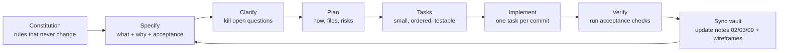

# Specs — Spec-Driven Development for X-Link

**Navigation**: [[00-Home-MOC]] | **Rules**: [[specs/constitution]] | **Design system**: [[09-Design-System]] | **Geometry**: [[wireframes/00-window-and-grid]]

## 1. The loop



A feature folder holds three files and nothing else is allowed to define behavior:

| File | Answers | Written by | Changes when |
| :--- | :--- | :--- | :--- |
| `spec.md` | **What & why.** Problem, user stories, functional requirements (`FR-`), acceptance criteria (`AC-`), non-goals, open questions | Human first, AI assists | Requirements change |
| `plan.md` | **How.** Root-cause analysis, design, exact files and snippets, risks, rollout | AI drafts, human approves | Approach changes |
| `tasks.md` | **Do.** Ordered checklist (`T-`), each with a done-check that points at an `AC-` | AI | Every commit |

## 2. Feature index and order

| # | Feature | Fixes | Depends on | Status |
| :--- | :--- | :--- | :--- | :--- |
| [[specs/001-self-hosted-icons/spec\|001]] | Self-hosted Material Symbols, offline-safe assets | **Icons missing in built app** | – | Ready |
| [[specs/002-desktop-window-shell/spec\|002]] | Desktop window & shell | Wrong/unstable window size, macOS inset, first paint | – | Ready |
| [[specs/003-responsive-fit-layout/spec\|003]] | Responsive, fit-to-window layout | Overflow, mixed breakpoints, nothing "fits" | 002 | Ready |
| [[specs/004-material-web-ui-conformance/spec\|004]] | Material Web conformance | Mixed shadcn/Tailwind/Material look | 001, 003 | Ready |

Do **001 first** — it is the shipping bug, it is small, and every later visual check depends on icons rendering.

## 3. IDs and traceability

`FR-001` requirement → `AC-001` acceptance → `T-001` task. A task is *done* only when the `AC-` it cites passes. Commit messages: `feat(002): clamp window to monitor (T-004, AC-003)`.

## 4. Working with an AI coding agent

Paste this at the start of every agent session:

```text
Read, in order: docs/00-Home-MOC.md, docs/07-AI-Agent-Playbook.md, docs/specs/constitution.md,
docs/09-Design-System.md, docs/wireframes/00-window-and-grid.md, then docs/specs/<NNN-feature>/spec.md,
plan.md, tasks.md.
Work ONLY on the first unchecked task in tasks.md. Do not change Rust IPC contracts or the 7 invariants.
When the task's done-check passes, tick it, update any vault note the change makes stale, and stop.
```

One task per session keeps diffs reviewable and stops the agent from "improving" unrelated code.

## 5. Definition of Done (every feature)

1. Every `AC-` passes (screenshots or command output attached to the PR).
2. `npm run build` and `npm run tauri build` succeed; **installer tested on a machine with no dev tools and no network**.
3. `npm run check:offline` green ([[specs/001-self-hosted-icons/spec]]).
4. Light and dark theme checked; reduced-motion checked.
5. Vault updated in the same PR (notes listed in the feature's "Docs to update").
6. No new hard-coded color, pixel width or CDN URL ([[specs/constitution]]).

## 6. Templates

[[specs/_templates/spec-template]] · [[specs/_templates/plan-template]] · [[specs/_templates/tasks-template]]
